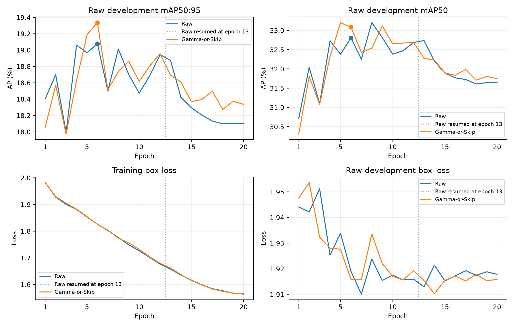

> Historical workflow record. Current entrypoints and replay paths: [issue 41 migration](HISTORICAL_REPLAY.md).

# Issue #21: completed five-class native S10 training

Both Raw and frozen **Gamma-or-Skip v2** completed **20 epochs** on 2026-11-04.
The runs use the same **4,890 S10 image IDs and paired label bytes**, with the
same **13,975 Raw development images** for native checkpoint selection.
Classes are `car, truck, bus, motorcycle, bicycle`; railway-train boxes were
removed by the separately verified five-class export, without dropping images.

This closes the training scope of [#21](https://github.com/truong51972/vehicle-detection/issues/21).
The five-class pretrained baseline and 3×2 development matrix remain in #22.
Final-test pixels were not accessed, and no S20 expansion was decided or run.

## Protocol and execution

- Each branch started independently from the original COCO-80 `weights/yolo26n.pt`,
  SHA256 `9b09cc8bf347f0fc8a5f7657480587f25db09b34bf33b0652110fb03a8ad4fef`.
  Native training remapped the head to five classes; no six-class S10 checkpoint
  was used for initialization or continuation.
- Ultralytics **8.4.198**, RTX 5060 Ti, imgsz **640**, batch **16**, seed **2026**,
  FP32, native **freeze=11**, AdamW, LR **0.001**, final LR factor **0.01**,
  cosine scheduling, three warmup epochs, nominal batch **64**, weight decay
  **0.0005**, no early stopping and all image augmentations disabled.
- Per-epoch validation uses the shared Raw development export, native rectangular
  validation batches of 32, confidence **0.001**, IoU **0.7**, max detections **300**
  and explicit **nms=False**. All declared settings match in both saved args files.
- The frozen S10 whole-group memberships, JPEG95 contract and Gamma-or-Skip v2
  policy were reused. No recalibration, resplitting or preprocessing ran in training.
- Raw saved epoch 12 before the notebook kernel died during epoch 13; the cause
  remains unconfirmed. It then used native `last.pt` resume for epochs 13–20.
  Adaptive ran its full 20 epochs independently from pretrained weights.
  This is **not bitwise uninterrupted continuation**, and the interruption limits
  a strict interpretation of the final-epoch comparison. Both selected best
  checkpoints precede the interruption.
- Native `YOLO.train` owns training and checkpoint publication. There is no custom
  trainer, optimizer-step override, freeze audit or custom resume framework.

## Saved development metrics and convergence

The plotted points and figures below come from native `results.csv` histories,
checked against saved best/last checkpoint `train_metrics`; **no new inference**
was performed for this report. Dotted lines mark Raw resuming at epoch 13.
Markers on both AP panels identify the checkpoint selected by mAP50:95.

- **Raw best, epoch 6:** mAP50:95 **19.078%**, mAP50 **32.805%**, precision
  **50.452%**, recall **30.837%**.
- **Gamma-or-Skip best, epoch 6:** mAP50:95 **19.336%**, mAP50 **33.086%**,
  precision **50.428%**, recall **30.639%**.
- **Raw final, epoch 20:** mAP50:95 **18.101%**, mAP50 **31.657%**.
- **Gamma-or-Skip final, epoch 20:** mAP50:95 **18.336%**, mAP50 **31.746%**.

The observed Adaptive difference is **+0.258 percentage points** at the selected
best checkpoints and **+0.235 points** at epoch 20. These are single-seed
exploratory point estimates, without uncertainty or a claim of reliable Adaptive
superiority. Native precision/recall use the native F1-selected operating point.
Five- and six-class macro-mAP have different denominators; the historical
six-class results are not evidence of an accuracy gain from dropping railway train.

Training loss keeps falling after the epoch-6 AP peaks. By epoch 20, mAP50:95 has
fallen **0.977 / 1.000 points** for Raw / Gamma-or-Skip. These curves do not justify
silently extending the schedule or expanding to S20. Any scale decision needs a
prospective rule and the same memberships/budget for both branches.

## Costs and artifacts

- **Raw:** **1,477.653 s (24.63 min)** from native timing segments **890.597 s**
  for epochs 1–12 plus **587.056 s** for epochs 13–20.
- **Gamma-or-Skip:** **1,439.300 s (23.99 min)** for epochs 1–20.

These totals include training and per-epoch validation. They exclude setup,
downtime, discarded partial-epoch work and final best-checkpoint validation;
they are not end-to-end wall time or isolated training/loader benchmarks.
The notebook sums visible CSV clock resets; retained logs are required when a
restart produces no visible decrease. Offline preprocessing belongs to its own
export phase. Its instrumented/resumed five-class export timings are not
performance evidence. No additional throughput, memory-peak or optimizer-step
audit is claimed.

Compact committed evidence:

- [s10_results.json](issue21/s10_results.json): frozen configuration, data/policy
  identities, best/final native metrics, timing segments and checkpoint hashes.
- [raw_results.csv](issue21/raw_results.csv) and
  [adaptive_results.csv](issue21/adaptive_results.csv): unmodified native histories.
- [03_training.ipynb](https://github.com/truong51972/vehicle-detection/blob/51687b273e7e87b5315d84f5b67202d4cc746992/notebooks/03_training.ipynb): fresh-kernel saved-run
  execution, convergence figure and checkpoint summary. Training and upstream
  preparation were blocked during the reporting execution; no guard fired.

Full local native artifacts remain gitignored under `runs/training-five-s10-v1/`:
`raw/weights/{best,last}.pt`, `adaptive/weights/{best,last}.pt`, each branch's
`results.csv`/`args.yaml`, `pair.json`, `summary.json`, original `training.log` and
`resume-epoch13.log`. All four checkpoints load with the correct five-class head.
They are referenced by hash rather than uploaded to Git; prior six-class
artifacts and archived notebooks remain unchanged.

Training used local changes based on `99d9af2`; the implementation and saved
reporting execution are finalized in this PR after the runs. The CPU native smoke
uses fixture weights/images and is implementation evidence, not a research result.

## Validation

The full study suite passes **104 tests**, including native one-epoch CPU training
and five-/six-class checkpoint loading, pairing/config/starting-weight/run-isolation
guards and fresh-kernel phase independence. The real-data reporting Run All reuses
both completed runs with training/preparation blocked. Ruff lint/format, source and
wheel builds, and whitespace checks pass. Research weights/images remain local;
CI does not retrain on BDD100K or release the final holdout.
