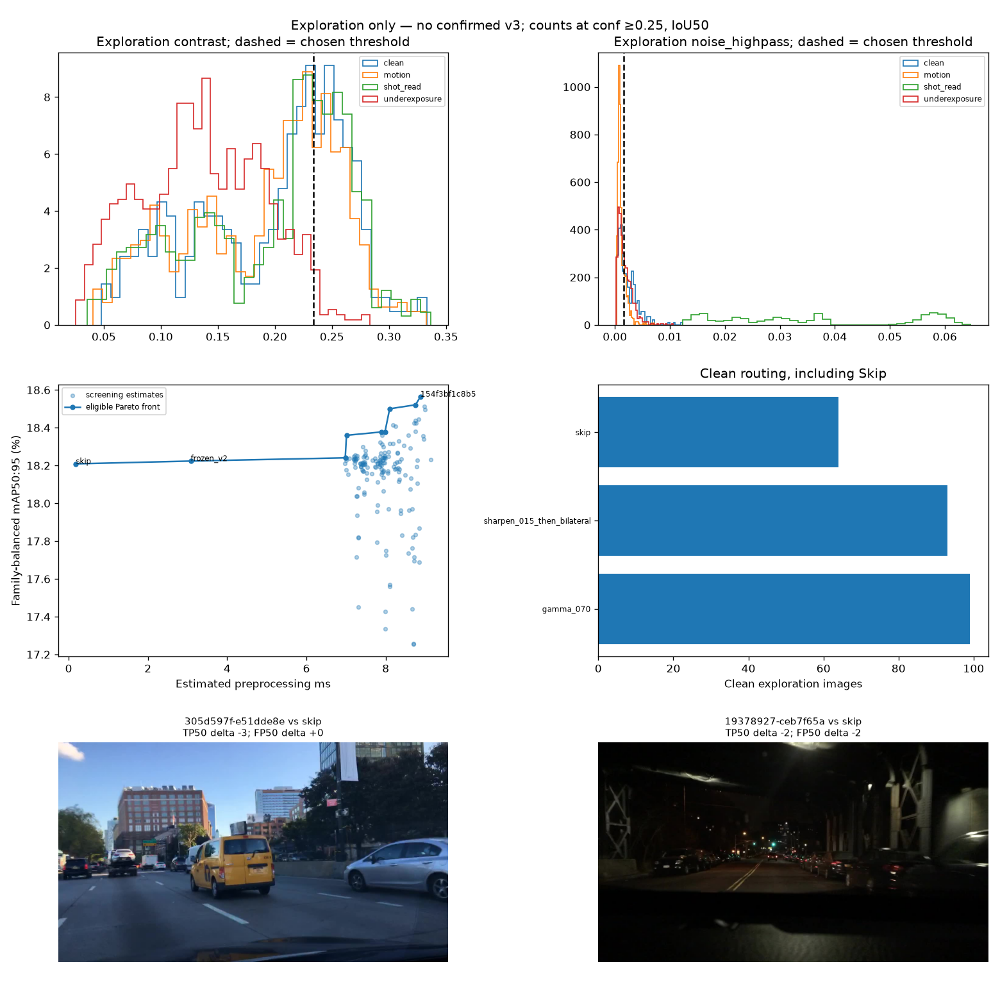
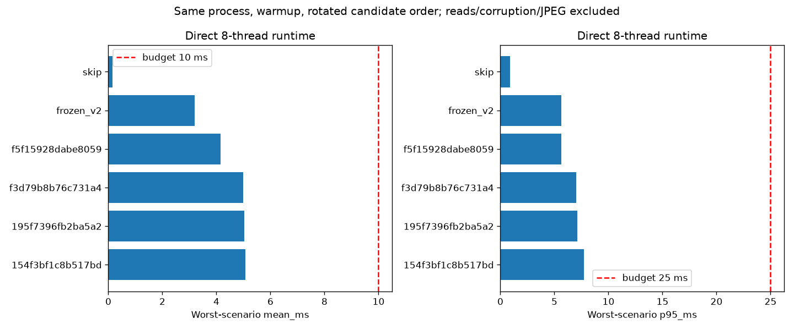

# Issue 30 — PR #38 review follow-ups

The [review](https://github.com/truong51972/vehicle-detection/pull/38#issuecomment-6658200875)
identified a concentrated search beam, missing operator-value measurements, an
unresolved accuracy/cost tradeoff, limited clean-error inspection, small rare-class
confirmation support and difficult-to-review visual evidence. This increment
addresses those exploration deliverables. **No confirmed v3 is released. #30 stays
open and #33 cannot assume a valid v3.**

## Bounded search and measured settings

The beam retains the four highest-scoring single rules and adds up to four rules
that favor features, directions, actions and thresholds absent from the current
beam. Keeping the original leaders avoids throwing away an already useful pair.
At most 56 ordered pairs are tested. One local pass changes each threshold of the
eligible exploration leader by ±0.05 in pooled exploration quantile space, at most
four additional policies. Skip stays the first-match fallback and wins ties.
Search remains a bounded heuristic, not a global optimum or independent validation.

Three additional settings are declared before measuring their outcomes:

- Gamma 0.775 is the midpoint of the measured 0.70/0.85 bracket. It tests a milder
  brightness correction, rather than assuming the strongest Gamma helps.
- Sharpen 0.075 halves the measured mild 0.15 setting. It tests whether less edge
  amplification helps when sharpness/high-pass proxies also respond to texture.
- Sharpen 0.075 → Bilateral keeps the useful measured order while isolating the
  unsharp amount. It does not infer the reverse order's performance.

Each setting receives ten matched native five-class exploration evaluations on
the original 256 images, with the same GT, pinned detector/settings and one JPEG95
encoding. The existing exporter and evaluator own native inference and AP. Only
completed verified matches enter routing search; unmeasured settings receive no
hypothetical score. The action set increases from sixteen to nineteen, bounding
single rules to 456. Measurements, including negative findings, are retained under
`round2-quality-v2` rather than overwriting either prior experiment.

The 30 native evaluations completed 7,680 image passes. Family-balanced mAP50:95
was 17.5372% for Gamma 0.775, 18.1824% for Sharpen 0.075 and 18.3198% for the
weaker Sharpen → Bilateral pair. None entered the leading route. This bounds
the tested values; it does not establish an optimal strength.

## Accuracy, cost and clean errors

The compact Pareto report includes both controls, all new routing trials and the
two preserved v1 leaders. A point is on the eligible front if no regression-passing
alternative has at least its AP and at most its estimated cost, with one strict
improvement. This exposes cheaper near-ties without imposing an undeclared
accuracy-to-milliseconds conversion. The declared mean ≤10 ms and p95 ≤25 ms
per-scenario constraints remain unchanged.

The screening cost still combines saved action time and the old diagnostic cost.
It is clearly labeled as an estimate. Before readiness for new confirmation,
controls, two current leaders and two v1 leaders are measured together in one
process at eight OpenCV threads, three repeats per image, after warmup and with
rotated execution order. Reads, corruption, JPEG and detector time stay outside
the preprocessing timer for every branch. A direct cost failure vetoes readiness;
it cannot silently publish a policy. This is an exploration runtime measurement,
not a deployment latency guarantee.

The completed matched benchmark contains 46,080 preprocessing calls across
60 candidate/scenario cases. The new leader averages 4.38 ms over the ten scenarios,
versus v2's 2.81 ms. Its worst scenario mean is 5.06 ms and highest scenario p95 is
7.73 ms; both direct cost gates pass. The preserved cheaper near-tie averages
3.49 ms. These direct figures replace the mixed-thread estimate for runtime
assessment, while the full-search Pareto chart stays explicitly labeled as a
screening estimate. Passing cost does not resolve the small AP gain or clean errors.

`apply_quality_candidate` computes only each rule's required metric and stops at
the first match. Brightness/contrast/sharpness retain the exact 512-pixel-side units;
high-pass noise retains the full-resolution frozen kernel/units. Tests compare
its output pixels and decisions with the original router, including strict
threshold boundaries. Direct measurement also checks equality on the first image
of every scenario. The hash-bound PR #37 router/evaluator remains unchanged.

Clean inspection retains class/subgroup AP and counts native IoU50 true positives
and false positives at confidence ≥0.25 for the selected route against **both**
controls. It includes per-class changes, image counts with TP losses or FP rises,
routing frequencies, and representative IDs. These illustrative error counts
do not replace dataset-level AP or claim significance.

The revised search retained 166 distinct cost-feasible assignments. The leading
route keeps contrast >0.2335527894 → Sharpen 0.15 → Bilateral, then refines the
high-pass noise threshold from the median to its 45th percentile:
noise <0.0016339057 → Gamma 0.70, otherwise Skip. Its exploration family-balanced
mAP50:95 is 18.5643%; full precision, regression reasons and configurations are
in `search.json`.

On clean images this route uses 93 Sharpen → Bilateral actions, 99 Gamma actions
and 64 Skips. At the illustrative fixed confidence, it has 923 TP50 and 216 FP50,
versus Skip's 929 TP50 / 212 FP50 and v2's 933 TP50 / 205 FP50. Against Skip,
29 images lose true positives and 27 gain false positives; against v2, 27 lose
true positives and 26 gain false positives. This is an explicit clean-data drawback
despite the native AP gain, not evidence that processing most clean images is safe.

## Confirmation and reviewable evidence

Before any new confirmation predictions, the deterministic whole-group prefix
target is raised from 256 to 1,024. It contains **1,025 images** because groups stay
whole. Both merged leakage groups and original source groups used in the old
exploration/confirmation samples are excluded. The exact metadata plan was frozen
before the new analysis and no confirmation images are opened here. The selected
prefix has **40 motorcycle groups** and **56 bicycle groups**; instance counts and
other support are recorded in `confirmation_support.json`. More support is not
proof of adequate uncertainty. Historical v2 used calibration, so these are unused
groups within this round rather than a historically untouched holdout.

The overview PNG shows overlapping quality distributions, chosen thresholds,
accuracy/cost tradeoffs, clean routing and representative error frames. A second
PNG shows the matched runtime against the unchanged gates. JSON reports retain
full precision and native evidence hashes; images, weights and native run caches
remain outside Git except these compact diagnostic figures.

## Replay and scope

Use notebook 03 section 6 with `RUN_QUALITY_SEARCH=True`. Existing v1 quality
measurements and PR #37 native caches are required saved inputs. Set
`ALLOW_INFERENCE=True` only to fill missing additional operator measurements, and
`ALLOW_RUNTIME_MEASUREMENT=True` only to fill the direct runtime report. Once both
are saved, turn both off: cache replay verifies identities and hashes and never
constructs a detector or repeats runtime measurements. Changed code, settings,
sample or budgets require a new output root. The v1 source revision is `3df03aa`.

PR #37 and v1 evidence bytes remain preserved. New results use
`runs/round2-quality-v2/` and `docs/round2-quality-v2/`. The larger confirmation
prefix is metadata only: a new verified export/evaluation path, a single locked
native confirmation, paired source-group uncertainty and any further justified
operator exploration still belong to #30. Development stays descriptive; final
holdout stays sealed. A no-improvement / retain Raw or v2 outcome remains valid.
