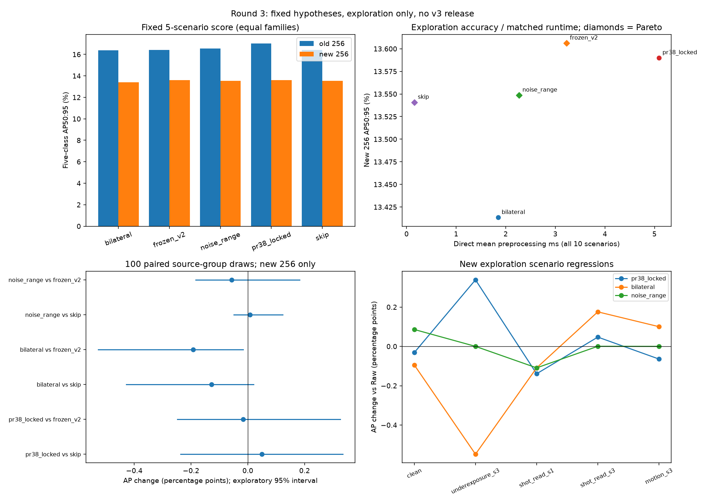
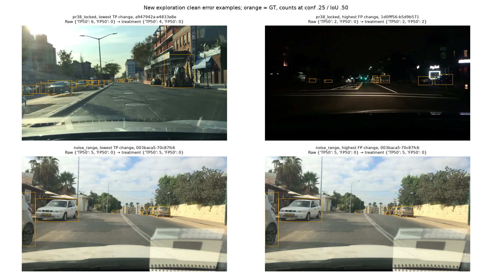

# Issue 30 — autonomous exploration round 3

This increment follows the revised [research contract](https://github.com/truong51972/vehicle-detection/issues/30)
and [workflow comment](https://github.com/truong51972/vehicle-detection/issues/30#issuecomment-6662593339).
It preserves PR #37/#38 and tests a small set of independently selected hypotheses.
`round2-research-v3` is the third exploration round's directory name, **not a v3
policy**. Confirmation, development and final holdout are not used here.

The [premeasurement research log](round2-research-v3/hypotheses.md), committed in
`fa25cea` before inference, records observations, competing explanations, rejected
directions, the fixed noise-range rule, budgets and the advancement rule. The
[plan](round2-research-v3/plan.json) binds code, model, settings, data identities,
source-group support and historical inputs. Measurements use the existing
Ultralytics validator/AP and checked JPEG95 exporter. No filter/evaluator library
is added or rewritten.

## Measured outcome: stop after the sentinel pilot

All **25 native evaluations / 12,800 image passes** completed. No treatment
passed the preregistered improvement gate on the new 256-image exploration slice,
so the other 25 evaluations were **not run**. The five-scenario, equal-family
AP50:95 / AP50 scores on the new slice are:

- Raw/Skip: **13.54089% / 21.60256%**.
- Frozen v2: **13.60626% / 21.73389%**.
- Exact PR #38 route: **13.59006% / 21.74568%**.
- Static bilateral: **13.41345% / 21.30980%**.
- Noise-range bilateral: **13.54876% / 21.61947%**.

These are sentinel scores, not the historical ten-scenario 18.5643% score.
All treatments stayed within the declared scenario/class regression tolerances on
the new slice; they failed the **minimum improvement** criterion. Passing broad
regression tolerances alone does not show a useful gain.

The PR #38 route's paired AP50:95 advantage over v2 was **+0.59575 percentage
points on the old 256** under these same five sentinels, but **-0.01621 points on
the new 256**. Pooling them produces an apparent **+0.19453-point** advantage,
which would obscure this failure to reproduce. Absolute AP levels across cohorts
reflect different populations and are not themselves paired treatment effects.
The null/generalization concern is supported; this is not a statistical proof
that every possible preprocessing method is ineffective.

The new noise-range hypothesis also failed. On the new images, mild-noise
bilateral AP was **0.109 points below Raw**, whereas the old exploration had
suggested a gain. Severe-noise bilateral was **0.176 points above Raw**, reversing
the old direction. The fixed upper cutoff largely skips that severity. Selecting
a cutoff from the old aggregate severity pattern did not transfer reliably to
new scene content. Clean noise-range AP improved slightly, but that did not yield
a useful four-family gain. No threshold was retuned after seeing these outcomes.

## Cost, uncertainty and failure inspection

The matched benchmark completed **76,800 calls** in one process with eight OpenCV
threads, three repeats, warmup and rotated order. All ten scenarios share the
same 512 images. Mean preprocessing / highest scenario p95 were Raw **0.16 / 0.43
ms**, v2 **3.22 / 6.28 ms**, PR #38 **5.09 / 8.28 ms**, bilateral **1.85 / 2.51 ms**
and noise range **2.27 / 5.14 ms**. All per-scenario mean <=10 ms / p95 <=25 ms
gates pass. These are directly matched CPU preprocessing timings, excluding reads,
corruption, JPEG, detector time and artifact verification; they are not deployment
latency guarantees. Cross-round timing changes are not controlled comparisons.

The new-slice accuracy/direct-cost front contains Raw, v2 and noise range.
Noise range sits on this **point-estimate** front because of its tiny Raw AP
increment; it still fails the declared useful-improvement gate. PR #38 is dominated
by v2 in this matrix, and static bilateral by Raw. Cost feasibility and Pareto
membership do not establish a beneficial replacement.

All 100 paired source-group draws were valid for each comparison. The PR #38
AP50:95 difference vs v2 is -0.01621 percentage points with an exploratory 95%
interval **[-0.24858, +0.32628]**. Noise range vs v2 is -0.05751 points,
**[-0.18350, +0.18306]**; vs Raw it is +0.00787, **[-0.04981, +0.12360]**.
The intervals do not establish a positive advantage. Static bilateral vs v2 has
an exploratory interval below zero; no multiplicity adjustment or claim of a
general causal filter effect follows. Full scenario/class intervals, draw support
and missing-class audits remain in the compressed draw evidence.

On the **new clean images**, illustrative TP50 / FP50 at confidence .25 were Raw
**949 / 200**, v2 **954 / 202**, PR #38 **947 / 216**, bilateral **947 / 207** and
noise range **949 / 199**. PR #38 still increases FP and loses TP against both
controls. Noise range causes no clean image to lose TP or gain FP against Raw;
protecting clean images is a positive finding, but it does not make the overall
method effective. AP also reflects ranking/localization beyond these counts.

The noise-range rule processes **9/256 clean**, **256/256 mild-noise** and only
**1/256 severe-noise** images, skipping all severe underexposure/motion images.
It therefore identifies the intended synthetic noise range well in this sample.
The missing link is **predicting when filtering benefits the detector**: bilateral's
mild/severe AP effects reversed on new scenes. Adding more quality thresholds is
not a justified response to this result. Representative GT frames and actual
native TP/FP changes are shown below. The noise-range clean examples have zero
changes because no clean TP-loss/FP-rise cases exist against Raw; their duplicate
tie-selected frame is not evidence of a failure.





## Recommendation and downstream scope

**No demonstrated useful improvement for these fixed treatments; retain Raw/frozen
v2 and stop this routing direction.** The improvement on old groups did not
reproduce, and the independent noise-range hypothesis did not produce enough new
accuracy to justify further acquisition. The expansion's other **12,800 possible
image passes were saved**, and no confirmation budget was consumed.

For #33, keep the existing Raw/frozen-v2 comparison and **do not add or require an
unconfirmed v3 arm**. Keep the reserved 1,025-image confirmation plan untouched.
Do not run confirmation merely to rescue the small old-sample winner, and do not
retune this range on the now-consumed new exploration slice. This PR does not
close #30 automatically; it records an evidence-supported stopping recommendation.

A future reopening needs a distinct mechanism and a new bounded design on remaining
exploration groups. The observed small/distant targets and severe-motion loss make
object-scale / detector-capacity work a more plausible next investigation than
another global quality-threshold grid, but that is **a hypothesis for separate
resolution/training work**, not a measured improvement or a change made here.
Synthetic stress is an approximation and pretrained rankings need not hold after
fine-tuning. No global optimum or universal ineffectiveness claim is supported.

## Design and interpretation

The old 256-image exploration sample had already supported hundreds of routing
comparisons. This round expands the same deterministic whole-group exploration
prefix to 512 images and reports the new 256 separately. Both are exploration, and "new" means new to these Round 2 comparisons,
not historically untouched: v2 previously used the calibration role. The new slice is now consumed for research and cannot serve as future independent
confirmation. Sampling preserves original roles, whole leakage groups, labels and
geometry. No rare-class oversampling or outcome-based image selection occurs.

Three fixed treatments compete against Raw/Skip and frozen v2: PR #38's exact
unconfirmed route; static bilateral; and a conservative noise-range bilateral
rule, with Skip outside the range. The range endpoints come from historical
exploration quality distributions, not new detection scores. Runtime receives
pixels only. It does not receive GT, scene attributes or synthetic scenario labels.

Five sentinel scenarios compare clean, mild/severe noise, severe underexposure
and severe motion. Their score weights each of the four families equally, sharing
the noise family's weight between its two endpoints. It **is not** the full
historical ten-scenario score. The preregistered stopping rule governs whether to
measure the other five scenarios. No runner-up is tried on confirmation.

Source support in the new slice is 154 car groups, 60 truck, 34 bus, **8 motorcycle
and 16 bicycle groups**. Those minimum counts remain small. Native dataset-level
AP50:95/AP50, class/scenario deltas and subgroup support are retained, together
with illustrative confidence-.25 / IoU-.50 TP/FP counts. Individual images never
receive AP labels. The original small-object diagnosis describes annotation
sizes and image-level counts; it does not attribute every missing detection to
small size or claim causal proof.

Paired uncertainty resamples original `source_group`, preserving the same seed,
group draws and five-class macro across candidates and scenarios before averaging
families. Missing-class draws are recorded and excluded without redraw or
imputation. The 100-draw percentile intervals are exploratory and do not correct
for prior search, multiple treatments or selection. They cannot establish a
confirmed replacement.

## Reproduction and evidence

From the repository root, with the existing study environment and frozen data,
protocol, five-class conversion tools, pretrained checkpoint and saved PR #38
quality input available:

```sh
# Explicitly authorize only this preregistered missing exploration matrix and timing.
.venv/bin/python -m vehicle_detection.research_round3 --infer --measure-runtime

# Cache-only native replay: no model construction or timing is allowed by default.
.venv/bin/python -m vehicle_detection.research_round3

# Verify hashes/native AP, reproduce uncertainty, errors and scientific figures.
.venv/bin/python -m vehicle_detection.research_round3_report
```

The runner can also be called from a notebook cell with
`from vehicle_detection.research_round3 import run; run()` with the kernel working
directory set to the repository root; the existing notebook
03 bytes are preserved. Completed inference is reused after deep source/export
and native-cache validation. The output root is fixed deliberately: changed code,
inputs, thresholds or budgets require a new versioned experiment, not overwriting
this evidence. Native runs and 512 source rows remain in ignored
`runs/round2-research-v3/`; compact identities, membership and scientific figures
are committed. Reconstruct sample rows with the existing deterministic
`calibration_sample(..., target_images=512)` and compare their plan hashes.

The report command verifies `evidence.json` on subsequent use. Runtime and native
measurements remain fixed; uncertainty/figures are deterministic analyses of the
saved matches. Full cached runner replay still performs expensive preservation
checks and is not a quick report viewer. The Markdown/PNG/JSON reports need no
model or dataset to inspect.

## Validation and evidence index

**149 local tests passed**, Ruff lint/format passed for all 88 files, whitespace
checks passed, and the sdist/wheel build succeeded. A fresh-process cache replay
reused all 25 native evaluations in 402.10 seconds with model construction,
conversion scanning and runtime measurement blocked. A separate fresh-process
report replay reproduced uncertainty and figures in 99.74 seconds with model
construction blocked. All 35 hash-bound PR #37 artifacts verify, and protected
PR #38 code/notebook/evidence bytes match `78efc7b`. The reserved confirmation
plan was deliberately neither read nor hashed. Both replay receipts, source-access
checks, hardware, tests and preservation checks are in
[validation.json](round2-research-v3/validation.json). No remote CI result is claimed.

The compact, immutable evidence also includes:

- [Plan and method identities](round2-research-v3/plan.json),
  [whole-group membership](round2-research-v3/membership.csv.gz) and
  [class/source support](round2-research-v3/support.json).
- [Native full-prefix measurements](round2-research-v3/measurements.json),
  [old/new/pooled native AP slices](round2-research-v3/slices.json),
  [predeclared stop decision](round2-research-v3/pilot_decision.json) and
  [round summary](round2-research-v3/summary.json).
- [Subgroup/class AP and TP/FP failures](round2-research-v3/failures.json),
  [routing/action counts](round2-research-v3/routing.json),
  [paired family uncertainty](round2-research-v3/uncertainty.json) and
  [scenario/class draws and support](round2-research-v3/uncertainty_draws.json.gz).
- [Matched direct runtime](round2-research-v3/runtime.json),
  [cost gates](round2-research-v3/cost.json),
  [point-estimate Pareto comparison](round2-research-v3/pareto.json) and
  [artifact hash receipt](round2-research-v3/evidence.json).
