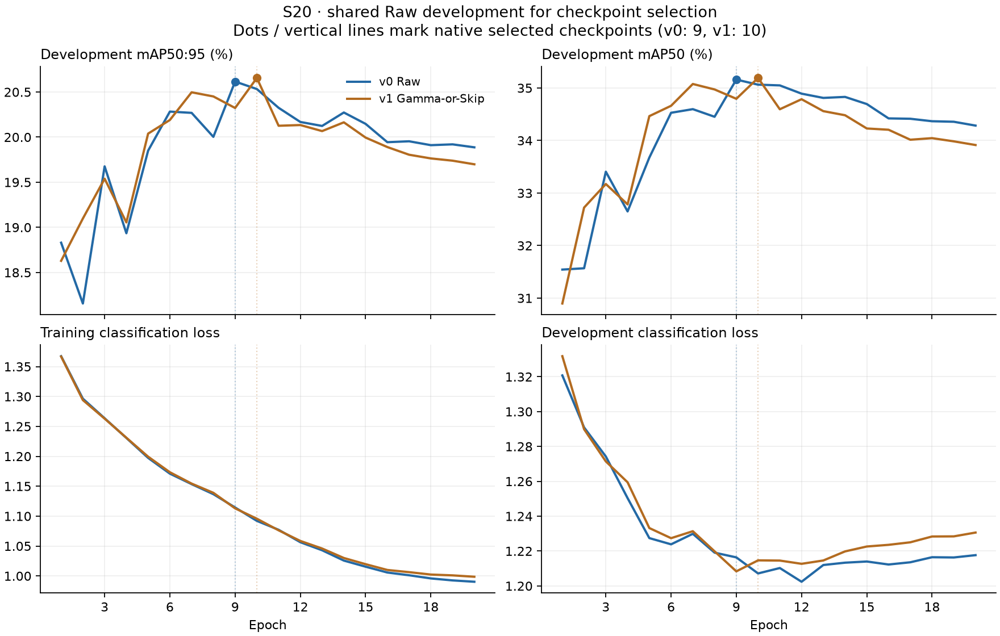

# Issue #43 — S20 execution

Source baseline: `1d14ac7` (merged #42), with the S20 changes on
`feat/issue43-s20`. Active identities remain v0 Raw and v1 frozen Gamma-or-Skip.
Both real S20 lifecycles completed on 2026-11-06. Gamma-or-Skip's observed
development mAP50:95 difference is **+0.0755 percentage points**: a near tie in
this single-seed study, without evidence of a reliable preprocessing gain.
Historical S10 measurements remain separate.

## Frozen selection

Recovered the historical S20 from committed
[`issue6-v2/subset_membership.csv.gz`](issue6-v2/subset_membership.csv.gz), not
deleted local manifests. Its SHA256 is
`ce00bfac25d159f83515845edfcec08708b6528c5b052dde457b5a7935cb9d16`, matching
[`issue6-v2/summary.json`](issue6-v2/summary.json). The summary's protocol/subset
identities match `configs/data.yaml`. The complete 48,903-image training-pool
inventory, groups and S10 flags match the shared table exactly.

S20 contains **9,781 images / 5,915 whole groups**, including every one of the
**4,890 S10 images / 2,974 groups**. Both flags preserve source and duplicate
groups. Calibration (6,985), development (13,975) and final-test (9,730) roles
are unchanged. Source paths, geometry, hashes, annotation hashes and S10 flags
are unchanged; the table only gains `s20`.

The active split SHA256 is
`b7a6aba1d1f72e1b1e3eceda8e8427d41f44408067fad63ee68479137714cb96`.
Sorted S20 IDs hash to
`ca35e8665e4b7961379b75bf96c697210f29f0fd17c6a3a172c9de6903bea1bc` using
the existing `digest` helper. Native `data.yaml` and `train.yaml` bind
`training_subset: S20`, seed 2026 and the shared split checksum.
Evaluation metrics also name `training_subset: S20` in their input identity.

## Execution

Preflight on 2026-11-06 found empty local `runs/` (nothing deleted), original
BDD sources, the pinned YOLO26n checkpoint, study dependencies and approximately
768 GiB free disk. PyTorch detects CUDA 13.2 and an RTX 5060 Ti (16 GiB).
The checkpoint SHA256 is the required
`9b09cc8bf347f0fc8a5f7657480587f25db09b34bf33b0652110fb03a8ad4fef`.
No substitute inputs were downloaded.
The actual pinned model passed COCO-name/backbone-boundary checks and a CUDA
kernel check. Python is 3.11.14; Ultralytics 8.4.198, Torch 2.15.0,
torchvision 0.29.2, NumPy 2.4.6 and OpenCV 4.14.0.

Run from the repository root with `uv run --locked --extra study jupyter lab notebooks/`.
Execute each notebook independently with the following explicit section-1 settings:

1. `00_data_init.ipynb`: `AUDIT_SOURCES=True`.
2. `experiments/v1/01_experiments.ipynb`: read historical provenance only.
3. Both `02_train_prepare.ipynb`: `ALLOW_PREPARATION=True`, v0 then v1.
4. Both `03_train.ipynb`: `READ_HISTORICAL=False`, `ALLOW_TRAINING=True`,
   `RESUME=False`, **v0 then v1 sequentially**.
5. Both `04_eval.ipynb`: `READ_HISTORICAL=False`, `ALLOW_INFERENCE=True`,
   `EVAL_SETTINGS={"workers": 0}`.

Budget/settings remain 20 epochs, 640 pixels, batch 16, FP32, AdamW, seed 2026,
frozen backbone 11, disabled augmentations, independent pinned initialization and
shared v0 Raw development checkpoint selection. Evaluation uses each arm's own
policy over the same original 13,975 development IDs/GT. v2 is outside scope.

Prepared data: `runs/{v0,v1}/data/`; native training histories/checkpoints:
`runs/{v0,v1}/train/`; native policy-matched evaluation:
`runs/{v0,v1}/eval/metrics.json`. Executed notebook copies stay under
`runs/issue43/`; tracked notebooks retain safe defaults and cleared outputs.
Large artifacts remain local and ignored.

The agent executes the same notebook sources using `nbclient`, appending the
listed opt-ins to section 1 in memory and saving executed copies. Native execution
uses the local command `uv run --locked --extra study python -u runs/issue43/execute_native.py`
with its console at `runs/issue43/native_execution.log`. This ignored local helper
only runs 03 v0 → 03 v1 → 04 v0 → 04 v1 in fresh kernels; it adds no training engine.
The JupyterLab instructions above reproduce the same calls without that helper.

## Completion status

- [x] Recovered and verified historical, group-nested S20 without resplitting.
- [x] Implemented explicit S20 preparation and native subset/seed/checksum binding.
- [x] Focused checks: 26 passed.
- [x] Full study tests (156 cases), Ruff and fresh-kernel notebook checks.
- [x] Real-source audit and policy-provenance notebook execution.
- [x] Real S20 v0/v1 exports and byte-identical paired GT verification.
- [x] Sequential native v0/v1 training completed.
- [x] Policy-matched real development evaluations and paired S20 comparison.

Checks after the evaluation recovery: `uv run --locked --extra study pytest -q`
passed **156 tests**. `uv run --locked --extra study ruff check .`,
`uv run --locked --extra study ruff format --check .` and `git diff --check` passed.
The smoke case includes independent fresh kernels and native CPU train/eval on
tiny synthetic data; it is not scientific evidence.

Real notebook 00 completed its annotation/hash/geometry audit in **165.10 s**;
the v1 provenance notebook completed in **1.01 s**, reading policy
`1ac3fb9bb94b132f70d3e168b5ef15a54b616444e535b9a3bb265682a6fce0ef`.
Executed copies are `runs/issue43/00_data_init.ipynb` and
`runs/issue43/01_experiments.ipynb`. No final-image audit or policy calibration
was performed. OpenCV used one CPU thread for these executions.

Real v0 preparation completed in **229.27 s** and its complete exported inventory
and bytes passed `verify_data`. S20 has 9,781 images including **73 negatives**;
development has 13,975 images including **121 negatives**. Five-class instances
(car, truck, bus, motorcycle, bicycle) are **100236, 4106, 1572, 432, 1080** in S20
and **142541, 5965, 2276, 562, 1430** in development. Native v0 file inventory digest:
`4e1a5ce060ef4775910f9bb7227b7fced7cb7b4b2afe3f928479b39cb49e43a6`.
Real v1 preparation completed in **259.10 s**; native file inventory digest:
`28fb7ec3e5c76af98920adfbf8ee3911dfc448e142c5d96e28c73e65f48cbcb0`.
Both exports passed complete file hashing and read-only `prepare_data` reuse;
their native YAML modification times stayed unchanged. Exact v0/v1 ID sets and
every label byte match across both populations. Ordered `(id, label SHA256)`
digests using shared-table order are
`c9a1068181d58654d45ff1e51cd3859cd32b487cc8cf19a7dddbea0e58981db7` (train) and
`cbecb87305ba283193ccdf69549a57dded5c41fbe85977deefc29b0a30db98a8` (development).
Neither export contains a final-test directory. Both detectors completed all
20 epochs with increasing native history clocks, `resume=False` and no observed
training interruption or parameter adjustment. Both `args.yaml` files passed
`validate_training_args`; their only differences are data/project/output paths.
Both use the pinned initialization and identical shared Raw selection data/digest.

## Training and checkpoint review

Native histories select **v0 epoch 9** and **v1 epoch 10**. Their saved best
checkpoint `train_metrics` exactly match those unique CSV rows; native checkpoint
stripping sets the top-level epoch to -1, so that field was not used to infer the
selected epoch. At selection, Raw development mAP50:95 was **20.616% / 20.656%**
for v0/v1. At epoch 20 it was **19.887% / 19.699%**, declines of **0.729 / 0.957
points** from the selected peaks. Training classification loss continues falling
while development classification loss flattens/rises. This is consistent with
overfitting after the middle of the schedule; extending the budget is not supported
by these curves. Keep the selected best checkpoints for the frozen comparison.

Checkpoint SHA256 (local `runs/{version}/train/weights/{name}.pt`):

- v0 best: `d9903b52ff7c52462761262eb39362c8cf9e1859973c499a9dc508477cc12fdd`.
- v0 last: `281368ac30ee506c1ec6c12647d43cd4a792cfcde82e951b4359201b38b452d5`.
- v1 best: `20a8b074ac00f6a26bd98329c6cfd11a028d0e472780963438bf79381baf82aa`.
- v1 last: `a59102145253fba15ed4c59258e14b93125409ed2d0af8de79c98c2831f8af7a`.

Unmodified compact native artifacts: [v0 history](issue43/v0_results.csv),
[v1 history](issue43/v1_results.csv), [v0 arguments](issue43/v0_args.yaml),
[v1 arguments](issue43/v1_args.yaml). Full native run directories, checkpoints,
extra plots and executed notebooks remain local; model files are not added to Git.

## Paired S20 development evaluation

These evaluate each selected checkpoint on **its own policy**, over the identical
13,975 original development IDs / 152,774 five-class instances. They are separate
from the Raw checkpoint-selection metrics above. Values below are percentages;
differences are percentage points, v1 minus v0.

- **mAP50:95:** v0 **20.6124%**, v1 **20.6879%**, difference **+0.0755 points**.
- **mAP50:** v0 **35.1576%**, v1 **35.2484%**, difference **+0.0908 points**.
- Native precision: **52.5654% / 51.8875%**; recall: **33.4808% / 33.5280%**.
  These use native F1-selected operating points.

Per-class AP50:95 (v0 → v1; native JSON also preserves AP50, precision and recall):

- Car: **35.5443% → 35.4385%** (−0.1058 points).
- Truck: **25.0262% → 24.8216%** (−0.2045 points).
- Bus: **24.8998% → 24.8195%** (−0.0803 points).
- Motorcycle: **7.7450% → 8.1438%** (+0.3988 points).
- Bicycle: **9.8465% → 10.2159%** (+0.3694 points).

Native results: [v0 metrics](issue43/v0_metrics.json),
[v1 metrics](issue43/v1_metrics.json). Input settings, original class support and
checkpoint hashes match the reviewed artifacts. Guarded read-only calls to
`train_experiment` and `evaluate_experiment(settings={"workers": 0})` reused both
completed results with training/inference patched to fail if called. Native
YAML, history, checkpoints and metrics retained identical bytes and modification
times. No final inputs or upstream source preparation were needed.

The small aggregate difference combines lower car/truck/bus AP with higher
motorcycle/bicycle AP. Both two-wheeler classes remain weak. One seed and a reused
development selection population do not establish a reliable method gain, and
there is no subgroup or uncertainty analysis in this execution round. Raw remains
the simpler reference; these results do not justify claiming Gamma-or-Skip wins.

## Runtime and evaluation recovery

Native cumulative training CSV time is **2051.380 s / 2102.970 s** (v0/v1;
34.19 / 35.05 min), including per-epoch Raw validation. Complete training notebook
wall time is **2141.959 s / 2177.362 s**, including verification/setup and final
best-checkpoint validation. No native history clock resets were observed.

The first standalone v0 evaluation with 8 workers stalled before its first batch
for **616.83 s**, blocked in PyTorch DataLoader tensor reconstruction and Python
`multiprocessing.resource_sharer` authentication. It was interrupted deliberately;
no metrics existed and trained checkpoints were unchanged. The failed notebook
and empty output directory were preserved as
`runs/issue43/v0_04_eval_workers8_interrupted.ipynb` and
`runs/v0/eval-workers8-interrupted/`. The original execution log retains the traceback.
The exact upstream cause was not determined.

Both evaluations then ran with **workers=0**, preserving GPU FP32, batch 32,
640 pixels, NMS-free validation, confidence 0.001, IoU 0.7, max_det 300 and seed
2026. This inference-only adjustment is explicit in both 04 notebooks and saved
metric identities; training still used 8 workers in both arms. Successful notebook
wall time was **99.491 s / 115.566 s**. Native inference-only timing was
**1.071 / 1.090 ms/image**; it excludes offline policy preparation and loader/I/O,
so it is not end-to-end throughput. These single-host timings are descriptive.
Recovery log: `runs/issue43/evaluation_retry.log`; phase wall times:
`runs/issue43/native_seconds.json`. All four successful lifecycle notebooks are
saved locally under `runs/issue43/{v0,v1}_{03_train,04_eval}.ipynb`.

## Historical reference and limits

Historical **S10**, separately, had development mAP50:95 **19.0756% Raw** and
**19.3631% Gamma-or-Skip**; see the [historical report](development-five-v1/RESULTS.md).
S10→S20 changes also change training scale and optimization exposure, and are not
preprocessing-gain measurements. This run introduces no new policy, extra epochs,
additional seeds, v2 detector or final-test release. The final holdout remains sealed.
