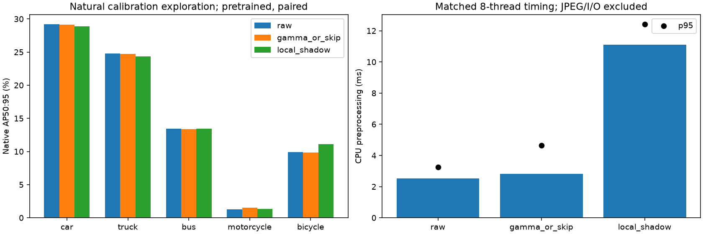
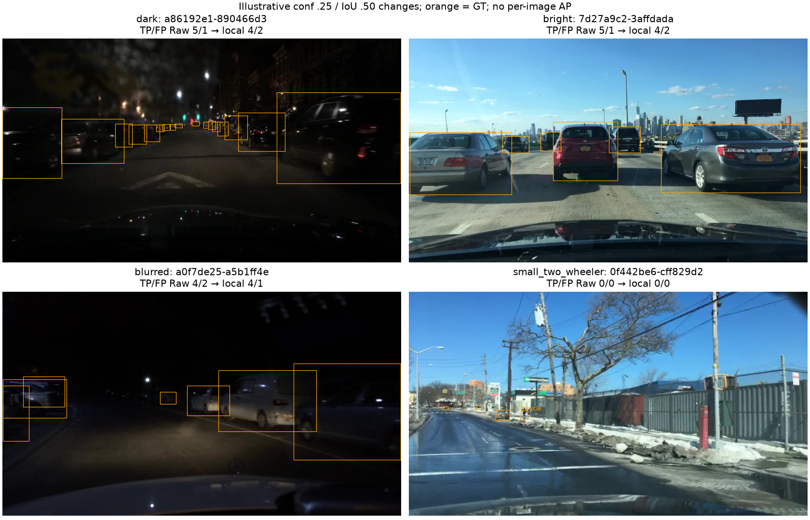

# Issue #45 — stop after the local-shadow pilot

**Decision: no defensible v2 candidate from this pilot; leave v2 untrained.**
All three real pretrained evaluations completed on 2026-11-06. Local-shadow
correction failed the predeclared improvement, dark-regression, uncertainty and
mean-cost gates. No parameter was retuned, runner-up tried, confirmation consumed
or S20 training started. This is a negative result for one fixed mechanism, not
evidence that every preprocessing/training hypothesis is ineffective.

## Design and execution

The [premeasurement declaration](ISSUE45_PILOT.md) was written before source-pixel
measurement/inference and its SHA256 frozen in the execution plan:
`7439c84d9ff3667e466ffd1ee4248ba370460431cfc4b6d0e261563735763c16`.
It was not separately committed before execution. The distinct hypothesis was
bounded, spatially varying illumination gain applied to original detail, rather
than further smoothing or another threshold search. Bright-region changes,
clipping and amplified noise were anticipated risks.

The deterministic next exploration slice contains **256 images / 136 whole leakage
groups**, disjoint from round 3's consumed 512 images and the complete saved
calibration-confirmation population by ID, leakage group, source group and source
hash. These groups are now consumed exploration, not independent confirmation.
Primary class source-group counts are car 135, truck 62, bus 29, motorcycle **5**,
bicycle **16**. No outcome-based sampling or rare-class oversampling occurred.

One fresh-kernel execution of v2 `01_experiments.ipynb` with `ALLOW_PILOT=True`
ran exactly **three native evaluations / 768 image passes** on natural images,
below the 816-pass cap. There were no synthetic corruptions. Raw and frozen
Gamma-or-Skip used their unchanged native recipes. Each arm decoded originals,
applied its operator, encoded JPEG95 once, retained every five-class GT/negative,
and passed exact ID equality, label-byte parity and original-box verification.
The existing COCO→five-class validator and native Ultralytics matching/AP were
reused. Native metrics agree with native AP recomputed from saved matches.

## Measurements and stopping decision

These are **pretrained calibration exploration**, not S20 development results.
Dataset-level mAP50:95 / mAP50:

- Raw: **15.7103% / 25.7330%**.
- Frozen Gamma-or-Skip: **15.7223% / 25.9505%**.
- Local-shadow: **15.8248% / 25.9280%**.

Local-shadow's mAP50:95 gain is **+0.1145 percentage points vs Raw** and
**+0.1026 vs Gamma-or-Skip**, both below the fixed +0.2-point gate. Its mAP50
is slightly below Gamma-or-Skip. Native F1-selected precision/recall are
66.6088%/21.6637% Raw, 66.2628%/22.1958% Gamma-or-Skip, and
67.2610%/21.4125% local-shadow; these are different selected operating points.

Per-class AP50:95, Raw → Gamma-or-Skip → local-shadow:

- Car: **29.1761% → 29.1244% → 28.9096%**.
- Truck: **24.7616% → 24.7183% → 24.3378%**.
- Bus: **13.4391% → 13.3877% → 13.4566%**.
- Motorcycle: **1.2573% → 1.5207% → 1.3374%**.
- Bicycle: **9.9174% → 9.8601% → 11.0828%**.

The apparent aggregate gain is mixed across classes. On 62 dark images, car AP
falls **21.3034% → 20.2749%** against Raw: **−1.0285 points**, crossing the
predeclared supported subgroup/class regression limit of −1 point. Dark observed-
class macro AP is Raw 12.2385%, Gamma-or-Skip 9.8539%, local-shadow 9.4953%,
but this averages only four represented classes and is not the primary five-class
score. Dark support is car 33, truck 8, bus 2, bicycle 2 source groups, with no
motorcycle GT. The required five-class dark support is absent; unsupported
rare-class changes cannot establish benefit or safety.

Bright images number 194; the pixel-defined blur subgroup has only **2 images**,
and small-two-wheeler-containing images only **6** (5 bicycle source groups,
1 motorcycle group). Their complete original GT is retained. These small,
overlapping image subsets are descriptive; they do not estimate size-specific AP
or establish a blur/two-wheeler benefit. Their AP and per-class support remain in
[summary.json](issue45/summary.json), including absent classes rather than zeros.

The 100 paired source-group bootstrap draws were all valid. Local-shadow's
AP50:95 difference has exploratory conditional 95% intervals, in percentage points:
**[−0.5926, +0.6592] vs Raw** and **[−0.5679, +0.4673] vs Gamma-or-Skip**.
Both include zero and fail the positive-lower-bound gate. These intervals do not
adjust for prior research, multiplicity or selection; five motorcycle groups are
particularly weak support. [Native bootstrap details](issue45/uncertainty.json).

Matched eight-thread CPU preprocessing mean / p95:

- Raw: **2.511 / 3.239 ms**.
- Gamma-or-Skip: **2.810 / 4.639 ms**.
- Local-shadow: **11.117 / 12.410 ms**.

The local-shadow mean exceeds the fixed **10 ms** gate, while p95 passes 25 ms.
There were 768 timed calls per arm, three repeats, warmup and rotated order.
These include each actual operator's pixel diagnostics (the unchanged Raw/v1
helpers calculate quality), and exclude source decoding, JPEG, detector time and
verification equally. They are matched pilot timings, not deployment guarantees
or comparisons against historical timings from other processes.



## Error inspection

At confidence .25 / IoU .50, total native TP/FP counts are Raw **926/249**,
Gamma-or-Skip **936/253**, local-shadow **931/257**. Changes in these counts do
not replace AP, which also depends on confidence ranking/localization.

The representative night street `a86192e1-890466d3` contains many small/distant
GT vehicles and changes from Raw **5 TP / 1 FP** to local **4 / 2**. The daylight
traffic frame `7d27a9c2-3affdada` has the same adverse count change, showing why
local correction still needs clean/bright-data protection. These counts do not
identify which individual boxes were lost or establish a causal explanation.

The pixel-defined blurred night example `a0f7de25-a5b1ff4e` retains 4 TP and drops
FP from 2 to 1, so it is explicitly an illustrative improvement, not a failed
case. It does not overcome the two-image blur support limitation. The snowy-road
small-bicycle example `0f442be6-cff829d2` remains **0 TP / 0 FP** for all arms.
Visible small GT remains missed; this does not prove every miss is caused by size.
Example choice is deterministic by TP loss then FP rise against Raw, within each
subgroup, with ID tie-breaking; examples are not a random sample of errors.



## S20 scope and reproducibility

The completed [v0/v1 S20 development comparison](ISSUE43_EXECUTION.md) stays
separate: 20.6124%/20.6879% mAP50:95, selected epochs 9/10, one seed. No new
S20 detector, v2 config, downstream notebook, selected epoch or development metric
is fabricated. The pilot declaration explicitly excluded a fine-tuning override
for weak pretrained evidence; there is no supporting measured reason to spend a
run for this fixed recipe. All original S20 9,781 IDs, development 13,975 IDs,
GT/negatives, four data roles, shared Raw selection and v0/v1 settings remain fixed.
Fourteen protected local v0/v1 YAML/history/checkpoint/metric hashes match preflight.
Confirmation/development/final source pixels were not opened by this pilot;
final annotations were handled as metadata only by the existing source reader.

The notebook configuration is `ALLOW_PILOT=False` by default: it reads and verifies
compact saved evidence without inference or training. To reproduce on an **unused**
local output root, open `notebooks/experiments/v2/01_experiments.ipynb`, read
`ISSUE45_PILOT.md`, set `ALLOW_PILOT=True`, then Restart & Run All. An existing
`runs/issue45/pilot/` raises before work and must be inspected, never silently
overwritten. The actual executed notebook and kernel log are local at
`runs/issue45/01_experiments_executed.ipynb` and `runs/issue45/pilot_execution.log`.
The equivalent API is:

```python
from vehicle_detection.v2_pilot import run

result = run(".")  # verified evidence only
# run(".", allow_inference=True)  # explicit new pilot; existing attempt blocks
```

Total runner wall time was **60.904 s**, including preflight/export, timing,
inference, uncertainty and figures. Native evaluation wall times were
**6.177 / 3.166 / 3.280 s** for Raw/Gamma-or-Skip/local-shadow; first-arm setup
makes these descriptive, not a detector-speed comparison. Hardware: RTX 5060 Ti,
CUDA 13.2; Ultralytics 8.4.198, Torch 2.15.0, NumPy 2.4.6, OpenCV 4.14.0.94.

Exact [plan/code/config/model hashes](issue45/plan.json),
[membership](issue45/membership.csv), [pixel features](issue45/features.json),
[metrics/timing/decision](issue45/summary.json), [error counts](issue45/errors.json)
and [artifact hashes](issue45/evidence.json) are compact tracked evidence. Native
images, labels, matching arrays, plots and execution notebooks remain under ignored
`runs/issue45/`. The initial checkpoint remains the pinned SHA256
`9b09cc8bf347f0fc8a5f7657480587f25db09b34bf33b0652110fb03a8ad4fef`;
sorted selected IDs hash to
`7e19ad76c3436cc54cceb14bcf727009aec546bd6eab4ff8db061e0e40801a55`.

**161 tests passed**, including independent fresh-kernel notebook execution and
native synthetic CPU train/eval. Ruff lint, format and whitespace checks passed.
Validation status and preservation checks are recorded in
[validation.json](issue45/validation.json). Fresh-kernel smoke execution is a
software check, not additional scientific evidence. No independent confirmation,
final-test result, reliable gain or universal negative conclusion is claimed.
