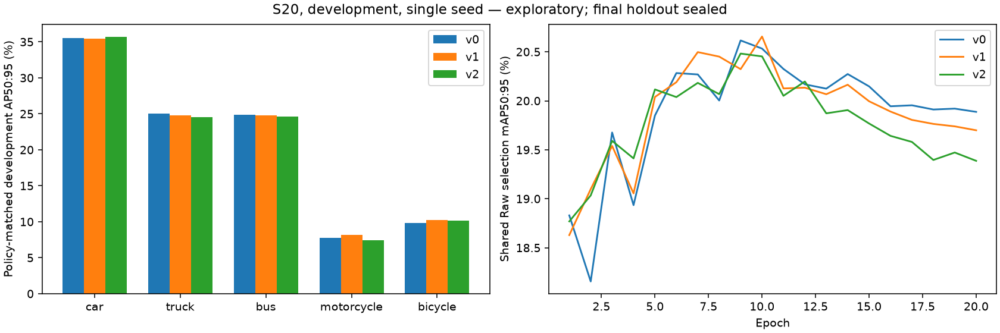
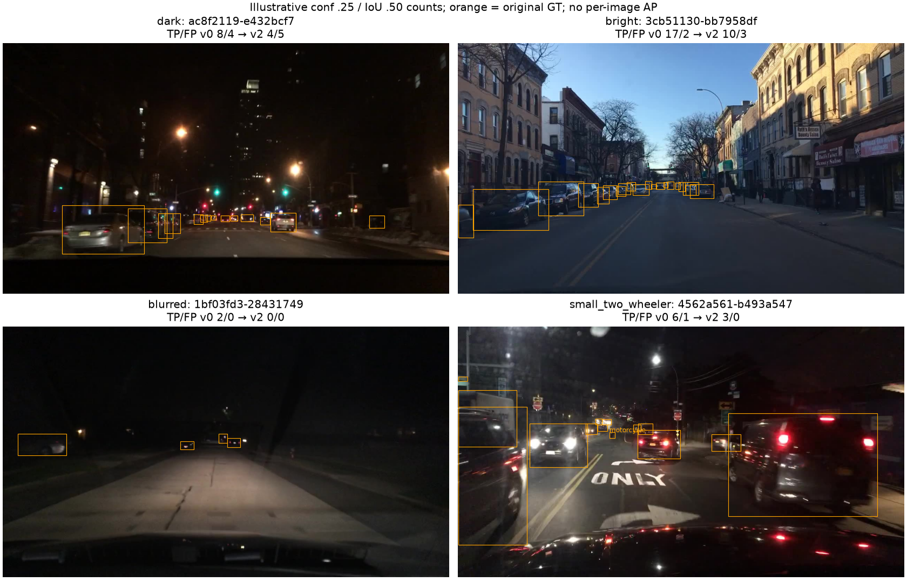

# Issue #45 — exploratory local-shadow S20 comparison

**Completed: one real v2 preparation/train/eval lifecycle and a paired v0/v1/v2
development comparison. Do not promote local-shadow on these results.** Its
primary mAP50:95 is below both controls and preprocessing costs substantially more.
The slight mAP50/dark-subgroup gains are mixed with class/subgroup regressions.
All results below are **development, single seed**, not an independent test.

## Separate post-pilot hypothesis and provenance

The [original pretrained pilot](ISSUE45_RESULTS.md) remains failed, with every
`docs/issue45/` artifact byte preserved. Its declaration was hash-bound before
inference but not separately committed; that limitation is unchanged. Following
the [review request](https://github.com/truong51972/vehicle-detection/pull/46#issuecomment-6680595496),
the [new fine-tuning plan](ISSUE45_FINETUNING_PLAN.md), unchanged operator,
`configs/v2.yaml` and lifecycle notebooks were committed/pushed at
`f1661c4649bff24497a7a88b33afd3dc8a807a65` **before execution**. The diagnostics
implementation was committed at `b6f4a26` before training began.

The new hypothesis was that matched fine-tuning could change the effect of the
same preprocessing, compared with applying it to a frozen pretrained detector.
This is a user-requested experimental extension, not a retroactive pilot pass.
No recipe, subgroup definition, hyperparameter or selection rule was tuned on
development. The operator moved verbatim into the native preprocessing module;
two fixed pixel fixtures authenticate its original output. Historical pilot
source hashes refer to commit `5945f1f`, not the moved/fixed current source.

Plan SHA256: `e5ba777f2dd88888bf8afdec8a5f5c178ace4a9f2df0d3fbd0fdd8dd90547fc5`.
Execution began **2026-11-06 09:15:58 UTC**, training at **09:24:39 UTC**, and
evaluation at **09:59:56 UTC**. The execution receipt is preserved in
[preparation.json](issue45-s20/preparation.json).

## Frozen data and native settings

All arms retain the exact **9,781 S20 IDs / 5,915 groups**, including 73 negatives,
and **13,975 development IDs / 8,258 groups**, including 121 negatives. Every
original five-class label byte matches across v0/v1/v2; development contains
152,774 instances. No original sources, frozen memberships, v0/v1 runs or pilot
evidence were modified. The final holdout remains sealed; confirmation was not
used. Source annotations were metadata only for final-role rows.

All three native training argument sets match: independent pinned YOLO26n
initialization, seed 2026, **20 epochs, 640, batch 16, FP32 AdamW, frozen backbone
11**, identical schedule and disabled augmentations. Shared **v0 Raw development**
selects checkpoints; final evaluation uses each detector's matching offline policy.
V2 completed uninterrupted, with no resume or training-setting deviation.
Standalone evaluation retains the existing shared `workers=0` recovery; training
uses 8 workers. JPEG95 is applied once, offline, before native data loading.

Native selection epochs are **v0 9 / v1 10 / v2 9**. Selection is authenticated
against the best checkpoint's saved metrics and its unique history row, not the
stripped checkpoint `epoch=-1`. V2 Raw-selection mAP50:95 peaked at **20.482%**;
policy-matched development evaluation below is a separate measurement.

## Primary and class results

Policy-matched mAP50 / mAP50:95:

- **v0 Raw: 35.1576% / 20.6124%.**
- **v1 Gamma-or-Skip: 35.2484% / 20.6879%.**
- **v2 local-shadow: 35.3136% / 20.4930%.**

V2 minus Raw is **+0.1560 / −0.1194 percentage points**; v2 minus v1 is
**+0.0652 / −0.1949 points**. Higher mAP50 does not establish an improvement
on the primary mAP50:95 metric. Native F1-selected precision/recall are
**52.5654%/33.4808%**, **51.8875%/33.5280%**, **52.2984%/33.1453%**
for v0/v1/v2; their selected operating points differ.

Per-class AP50:95, v0 → v1 → v2:

- Car: **35.5443% → 35.4385% → 35.6586%**.
- Truck: **25.0262% → 24.8216% → 24.5748%**.
- Bus: **24.8998% → 24.8195% → 24.6158%**.
- Motorcycle: **7.7450% → 8.1438% → 7.4628%**.
- Bicycle: **9.8465% → 10.2159% → 10.1531%**.

V2 improves car/bicycle AP against Raw but loses truck/bus/motorcycle AP. Against
v1, only car AP improves. Full per-class AP50, AP75, AP50:95, precision/recall
and original support are retained in [v0](issue45-s20/v0_metrics.json),
[v1](issue45-s20/v1_metrics.json), [v2](issue45-s20/v2_metrics.json).



## Subgroups and representative errors

Definitions stayed fixed: original-pixel brightness <0.12 (dark), >=0.12
(bright), sharpness <50 (pixel-defined low sharpness), and images containing a
motorcycle/bicycle box smaller than 32² original pixels. Every GT in a selected
image remains included. These are **image subgroups, not size-specific AP-small**.
Support was saved [before diagnostic inference](issue45-s20/support.json), with
no resampling based on outcomes. Source groups may span several image conditions.

Subgroup mAP50:95, v0 → v1 → v2:

- Dark, **3,307 images**: **16.3610% → 16.6475% → 16.7199%**. All five classes
  have at least 54 source groups. This mixed gain includes dark truck/bus gains,
  but motorcycle AP falls **4.8689% → 2.8760% → 2.5007%**; bicycle is below v1.
- Bright, **10,668 images**: **21.2454% → 21.3616% → 21.1073%**.
- Small-two-wheeler-containing, **412 images**:
  **18.5495% → 18.3581% → 17.9643%**. Motorcycle/bicycle support is 155/274
  groups. This does not establish a small-target benefit; all image GT contributes.
- Low sharpness, **122 images**: observed-four-class macro
  **13.1655% → 12.0708% → 11.8310%**. Bicycle GT is absent; bus/motorcycle each
  have one group and truck only seven. Rare-class effects are inconclusive, not
  zero-imputed; this pixel feature does not diagnose the physical cause of blur.

At fixed confidence .25 / IoU .50, total native TP/FP counts are
**75,491/24,797 → 74,166/21,486 → 75,085/22,027**. Relative to Raw, v2 reduces
FP but also loses TP; these counts do not replace ranked/localized AP.
Deterministic examples rank TP loss, then FP rise, against Raw within each subgroup:

- Night street `ac8f2119-e432bcf7`: Raw **8 TP / 4 FP**, v2 **4 / 5**.
- Daylight distant traffic `3cb51130-bb7958df`: **17 / 2 → 10 / 3**.
- Low-sharpness dark road `1bf03fd3-28431749`: **2 / 0 → 0 / 0**.
- Small-two-wheeler night scene `4562a561-b493a547`: **6 / 1 → 3 / 0**.

These GT frames and count changes are illustrative, not a random error sample.
They neither identify each lost box nor assign per-image AP or prove a cause.
All subgroup/class metrics and examples remain in [summary.json](issue45-s20/summary.json).



## Preprocessing cost and execution time

New matched native preprocessing mean / p95, v0/v1/v2:
**2.428/2.940 ms**, **2.794/4.605 ms**, **13.627/16.382 ms**.
The same consumed 256 exploration images were used for all arms, eight OpenCV
threads, warmup, three repeats (768 calls/arm), rotated order. These include the
native wrappers' normal quality diagnostics, and exclude source reads, JPEG,
verification and detector time equally. V2's wrapper includes diagnostics beyond
the original pilot's direct local-shadow call; this is a new cost comparison,
not a rewrite of the failed pilot timing. No deployment-latency claim follows.

Native cumulative training CSV seconds, v0/v1/v2:
**2051.38 / 2102.97 / 2046.66**. Complete training notebook wall seconds:
**2141.959 / 2177.362 / 2115.316**. Policy-matched evaluation notebook seconds:
**99.491 / 115.566 / 113.546**. V2 preparation took **482.900 s**.
Native detector inference alone is **1.071 / 1.090 / 1.076 ms/image**; it excludes
offline preprocessing and I/O. These one-host times are descriptive.

Existing v0/v1 evaluations lacked matching arrays, so exactly one diagnostic
replay per control was needed, at separate ignored outputs. They reproduced the
original precision/recall/mAP50/mAP50:95 within 1e-6 without changing old caches.
Their wall times were **87.889 / 82.286 s** (27,950 image passes total); v2's
existing 13,975-image evaluation matches were reused. Full diagnostic/report
runner time was **306.795 s**. No extra detector inference or training was run.

## Reproduce, identities and limitations

Use the project study kernel and execute independent v2 notebooks:

1. `02_train_prepare`: `ALLOW_PREPARATION=True`.
2. Verify exact ID/label-byte parity with v0/v1; the receipt is in
   [preparation.json](issue45-s20/preparation.json).
3. `03_train`: `ALLOW_TRAINING=True`, `RESUME=False`.
4. `04_eval`: `ALLOW_INFERENCE=True`, `EVAL_SETTINGS={"workers": 0}`.
5. After evaluation, set `ALLOW_INFERENCE=False`, `ALLOW_COMPARISON=True` in 04
   for the declared control replays/report. Existing diagnostics refuse overwrite.

Defaults inspect saved results with no training/inference. Equivalent report API:

```python
from vehicle_detection.s20_report import run

result = run(".")  # verify/replay compact evidence only
# run(".", allow_inference=True)  # one new diagnostic attempt, refuses existing output
```

Executed notebooks/logs are local under `runs/issue45-s20/` and
`runs/issue45/extension_execution.log`. Native data/train/eval stay at `runs/v2/`.
Compact native args and complete histories are saved alongside the metrics, with
all config/data/model/statistics hashes in [summary.json](issue45-s20/summary.json).
V2 best SHA256 is `563f748e054b120ff5257f72d975a7b31cf1d6291f810eef8c804388afee2e9e`;
last is `60c0a78394517c6739fa8eaf4165da85af2ea7e5844ce7aeabca9c4d3a94fbd4`.
The initialization remains pinned to
`9b09cc8bf347f0fc8a5f7657480587f25db09b34bf33b0652110fb03a8ad4fef`.
The exact environment is in [environment.json](issue45-s20/environment.json).

Full study/lightweight tests, Ruff, guarded fresh kernels and preservation checks
are recorded in [validation.json](issue45-s20/validation.json). The original CI
bug is fixed by checking existing output before heavy imports; future pilot
execution now checks required dark support before GPU inference, without changing
the consumed pilot's result or sampling a replacement.

This comparison does not establish generalization: development selected the
checkpoints, only one seed/model/recipe was studied, and prior results motivated
the extension. The pretrained pilot and S20 evaluation use different populations,
so their effect differences cannot isolate a causal fine-tuning effect. Historical
S10 and pretrained/synthetic results remain separately attributed. No independent
confirmation or final-test result is claimed. The requested experiment is complete;
these results do not support replacing the simpler reference with local-shadow.
