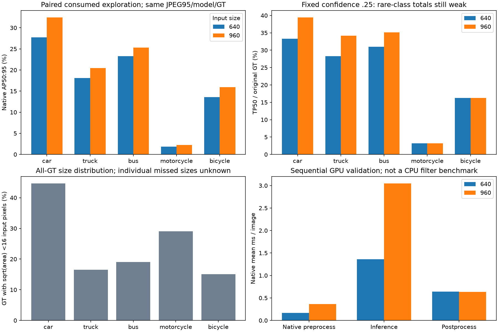

# Issue #47 — diagnose first, keep method discovery open

**Resolution is an actionable exploratory signal, but it does not solve the
two-wheeler failure or select a preprocessing policy.** The native 640/960
diagnostic passed its prospectively fixed gates on already-consumed images.
The next prioritized experiment is **resolution-aware fine-tuning: matched
640/960 training arms, each evaluated at both inference resolutions**. Task-aligned
photometric training remains a secondary candidate. This recommendation needs a
separately declared short paired study. It is not a preprocessing policy and
does not authorize or report full S20 training. Issue #47 remains open.

PR #48 was merged as an immutable negative Gamma/Sharpen pilot. Its outcome,
thresholds and support gates remain unchanged. This separate follow-up diagnoses
its errors, reviews materially different mechanisms, and executes only the
single resolution diagnostic declared in [the discovery plan](ISSUE47_DISCOVERY_PLAN.md).
The plan/implementation were committed at **`ee76601` before diagnostic inference**.
No new exploration groups or confirmation/development/final pixels were consumed.

## What the existing evidence supports

The saved native matches and original GT establish class-level counts at
confidence .25 / IoU .50:

- Motorcycle: **31 GT, 1 TP, 8 FP, 30 FN**, across 25 original source groups.
- Bicycle: **86 GT, 14 TP, 2 FP, 72 FN**, across 54 groups.
- Car: **10,477 GT, 3,489 TP, 715 FP, 6,988 FN**.
- Truck: **442 GT, 125 TP, 195 FP, 317 FN**.
- Bus: **168 GT, 52 TP, 56 FP, 116 FN**.

Of images containing motorcycles/bicycles, **28/29 and 55/59 are bright** under
the original brightness >=0.12 definition; **28/29 and 54/59 were skipped** by
the failed pixel route. Exposure selection did not cover most of this failure
population. This does not prove bright scenes are easy or identify the cause of
the detector's low coverage.

At a nominal 640 input, median sqrt(original box area) scaled by longest-side
resize is **22.89 pixels for motorcycles, 26.38 for bicycles**. Only **9/31 and
13/86** boxes are below 16 pixels; some targets are small, but the majority are
not in that smallest bucket. Car's median is 17.95 pixels, with 4,683/10,477 below
16. These are distributions of **all GT**, not of identified missed boxes.

Scene metadata reinforces that darkness is not the only plausible issue. Daytime
contains 27 motorcycle GT with only one TP, and 71 bicycle GT with 12 TP. Night
contains four motorcycle and 11 bicycle GT, all missed at the illustrative
threshold. Metadata night (393 images) differs from pixel-defined darkness
(211 images). The higher-noise cohort has just two images, so this median-residual
proxy provides little support for a noise-specific explanation or new route.

The [diagnosis](issue47-discovery/diagnosis.json) retains class AP/counts/support
for brightness, contrast, noise, low sharpness, original routes, small-two-wheeler
image cohorts and original weather/scene/time-of-day categories. All GT in each
cohort image stays included. Unsupported effects remain descriptive and absent
AP is never filled with zero.

**Evidence boundary:** the historical matching cache stores prediction TP flags,
confidence/classes and target classes, but not matched GT indices or prediction
geometry. It cannot identify individual missed-box sizes, local glare/noise at
an object, or FP geometry. Image-cohort AP is not AP-small. These associations
motivate controlled tests; they do not establish a causal exposure, resolution,
sensor-noise or train/inference explanation. No new matcher or box attribution
is invented to close that gap.

## Ranked mechanisms and distinguishing tests

The [independent notebook](../notebooks/research/issue47/01_method_discovery.ipynb)
contains the short ranked hypothesis table, controls, cost and falsification
criteria from before this diagnostic. The current next-experiment priority is
resolution-aware fine-tuning, as described below. The [plan](ISSUE47_DISCOVERY_PLAN.md)
cites primary papers and official implementations, distinguishing external evidence
from our inference.

1. **Native resolution sensitivity — executed first.** Change only 640 to 960
   on identical JPEG95/GT/model. This is a cheap way to test sensitivity to
   input detail without SAHI slicing/crop merging or another dependency.
2. **Task-aligned photometric training — secondary candidate.** Test learned
   exposure robustness with the same inference inputs, rather than assume a
   visually improved input helps a frozen detector. Existing native HSV is a
   possible controlled first intervention, not a calibrated noise model or a
   reproduction of Exposure-Aware Training. A short matched training diagnostic
   must distinguish domain adaptation from illumination augmentation and keep
   its settings/results separate from completed S20 evidence.
3. **Constrained luminance/local contrast — deferred.** It differs from old
   local-shadow gain, but current global features do not localize recoverable
   vehicle shadows. A future local-versus-global ablation needs that mechanism
   and highlight/noise/clean-regression protection; another CLAHE grid is weakly
   motivated by the current evidence.
4. **One learned SCI comparator — deferred.** The official CVPR release offers
   three difficulty-specific weight sets and distinguishes them from its paper's
   reported models. No license was established from the inspected official
   README/repository listing. No model was downloaded, checkpoint selected by
   outcomes, new enhancement framework written, or multiple learned models tried.

The linked AAAI page was access-blocked and unverified; no claim or selection
relies on its presumed contents. RUAS/SCI/SAHI and task-aligned enhancement results
on other tasks/datasets are hypotheses here, not BDD100K performance predictions.

## Controlled resolution measurement

Exactly **two native evaluations / 2,054 image passes** used the same consumed
1,027 images / 649 source groups. Verified Skip JPEG95 bytes and exact original
five-class labels/negatives were copied to new owned files; native caches live
under `runs/issue47-discovery/resolution/`, preserving all old exports/runs.
No original pixel reads, re-encoding, crop/geometry/GT changes or runtime routing
occurred. The same pinned pretrained YOLO26n, FP32, batch 32, workers 0, seed 2026,
rectangular loading and NMS-free native settings were used; only `imgsz` changed.

The fresh **640 control reproduces every historical native aggregate within
absolute 1e-6**. Native mAP50:95 / mAP50:

- 640: **16.904200% / 28.076839%**.
- 960: **19.276913% / 31.366105%**.

Primary gain is **+2.372712 AP percentage points**, with 100 paired original-
source-group draws, all valid, and exploratory conditional 95% interval
**[+1.360202, +3.961617] points**. It is not independent confirmation or adjusted
for prior research/selection. Per-class AP50:95 changes are car **+4.739343**,
truck **+2.317923**, bus **+2.030381**, motorcycle **+0.417503**, bicycle
**+2.358411 points**. The two-wheeler mean gain is **+1.387957 points**. No supported
primary/dark/bright class crosses the declared regression tolerances.
The individual motorcycle/bicycle exploratory intervals still include zero
([−1.488, +4.879] / [−0.737, +5.648] points); aggregate support does not establish
a reliable gain for either rare class separately.

The small-two-wheeler **image-cohort** observed-class AP rises
**14.744657% → 22.353898%**; that macro includes all classes in those images.
It does not isolate motorcycle/bicycle AP-small or show which GT boxes benefited.
The complete per-class/cohort metrics and draw support are in
[resolution.json](issue47-discovery/resolution.json).

The rare-class result is mixed: **motorcycle and bicycle fixed-confidence TP
totals remain 1 and 14**, while their FP totals rise from 8/2 to 9/3. Motorcycle
mAP50 falls despite the AP50:95 increase. Better AP can reflect ranking and
localization at other confidence/IoU thresholds; it is not evidence that this
setting solves missed two-wheelers at the illustrative operating point.
Across all classes, totals change **3,681 TP / 976 FP → 4,360 TP / 1,121 FP**.
Native F1-selected precision/recall use different selected operating points and
should not be treated as a common confidence threshold.

[Representative per-class changes](issue47-discovery/examples.json) include a
car scene `548a8059-bef4812f` improving 4 TP / 6 FP → 12 / 0, and another
`264b9ed7-741f6ed4` regressing 6 / 0 → 3 / 2. Motorcycle example
`5cc1f61a-8cf3056a` loses its only TP and gains an FP; `989bd529-779a95b6`
gains a TP. Thus unchanged rare-class totals also hide different image-level
gains and losses. Examples follow TP-change then FP-change/ID ordering; they
are illustrative counts, not individual AP or inferred GT-box matches.

## Timing, decision and next boundary

Native mean inference is **1.360 / 3.050 ms per image** at 640/960, a **2.243x**
ratio within the predeclared 3x engineering gate. Native preprocessing means are
0.165/0.365 ms and postprocessing 0.641/0.636 ms. Synchronized validation-batch
mean / p95 is **142.150 / 197.918 ms** versus **199.005 / 287.448 ms**, 33 batches
per arm. Batch p95 is not image p95. Sequential order/setup effects remain;
13.219/12.438-second phase wall times cannot establish faster inference at 960.
There is no added offline filter or new matched CPU preprocessing benchmark.

The diagnostic passes its declared aggregate/two-wheeler/uncertainty/regression/
cost checks. The strongest measured signal therefore prioritizes **resolution-aware
fine-tuning** over the secondary photometric-training hypothesis. It does not
establish a released policy, explain every miss, or create a v3 S20 result.
No training was performed or independently confirmed here.

The separate follow-up should declare a short source-group-safe training subset
and fixed epoch/compute budget before execution. Independently initialize matched
native YOLO26n arms at 640 and 960, keeping train IDs/GT, seed, epochs, freeze and
augmentation settings identical. Evaluate both arms at both 640 and 960 on the
same consumed exploration IDs: a 2×2 matrix separating training-resolution from
inference-resolution effects. Training at 960 must show **incremental benefit
over the 640-trained arm evaluated at 960**, rather than merely recover the
already-observed inference-resizing gain. Set rare-class uncertainty, supported
cohort/clean-regression and compute stop criteria prospectively; report VRAM,
training time and inference latency. Any necessary batch-size difference must
be disclosed as a confounder. Do not change augmentation in this resolution test
or add a hyperparameter grid; photometric training remains a later candidate.

This PR adds no inference/training and leaves its measured results and original
plan unchanged. Candidate selection on new group-disjoint exploration still
requires a new committed plan, and a frozen candidate needs appropriate independent
confirmation before full S20 training. No gate is revised retroactively and the
reserved confirmation plan stays unread.

## Reuse and provenance

Default Restart & Run All of the new notebook reads hash-verified compact evidence
without model construction, original annotations, source pixels or local runs.
The acquisition executed once in a fresh kernel with both explicit flags enabled;
its notebook/log are under ignored `runs/issue47-discovery/`. Existing/incomplete
attempts block re-execution. All images, native caches/matching arrays and weights
stay ignored; [compact artifact hashes](issue47-discovery/evidence.json) bind the
diagnosis, fixed plan, measurements, uncertainty, examples and plot.

The broader issue remains open. No v3 config, enhancer, S20 arm, confirmation,
development or final-test result is fabricated, and all completed artifacts remain
unchanged. Cross-version S20 presentation stays in `experiments/compare.ipynb`;
this research notebook compares input resolutions within one consumed population.

Validation: **177 tests passed**, including the actual tiny native CPU lifecycles
and fresh-kernel inspection of the new notebook with acquisition/heavy/source
paths blocked. Ruff lint/format and whitespace checks passed. All **75,420**
preflight-hashed historical local files remain unchanged; completed tracked
policies/notebooks/evidence also have no edits. The [validation receipt](issue47-discovery/validation.json)
records preservation, software checks and the postrun environment. Software tests
are not independent scientific evidence; remote CI is not claimed before the PR.
