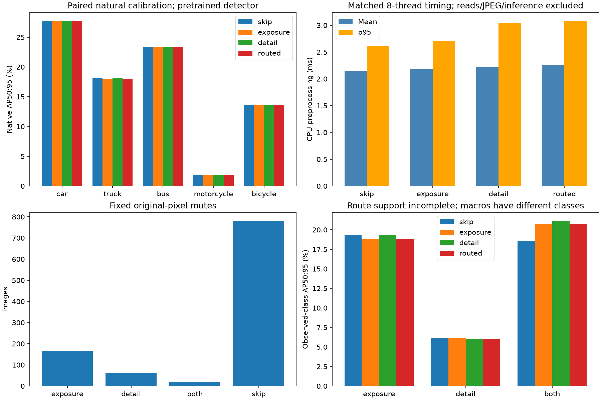
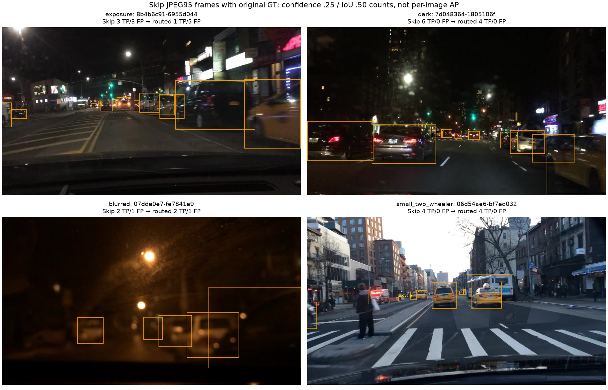

# Issue #47 — stop the fixed adaptive exposure/detail direction

**No defensible v3 policy was found; stop before confirmation or S20 training.**
The real four-arm natural-image pilot completed on 2026-11-06. Its primary gain
is negligible, supported truck regressions cross the declared tolerance, and
all three active routes lack the required five-class support. No thresholds were
retuned, components promoted, samples expanded or confirmation pixels opened.
This is a negative/insufficient-evidence decision for these fixed hypotheses,
not a proof that adaptive preprocessing is universally ineffective.

## Preregistration, population and integrity

The [plan](ISSUE47_PLAN.md), implementation and acquisition notebook were committed
at **`a88c996` before pixel measurement and inference**. Unlike the historical v2
pilot, the declaration was separately committed. A runtime check rejects
uncommitted changes to those files and the reused measurement helpers. Exact
[code/config/model/settings hashes](issue47/plan.json) bind the acquisition.

The deterministic next whole-group slice has **1,027 images / 649 source groups**.
Its [membership](issue47/membership.csv) excludes the 512 images consumed by
round 3 and the 256-image v2 pilot, with no overlap by original ID, leakage group,
source group or source hash. The complete saved calibration-confirmation
population is also excluded. The reserved 1,025-image confirmation plan was not
read. No images were selected by features, GT or detector outcomes. Primary
source-group support is car 644, truck 237, bus 126, motorcycle 25, bicycle 54.
These groups were unconsumed by the documented recent searches; broader historical
Gamma calibration means they are not a historically untouched holdout.

Exactly **four native evaluations / 4,108 image passes** completed, below the
4,352-pass cap. All arms decode the same original natural images, use original
five-class GT/negative images and unchanged geometry, then encode JPEG95 once.
Every paired label byte and native-loader ID is checked; every skipped image is
byte-identical across all arms. The existing COCO-to-five-class NMS-free native
validator/AP implementation is reused, and saved-match AP agrees with native AP.
No synthetic scenario, per-image AP, GT-based runtime route or new search engine
is introduced. Final annotations are metadata only; confirmation/development/final
source pixels were not read. Completed v0/v1/v2 artifacts remain unchanged.

## Native outcomes and directly matched cost

These are **pretrained calibration exploration**, not trained S20 development.
Native dataset mAP50:95 / mAP50, percentages:

- Skip: **16.904200% / 28.076839%**.
- Exposure component: **16.909368% / 28.135048%**.
- Detail component: **16.906175% / 28.084783%**.
- Complete routed treatment: **16.910513% / 28.137235%**.

The full candidate gains only **+0.006313 AP percentage points** over Skip,
below the declared +0.2-point primary gate. Its 100 paired original-source-group
draws are all valid, with exploratory conditional 95% interval
**[−0.095116, +0.115024] points**. The positive-lower-bound gate fails. This
interval has no multiplicity correction or independent-confirmation claim.

Primary per-class AP50:95, Skip → full route:

- Car: **27.743676% → 27.689695%**.
- Truck: **18.116085% → 17.994115%**.
- Bus: **23.273734% → 23.370545%**.
- Motorcycle: **1.812963% → 1.813140%**.
- Bicycle: **13.574544% → 13.685072%**.

Matched CPU mean / p95: Skip **2.146 / 2.617 ms**, exposure **2.187 / 2.706 ms**,
detail **2.227 / 3.034 ms**, full route **2.266 / 3.083 ms**. Each arm has 3,081
timed calls, totaling 12,324: eight OpenCV threads, warmup, three repeats and
rotated arm order in one process. All include original quality/routing work and
exclude reads, JPEG, inference and verification. The candidate passes the 10/25
ms cost gates; passing cost does not establish useful detection benefit. These
are offline CPU measurements, not deployment latency or cross-round speed claims.

## Does the route predict beneficial detector response?

The fixed route chooses exposure only for **164 images**, detail only for **63**,
the ordered Gamma → Sharpen pair for **19**, and Skip for **781**. It changes
246/1,027 images; image quality does not itself establish that those changes help.

On the exposure-only stratum, observed-class macro AP50:95 falls from
**19.307350% to 18.843345%**. All five classes occur, but only **one motorcycle
source group** is represented. Truck AP falls **37.698707% → 34.376342%** with
19 source groups: **−3.322365 points**, beyond the one-point subgroup tolerance.
The dark diagnostic subset has 211 images; truck AP falls
**17.094965% → 15.308683%**, **−1.786283 points** with 22 truck groups. Dark
motorcycle/bicycle support is just 1/4 groups. Rare-class safety is inconclusive.

On the detail-only stratum, observed-class macro AP falls
**6.095962% → 6.062637%**. Only car, truck and bus occur, with 52/7/1 source
groups. It does not establish five-class benefit. All 20 small-two-wheeler images
and four severe-low-sharpness images retain identical AP across arms. Their
original GT remains included; the low-sharpness subset has only car GT, so its
9.647241% macro is a one-class descriptive statistic, not five-class mAP.

On the 19-image intersection, observed-class macro AP is Skip **18.559064%**,
Gamma **20.690904%**, Sharpen **21.143556%**, ordered pair **20.803384%**.
The pair does **not** beat Sharpen alone. Only car/truck occur (17/3 source
groups); this tiny two-class subset does not satisfy the composition-support
gate or justify promoting the component. Route macros describe different
populations/classes and must not be ranked as comparable five-class scores.

The E-only, D-only and intersection routes all fail the fixed support requirement.
Those failed gates are retained alongside the measured primary/regression/interval
failures in [summary.json](issue47/summary.json). No additional thresholds or
quality metrics are added to fit these outcomes.

## Representative errors and limitations

Native confidence-.25 / IoU-.50 totals are Skip **3,681 TP / 976 FP**, exposure
**3,691 / 987**, detail **3,683 / 976**, full route **3,693 / 990**. Counts illustrate
errors; AP also reflects confidence ranking and localization. More TP alongside
more FP does not override the negligible AP gain and failed regression gates.

The exposure-only example `8b4b6c91-6955d044` changes **3 TP / 3 FP → 1 / 5**;
the dark example `7d048364-1805106f` changes **6 / 0 → 4 / 0**. The low-sharpness
example `07dde0e7-fe7841e9` stays **2 / 1**, and small-two-wheeler example
`06d54ae6-bf7ed032` stays **4 / 0**. The latter examples illustrate no response,
not a successful rescue or a measured new failure. Example choice follows the
declared TP-loss/FP-rise/ID rule. Frames show verified Skip JPEG95 exports with
original GT; no extra original-source read or inference is used for plotting.

These global quality proxies still cannot locate a tiny vehicle or distinguish
texture from recoverable blur. The median-residual noise proxy can collapse to
zero; it is not a calibrated sensor-noise estimate. No universal ineffectiveness,
generalization, causal training effect or final-test result follows from this
single pretrained exploration sample.

## Lifecycle decision and replay

There is **no frozen v3 config and no 02/03/04 notebook**: the plan explicitly
forbids a post-pilot training override. Do not fabricate S20 training/evaluation
or relabel a historical router. The frozen 9,781 S20 and 13,975 development IDs,
original labels/negatives, memberships, initialization and shared Raw checkpoint
selection remain unchanged. [compare.ipynb](../notebooks/experiments/compare.ipynb)
reads v3's own committed decision, separately from completed v0/v1/v2 S20 evidence;
there is no v3 development metric row or older-snapshot inference of one.

Open [01_experiments.ipynb](../notebooks/experiments/v3/01_experiments.ipynb) with
`ALLOW_PILOT=False` and Restart & Run All, or call
`vehicle_detection.v3_pilot.run(".")`. Default replay verifies compact artifact
hashes without models, sources, training or preprocessing. The actual opted-in
fresh-kernel notebook and log are local at
`runs/issue47/01_experiments_executed.ipynb` and `runs/issue47/pilot_execution.log`.
An existing/incomplete attempt blocks acquisition; do not delete it to reuse
consumed groups. Changed hypotheses require a new declared study/population.

The acquisition took **107.025 seconds** after metadata preflight, with native
evaluation wall times **11.304 / 8.931 / 8.484 / 8.429 seconds** for Skip/exposure/
detail/routed. First-arm setup differs, so these are not controlled detector-speed
comparisons. Hardware was RTX 5060 Ti / CUDA 13.2; Ultralytics 8.4.198, Torch
2.15.0, NumPy 2.4.6, OpenCV 4.14.0.94. Full-precision metrics, original-source-group
draws, features, errors and hashes remain in [compact evidence](issue47/evidence.json).
Large exports, native matching arrays and executed notebooks remain ignored.

Validation: **172 full-study tests passed**, including fresh-kernel lifecycle,
isolated read-only comparison and isolated v3 evidence inspection with model/
source/preprocessing imports blocked. Ruff lint/format and whitespace checks
passed. All 21 preflight-hashed local v0/v1/v2 YAML/history/checkpoint/metric files
remain unchanged; historical tracked policies/notebooks/evidence have no edits.
The final v3 notebook adds displays of saved plots after acquisition, without
changing the measured policy or replaying inference. The acquisition notebook
hash remains the one recorded at `a88c996`. The [validation receipt](issue47/validation.json)
records checks and preservation; software tests are not new scientific evidence.
