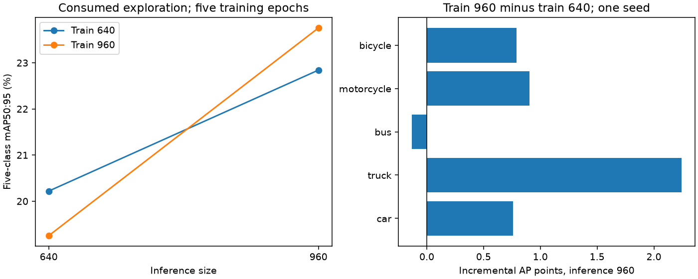

# Issue #47 — resolution-aware training adds uncertain benefit, with a dark-bus regression

**Stop this fixed short training diagnostic without promotion.** Training at
960 improves the point estimate over training at 640 when both are evaluated
at 960, but the primary paired interval includes zero and the supported dark-bus
regression exceeds the prospective tolerance. This does not reject every
resolution or training mechanism, and it does not select an adaptive policy.
Issue #47 stays open. No confirmation, development or final pixels were read.

## Declaration, first failure and explicitly requested repeat

The [original plan](ISSUE47_TRAINING_PLAN.md), implementation and independent
[notebook](../notebooks/research/issue47/02_resolution_training.ipynb) were committed
at **`e9a51cc` before training**. That attempt completed both five-epoch runs and
one evaluation, then hit an API error: `YOLO.val` does not expose `model.validator`.
The first failed executed notebook, log, models, histories and evaluation remain
under ignored `runs/issue47-resolution-training`; its compact
[failure receipt](issue47-resolution-training/failure.json), original plan,
membership, histories and arguments remain committed separately.

After disclosure, the user explicitly requested **“train it again.”** The
[repeat declaration](ISSUE47_TRAINING_REPEAT_PLAN.md) and callback correction
were committed at **`fbead44` before repeating**. A native CPU regression test
exercises the actual validator callback API. The corrected implementation also
saves training wall/peak-VRAM and evaluation timing receipts immediately, so
later reporting errors cannot discard these measurements.

The fresh repeat is the reported experiment regardless of whether it improves
on the first attempt; no run selection or threshold adjustment occurred. Its
original code/config/environment/population hashes are in
[plan.json](issue47-resolution-training-repeat/plan.json). The same seed and
population are **not independent replication or confirmation**.

## Paired populations and settings

The whole-group deterministic prefix contains **2,048 S20 training images /
1,244 source groups**, ID hash
`0c895a25bdb405d289676bedd73d83bf7a483d3709a94a4cdb81e35e8206bdfc`.
It is identical in both attempts and both arms. It retains complete leakage,
source and duplicate-image groups without class/outcome-based sampling.
The original 9,781-image S20 membership itself is unchanged.

Evaluation uses exactly the **consumed 1,027 PR #48 images / 649 source groups**,
hash `d925d907e4ea2da0ff1301a418d7a5a194ff0f4c114f73aba2adb0b0e8c45084`.
Training and evaluation are disjoint by original ID, leakage group, source group
and source hash. Each population has all five classes in at least five source
groups. The copied original Raw/Skip JPEG95 exports preserve exact label/image
bytes, GT geometry and negative images. Native loader IDs and original GT counts
are checked. Original sources and reserved confirmation/development/final pixels
are not opened; annotations remain metadata. New caches/outputs are owned files
under `runs/issue47-resolution-training-repeat/study`.

Two native Ultralytics runs independently initialize the same pinned COCO
YOLO26n at seed 2026: five epochs, batch 16, workers 0, AdamW, FP32/no AMP,
backbone boundary 11, unchanged shared learning schedule and disabled
augmentation. Only training resolution differs. The reported checkpoint is
always **fixed final-epoch `last.pt`**, with no development selection. Native
terminal validations use consumed exploration only; their metrics do not choose
the reported epoch. Five epochs, including three warmup epochs, are a short
adaptation diagnostic and do not establish convergence.

Both final checkpoints are evaluated at 640 and 960 with the same native FP32,
batch-32, rectangular, confidence-.001, NMS-free settings. Native AP50 and
AP50:95 agree with saved-match aggregation for all four cells. There is no
enhancer, new search, photometric augmentation or learned runtime route here.

## Full 2×2 matrix and incremental training benefit

These are **short trained calibration-exploration** results, not pretrained
pilot metrics or completed S20/development results. Native five-class
mAP50:95 / mAP50, percentages:

- Train 640, infer 640: **20.219447% / 33.981616%**.
- Train 640, infer 960: **22.842672% / 39.693852%**.
- Train 960, infer 640: **19.252958% / 31.965879%**.
- Train 960, infer 960: **23.756023% / 39.668199%**.

At inference 960, the incremental training-resolution gain is **+0.913351 AP
percentage points**, beyond the resizing-only gain of +2.623225 points within
the 640-trained arm. Conversely, the 960-trained checkpoint loses 0.966489 points
at inference 640. Resolution alignment matters in this sample; neither finding
establishes a general causal explanation for missed vehicles.

The fixed 100 paired original-source-group draws are all valid. The primary
conditional 95% interval is **[−0.081883, +1.778887] AP points**: its positive-
lower-bound gate fails. There is no missing-class imputation/redraw or
multiplicity adjustment. These intervals are exploratory on a population
already used to choose this research direction.

At fixed inference 960, per-class incremental AP50:95 points and conditional
95% intervals are:

- Car **+0.757621**, interval **[+0.510175, +1.037586]**, 644 source groups.
- Truck **+2.244071**, **[+0.472377, +3.919914]**, 237 groups.
- Bus **−0.131639**, **[−3.031721, +2.669895]**, 126 groups.
- Motorcycle **+0.905514**, **[−3.537671, +4.139665]**, 25 groups.
- Bicycle **+0.791190**, **[−1.590864, +3.673267]**, 54 groups.

The two-wheeler mean gain (+0.848352 points) passes its point-estimate gate,
but neither rare-class interval establishes a reliable individual improvement.
More seriously, dark-bus AP50:95 falls **25.147229% → 17.381084%**, a
**−7.766145-point** loss across 16 original source groups/16 GT instances,
exceeding the one-point supported-cohort tolerance. No other supported
all/dark/bright class crosses its declared no-harm limit. Sparse cohort/classes
remain inconclusive, and the original PR #48 route-support gates are unchanged.

## Fixed-confidence errors and cost

At confidence .25 / IoU .50, holding inference at 960, total TP/FP changes
**5,698 / 1,668 → 5,772 / 1,690**. Motorcycle TP/FP is **3 / 6 → 2 / 7**;
bicycle is **27 / 18 → 25 / 14**. Thus the rare-class AP point gains do not
establish improved missed-object coverage at this operating point. mAP50 also
slightly declines in the primary contrast. AP ranking/localization and a fixed
confidence count describe different aspects of detector behavior.

Representative class-specific changes include car `68a83975-5a0dee69`
**6 TP / 3 FP → 12 / 4**, car `5706182e-65cdd8f2` **12 / 3 → 9 / 5**,
motorcycle `5cc1f61a-8cf3056a` **1 / 0 → 0 / 0**, and bicycle
`57e78466-241bdffe` **1 / 0 → 3 / 0**. Deterministic example selection orders
TP change, FP change and original ID. Saved matches do not identify individual
missed GT-box indices or FP geometry; these are illustrative class counts,
not per-image AP or AP-small. Cohort metrics retain all original GT.

Fresh 640/960 training wall times are **121.692 / 210.278 seconds** (1.728×),
including native terminal validation. Peak allocated VRAM is **2.347 / 5.240
GiB**. Both complete exactly five epochs at batch 16, without recovery or batch
reduction. Engineering training-time and VRAM gates pass.

At matched inference 960, native mean inference is **2.614 / 2.521 ms per image**
for the 640/960-trained checkpoints. Synchronized validation-batch mean/p95 is
**162.349 / 226.354 ms** versus **155.764 / 240.719 ms**, 33 batches per cell.
The matched mean-inference gate passes. Batch p95 is not per-image p95, sequential
setup/order effects remain, and these are not deployment latency claims. No
offline filter or extra CPU preprocessing benchmark was added. Full native
preprocessing/inference/postprocessing timings, histories, arguments, checkpoint
hashes, cohorts, errors and uncertainty draws are retained in
[result.json](issue47-resolution-training-repeat/result.json) and adjacent receipts.

The fresh repeat spends 20,480 training image exposures, 4,108 explicit evaluation
passes and four native terminal-validation passes (4,108). Including the failed
attempt, the total is **40,960 training exposures / 13,351 validation image
passes**. No further run, tuning, population expansion or confirmation follows.

## Decision, replay and preservation

Preserve both failed prospective gates: **primary uncertainty** and **dark-bus
regression**. Keep the resolution sensitivity as research evidence without
promoting this fixed training recipe. The remaining photometric/task-alignment
hypothesis from PR #49 would need its own bounded declaration and controls;
this result does not authorize another grid or S20 run. Resolution by itself
also does not implement the adaptive preprocessing sought in Issue #47.

Default Restart & Run All of the independent notebook verifies and displays
compact evidence without models, original metadata, sources or local runs.
Actual opted-in acquisition completed once in a fresh kernel under the repeat
root, preserving the failed original execution. Existing/incomplete repeat
attempts block reruns. Large datasets, weights, matching arrays and executed
notebooks remain ignored. Cross-version S20 presentation stays exclusively in
`experiments/compare.ipynb`, which is unchanged.

The [preservation receipt](issue47-resolution-training-repeat/preservation.json)
verifies unchanged size/mtime inventories for **160,890 historical local files**,
including the first attempt, and exact hashes for **330 historical evidence,
config and notebook files**. This inventory check does not reread historical
pixel bytes; it is not a cryptographic rehash of all historical exports. The
13,975 development IDs, final-test pixels and completed v0/v1/v2 results stay
unchanged. Validation checks and their limits are recorded separately; software
tests do not turn this consumed-data result into independent evidence.
