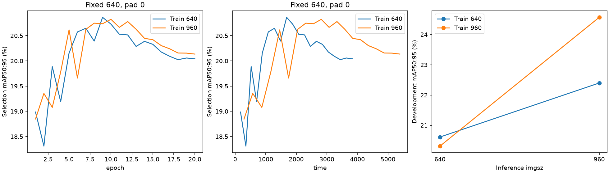

# Issue #51 — full S20 resolution-training results

**Training at 960 adds 2.170 AP percentage points when both models infer at 960** (conditional 95% source-group interval [1.773, 2.620]). The frozen research assessment is **inconclusive**. No policy is promoted; Issue #47 remains open.

Both arms completed the entire 9,781-image S20 for 20 epochs, independently initialized from the same pinned YOLO26n. Only training resolution differed scientifically. Checkpoint selection used the same 13,975 Raw development images at fixed actual 640, native rectangular pad=0, batch 32, FP32 and native fitness. The selected checkpoint per arm is frozen across its two inference cells. These are single-seed, reused-development results, not independent confirmation or a final test.

## Fixed 2×2 matrix

- Train/infer **640/640**: mAP50:95 **20.612%**; mAP50 **35.158%**.
- Train/infer **640/960**: mAP50:95 **22.398%**; mAP50 **38.957%**.
- Train/infer **960/640**: mAP50:95 **20.312%**; mAP50 **34.380%**.
- Train/infer **960/960**: mAP50:95 **24.568%**; mAP50 **41.600%**.

Resizing-only gain B-A is **+1.786 points**. Incremental training gain D-B is **+2.170 points**. At inference 640, C-A is **-0.301 points**. The interaction (D-B)-(C-A) is **+2.471 points**. The diagonal D-A changes both factors. These estimates apply to the fixed checkpoint-selection procedure; selected epochs can differ.

The middle panel uses native-history elapsed seconds; all original CSV precision is retained.

## Class AP and fixed-confidence coverage

Primary comparison below is train 640 → train 960, both inferring at 960. AP50:95 uses native conf=.001; TP/FP/FN use conf≥.25 and matching IoU=.50. Native F1-selected precision/recall is a separate operating point.

- **car**: AP50:95 39.247% → 41.038% (+1.791 points; 95% interval [1.698, 1.889]); AP50 68.031% → 69.831%. 142541 GT / 8199 original source groups. TP/FP/FN 81711/25304/60830 → 80224/18546/62317.
- **truck**: AP50:95 26.344% → 28.804% (+2.460 points; 95% interval [1.829, 3.105]); AP50 40.389% → 43.269%. 5965 GT / 3043 original source groups. TP/FP/FN 2449/2695/3516 → 2215/1509/3750.
- **bus**: AP50:95 25.809% → 27.735% (+1.926 points; 95% interval [0.868, 3.058]); AP50 37.476% → 38.380%. 2276 GT / 1549 original source groups. TP/FP/FN 759/532/1517 → 737/467/1539.
- **motorcycle**: AP50:95 7.780% → 11.090% (+3.311 points; 95% interval [2.050, 4.725]); AP50 18.944% → 23.430%. 562 GT / 408 original source groups. TP/FP/FN 88/78/474 → 112/76/450.
- **bicycle**: AP50:95 12.810% → 14.175% (+1.366 points; 95% interval [0.497, 2.343]); AP50 29.948% → 33.093%. 1430 GT / 794 original source groups. TP/FP/FN 328/191/1102 → 332/145/1098.

Totals: **TP/FP/FN 85335/28800/67439 → 83620/20743/69154** on unchanged 152774 GT. FP fall 27.976%, while TP fall 2.010%. Macro AP weights five classes equally; these total counts are dominated by cars. AP gains coexist with a fixed-confidence precision/recall tradeoff.

## Dark-bus and rare-class uncertainty

Dark: 1000 valid / 0 missing-class draws out of 1,000. Focus classes:

- bus: 163 GT / 129 groups; AP change +0.170 points, interval [-2.952, 3.415]; TP/FP/FN 40/29/123 → 31/20/132.
- motorcycle: 63 GT / 54 groups; AP change +3.019 points, interval [0.654, 6.552]; TP/FP/FN 3/6/60 → 6/7/57.
- bicycle: 98 GT / 67 groups; AP change +1.278 points, interval [-2.356, 4.364]; TP/FP/FN 17/9/81 → 19/12/79.

Bright: 1000 valid / 0 missing-class draws out of 1,000. Focus classes:

- bus: 2113 GT / 1429 groups; AP change +2.013 points, interval [0.952, 3.080]; TP/FP/FN 719/503/1394 → 706/447/1407.
- motorcycle: 499 GT / 357 groups; AP change +3.246 points, interval [1.852, 4.846]; TP/FP/FN 85/72/414 → 106/69/393.
- bicycle: 1332 GT / 734 groups; AP change +1.367 points, interval [0.485, 2.394]; TP/FP/FN 311/182/1021 → 313/133/1019.

The prospective criteria retain every failure and inconclusive finding:

- inconclusive: AP vs fixed-confidence TP/FN contradiction: dark/bus.

Primary bootstrap: **1000 valid / 0 missing-class draws** out of 1,000, seed 2026, original-source-group pairing, fixed five-class macro, no imputation/redraw. All/dark/bright counts were fixed before outcomes. Intervals condition on the selected models and reused development; they omit training-seed/selection uncertainty and multiplicity correction. Five groups is only an engineering minimum. The GT-area<32² two-wheeler image cohort retains all GT and is not AP-small or per-image AP. Complete cohort metrics and deterministic class-count gain/loss IDs are retained in the saved result; matches do not identify individual missed GT boxes.

## Convergence and cost

- Train 640: native selected epoch **9**, selection peak **20.864%**, last **20.042%** (drop 0.822 points). Train/val classification loss at selection→last: 1.11448→0.99032 / 1.20600→1.20668. Native training-call wall **65.679 min**; peak allocated/reserved VRAM **2.347/2.775 GiB**.
- Train 960: native selected epoch **10**, selection peak **20.824%**, last **20.135%** (drop 0.689 points). Train/val classification loss at selection→last: 1.03918→0.92222 / 1.22348→1.22307. Native training-call wall **91.176 min**; peak allocated/reserved VRAM **5.239/5.545 GiB**.

960/640 full-training wall ratio: **1.388×**. Both full budgets were completed without resume, batch reduction or recovery. The fixed-640 curves favor mid-schedule checkpoints; later training loss reduction did not improve that selector. Selection pad=0 is prospective and differs from historical native pad=.5. Native CSV time includes per-epoch validation; training-call wall also includes trainer setup, final best validation and native output generation; prior YOLO construction is excluded. Selection pad=0 at nominal 640 produces actual 384×640 tensors, whereas matrix pad=.5 at nominal 640 produces 384×672 (and nominal 960 produces 576×992). Selection AP therefore need not equal the nominal-640 matrix point. A completed 20-epoch budget does not establish optimization convergence across other schedules or seeds.

- Train/infer 640/640: native preprocess/inference/postprocess **0.1739/1.0314/0.1022 ms/image**; phase **83.660 s** (167.046 images/s inside native validation, including setup/I/O/metrics); synchronized batch mean/p95 **98.054/121.588 ms**, 437 batches; actual shapes [[384, 672]].
- Train/infer 640/960: native preprocess/inference/postprocess **0.3697/2.4761/0.1065 ms/image**; phase **120.638 s** (115.843 images/s inside native validation, including setup/I/O/metrics); synchronized batch mean/p95 **152.948/170.861 ms**, 437 batches; actual shapes [[576, 992]].
- Train/infer 960/640: native preprocess/inference/postprocess **0.1713/1.0306/0.1009 ms/image**; phase **82.484 s** (169.427 images/s inside native validation, including setup/I/O/metrics); synchronized batch mean/p95 **96.277/121.099 ms**, 437 batches; actual shapes [[384, 672]].
- Train/infer 960/960: native preprocess/inference/postprocess **0.3664/2.4820/0.1083 ms/image**; phase **121.706 s** (114.826 images/s inside native validation, including setup/I/O/metrics); synchronized batch mean/p95 **155.187/176.701 ms**, 437 batches; actual shapes [[576, 992]].

At fixed inference 960, D/B native inference ratio is **1.0024×**. Native inference means exclude loader/I/O and setup; validation-call throughput includes them but excludes prior YOLO construction and later saved-match/cohort aggregation. Batch p95 is not per-image p95. Sequential one-host timing is descriptive and has order/cache/thermal effects; it is not a deployment SLA. No filter overhead, export/quantization benchmark, extra inference size or timing rescue run was introduced.

## Execution, interruption and preservation

Acquisition was frozen at `30fde1b`, following implementation `0dba036`. The same SHA256-pinned COCO YOLO26n, Ultralytics 8.4.198, seed 2026, batch 16, FP32 AdamW, freeze 11, optimizer/schedule and disabled augmentations were retained. Native resolved arguments differ only in imgsz/name/save_dir; initialized trainable parameter names match. All 42 selection/terminal passes used actual maximum tensor edge 640; training remained square 640/960. Every matrix cell matched native AP and original GT/IDs, and retained the frozen best checkpoint hash.

Reproduction identities: split table SHA256 `b7a6aba1d1f72e1b1e3eceda8e8427d41f44408067fad63ee68479137714cb96`; initial checkpoint SHA256 `9b09cc8bf347f0fc8a5f7657480587f25db09b34bf33b0652110fb03a8ad4fef`. S20 contains 5,915 leakage groups / 73 negative images; development contains 8,258 leakage groups / 121 negatives. Original-source groups used for uncertainty are recorded separately. Settings: batch 16, effective native nbs 64, AdamW lr0=.001/lrf=.01, cosine schedule, warmup 3 epochs, weight decay .0005, freeze 11, FP32/AMP off, workers 0. Environment: Python 3.11.14, Ultralytics 8.4.198, Torch 2.15.0+cu132, CUDA 13.2, RTX 5060 Ti 16 GiB. The lockfile and actual native arguments preserve the remaining settings.

The notebook parent exited during CPU postprocessing after all acquisition completed. The partial executed notebook, log and resource samples are preserved under ignored `runs/issue47-s20-resolution-20e/interrupted-reporting/`. The [prospective CPU-only continuation](ISSUE51_REPORTING_RECOVERY.md) recomputed unfinished fixed intervals from verified saved matches with durable cohort receipts and three independent CPU workers. It repeated **zero study training/inference image passes** and changed no AP calculation, cohort, seed, draw count, threshold or selected model. Recovery inputs and cost are in [analysis_recovery.json](issue47-s20-resolution-20e/analysis_recovery.json).

Study acquisition totals: **391,240 training image exposures / 642,850 validation image passes** (559,000 per-epoch selection + 27,950 terminal best validation + 55,900 explicit matrix). Software-only synthetic CPU checks are separate from these scientific counts.

The [preservation receipt](issue47-s20-resolution-20e/preservation.json) verifies every pre-acquisition tracked hash and historical local file size/mtime record. Completed v0/v1/v2, PR #48/#49/#50 evidence, models, policies and caches remain unchanged. Size/mtime inventory is not a cryptographic rehash of all historical image/model bytes. The S20/development IDs, labels, negatives, JPEG95 bytes and original geometry were verified; cross-role metadata leakage checks passed. Reserved confirmation plans/pixels and final-test pixels/headers/predictions/source hashing stay sealed. Annotation metadata was used only for integrity and declared analysis.

The [native result](issue47-s20-resolution-20e/result.json), adjacent histories/settings/checkpoint receipts, [evidence hashes](issue47-s20-resolution-20e/evidence.json), and the committed research notebook provide read-only inspection. Large pixels, weights, matching arrays, executed notebooks and logs remain ignored. No v3 policy/configuration or cross-version comparison row is created; `experiments/compare.ipynb` is unchanged. PR #50 keeps its original failed gates and results. This study does not establish independent generalization.

Post-execution [software and preservation validation](issue51/execution_validation.json) is separate from the original pre-acquisition [implementation validation](issue51/validation.json). The earlier receipt remains historical and is not rewritten to claim acquisition had already occurred.

## CPU analysis cost

The CPU-only continuation took **65.065 minutes** wall time across three independent cohort workers. Cohort costs:

- all: 64.947 min wall; 66.162 CPU-min; 1.623 GiB process peak RSS (not a simultaneous aggregate).
- dark: 19.287 min wall; 19.636 CPU-min; 0.798 GiB process peak RSS (not a simultaneous aggregate).
- bright: 54.564 min wall; 55.563 CPU-min; 1.356 GiB process peak RSS (not a simultaneous aggregate).

The interrupted post-matrix reporting attempt consumed at least **40.920 sampled CPU-min** across **40.880 sampled wall minutes** before shutdown. This lower bound omits unsampled edges and is reported separately from the completed continuation. The archived notebook was interrupted, so its acquisition run is not presented as a completed Restart & Run All. A separate fresh-kernel read-only inspection verifies the completed evidence.

Combined measured training-arm and matrix wall time was **163.663 minutes**. This sums the measured training-arm walls and native matrix-validation calls; it excludes prior YOLO construction and later saved-match/cohort aggregation. It is not end-to-end notebook duration, measured GPU busy-time, or cloud billing. CPU reporting and the 137.7-second preparation phase are additional.
