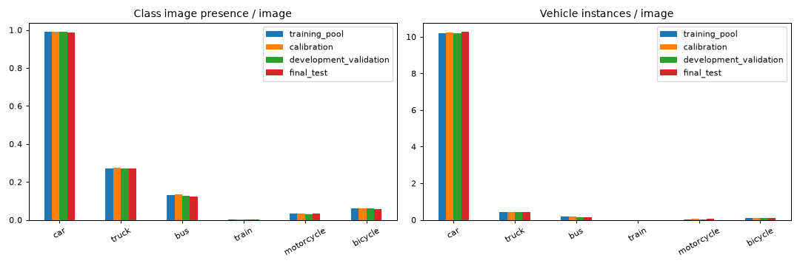
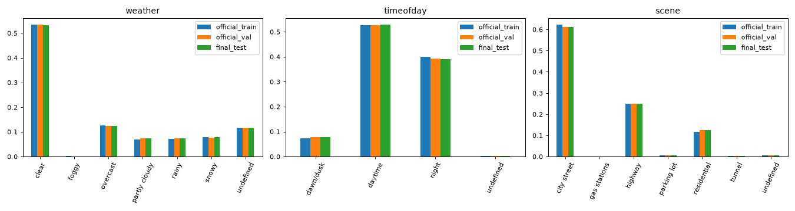
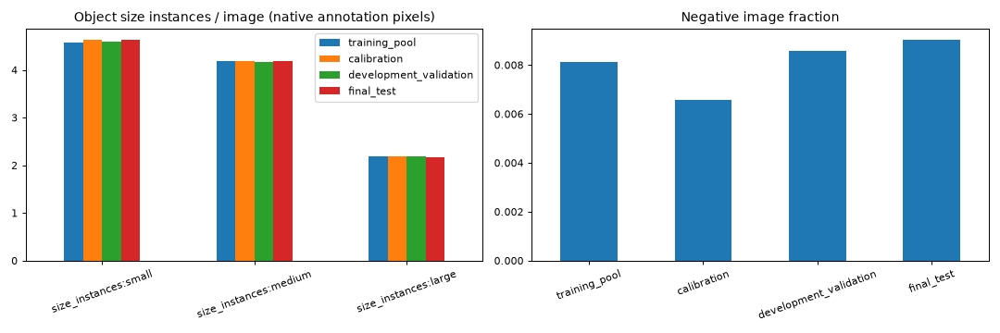
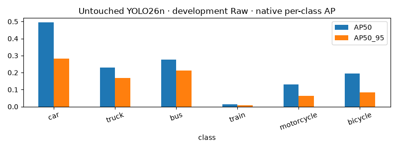

# Issue #5: data protocol and pretrained YOLO26n baseline

This implements the first child of [parent #4](https://github.com/truong51972/vehicle-detection/issues/4).
The execution uses real local BDD2018 data and CUDA. No fine-tuning or final-test
performance evaluation is part of this issue. PR #3's YOLO11 results are historical.

## Migration and provenance

The checkout matches upstream `main` at `d06d05c60799ab900ef7de08ad1bcea37d182009`.
The owner moved data/artifacts from `/mnt/d/Projects/vehicle-detection` to
`/home/truong51972/projects/vehicle-detection` before this work. Repairs updated
65 copied environment launcher/editable references, reinstalled the editable
project, and repaired **71,457 absolute artifact symlinks**, including two directory
links. No targets remain missing. No source datasets were moved by the implementation.
The repair inventory is local `runs/wsl-migration.json`.

Python 3.11.14, torch 2.15.0+cu132, Ultralytics 8.4.198 and CUDA load from WSL.
The GPU is an RTX 5060 Ti with 16,311 MiB reported VRAM. About 769 GiB was free on
the WSL filesystem at preflight. The original 18 tests passed after repair.
The historical YOLO11 notebook's existing local outputs were preserved, and its
source cells were not changed. Old YAML/manifests/checkpoint arguments retain
original paths and identity; the new protocol uses an independent root.

## Frozen populations and exclusions

Discovery found **69,863 official-train records/images and 10,000 official-val
records/images**, with no missing files. All train images were decoded and hashed;
all selected train boxes passed geometry checks. One duplicate vehicle box is
excluded consistently with the native converter, leaving **765,201 train vehicle
instances** and **563 negative train frames**.

The new roles are:

- **Training pool:** 48,903 images, 535,597 vehicle instances, 397 negative frames.
- **Calibration:** 6,985 images, 76,809 instances, 46 negative frames.
- **Development validation:** 13,975 images, 152,795 instances, 120 negative frames.
- **Final test reserved:** 9,730 images, 106,939 annotation instances, 88 negative frames.

The former **9,904** untouched-ID count was provisional. Starting from 10,000,
the new audit excludes **96 prior exposures**, **169 additional frames sharing
inferred groups with those exposures**, and **5 frames sharing an inferred group
with official train**. These are disjoint exclusion reasons. All 270 exclusions
are enumerated in [the protocol summary](issue5/protocol_summary.json).
No test images were opened, decoded, hashed, exported, previewed or evaluated.
Val geometry is audited against the BDD2018 annotation canvas (1280×720), not
verified image headers.

Allocation targets the natural 70/10/20 proportions of official train, preserving
whole groups. It chooses the minimum train-only marginal drift across 64 seeded
permutations (seed 2026). Features include class image presence and instances,
negative images, object sizes, weather, time of day, scene and intersections.
The exact allocation reproduced from reversed full-manifest input order.

There were no reliable explicit video IDs in the source records: **all 79,863
records use inferred BDD filename-prefix groups**. Exact byte duplicates and equal
64-bit dHash candidates are merged transitively with those groups within train.
One repeated byte hash and two repeated dHashes were detected; there are **42,109
training allocation groups**. Cross-role IDs/groups/train-content fingerprints
are disjoint. This is best-effort sequence protection, not proof of all-video or
all-near-duplicate isolation. Cross-official content duplicates remain unverified
until controlled final-test release.

The previous 55,890 train / 13,973 tune assignment is explicitly superseded:
old train contributes 39,051 training-pool / 5,638 calibration / 11,201 development
images; old tune contributes 9,852 / 1,347 / 2,774 respectively. These transitions
are provenance, not reuse of the old trained model or its selection decisions.

## Distribution and rare-support evidence

The largest absolute class-presence/condition/negative marginal deviation from
official train is approximately **1.04 percentage points** (calibration daytime).
There is no forced class/weather balancing. Final-test statistics never enter
allocation scoring or policy/model selection.

The train class has only **136 objects in 105 official-train images**. Development
contains **21 objects in 17 images**; calibration has **16 in 13 images**. Its AP is
therefore unstable despite being present. Development has just **one gas-station
image**, and many condition intersections have fewer than five samples.
These are explicitly flagged; their reporting falls back to parent marginals
rather than inventing support or drawing separate subgroup conclusions.
Undefined/missing metadata is retained and counted: official train includes
8,119 unknown-weather, 137 unknown-time and 361 unknown-scene frames.

## Immutable artifacts and Raw export

The complete manifest is local `runs/issue5-v1/protocol.json` (about 174 MB), with
relative paths, image/label/annotation hashes, boxes, groups, metadata and exclusions.
Its identity is `b308ba62bca6c59f167ae2fa39026a80eece8b542a99d544d7e5b3c079395186`.

Version-controlled evidence is compact:

- [Membership with every ID, role and group key](issue5/split_membership.csv.gz)
  (gzip CSV; readable in notebook 01); SHA256
  `02c532371deae481582f9c9083a7a0f54c0fe4ded937513e5cf4b3925b6e8376`.
- [Protocol summary](issue5/protocol_summary.json): sources, algorithm/code hash,
  exclusions, counts, drift/support diagnostics, historical transitions and
  deep-verified Raw export identity.
- [Executed notebook 01](../notebooks/phase2/01_data_protocol.ipynb): audits,
  charts, native conversion, 0.01-pixel box roundtrips and export verification.

Only development Raw was materialized. Raw has **no enhancement**, with JPEG
quality 95 for a common encoding contract with future Adaptive exports. All
13,975 development images and labels passed deep verification. Training,
calibration and final-test export directories remain empty. New code uses the
existing native conversion/export helpers; no new metric engine or CLI is added.

## Pretrained development validation

Execution evidence is recorded in [the baseline summary](issue5/pretrained_baseline.json)
and [executed notebook 03](../notebooks/phase2/03_finetuning_benchmark.ipynb).

Executed on **2026-11-03** with CUDA device 0, retaining **13,975 images**.
The pinned, untouched YOLO26n release checkpoint SHA256 is
`9b09cc8bf347f0fc8a5f7657480587f25db09b34bf33b0652110fb03a8ad4fef`.
Its [release source](https://github.com/ultralytics/assets/releases/download/v8.4.0/yolo26n.pt) and all software/hardware identities are recorded in the JSON.

- **mAP50:95: 0.13636196** (13.6362%).
- **mAP50: 0.22331069**.
- **Precision: 0.37901972; recall: 0.24388511**.

Per-class AP50:95 (all six classes have support):

- car: **0.28246474**, 142,541 instances in 13,820 images.
- truck: **0.16694395**, 5,965 instances in 3,773 images.
- bus: **0.21232416**, 2,276 instances in 1,759 images.
- train: **0.00902441**, 21 instances in 17 images.
- motorcycle: **0.06248465**, 562 instances in 435 images.
- bicycle: **0.08492984**, 1,430 instances in 872 images.

These are development observations, not final-test estimates or evidence of an
Adaptive improvement. The very small train-class support warrants particular caution.
Precision/recall follow native best-F1 curve selection; confidence 0.001 is the
inference floor, not a claim that these P/R values use a fixed 0.001 operating point.

Protocol: Ultralytics 8.4.198, imgsz 640, batch 32, FP32, confidence 0.001, IoU 0.7,
max detections 300, rectangular batches, no augmentation, seed 2026, workers 8.
**`nms=False` explicitly selects the one-to-one end-to-end head**; runtime confirmed
`end2end=True`, `max_det=300`, `device=cuda:0`. The COCO-80 head/names remain unchanged;
postprocessed vehicle predictions are mapped by checked semantics before native
matching/AP/confusion matrices. No optimizer step was taken.

The checkpoint hash was unchanged after validation and after completed-result
reuse. Identity-checked cache reuse passed in notebook 03. Native PR/confusion
plots are embedded there; their hashes are recorded with the result.

Native exported-file average stage timing was 0.219 ms preprocessing,
1.086 ms inference and 0.598 ms postprocessing per image.
This is batched native validation timing, not batch-1, offline enhancement or
application end-to-end latency. No deployment-throughput claim is made.

## Checks and remaining boundary

`pytest -q`: **27 passed**, including actual native fixture conversion, semantic
mapping through native postprocessing/matching/AP, split reproducibility and
integrity, duplicate grouping, exposure-group exclusion, rare/absent supports,
stale/moved paths, and rejection of final-test exports before pixel verification.
Notebook checks inspect actual execution status and compile cells. Ruff lint,
format, source/wheel builds and `git diff --check` pass. These are local checks;
GitHub CI and review status are tracked separately on the pull request.

Issue #6 Adaptive calibration/nested subsets, #7 partial fine-tuning and #8 final
benchmark remain separate work. No final-test metrics or deployment-latency claim
is made. Full pixel/content checks against the final test must be completed at
its locked release; nonzero-distance near duplicates remain a disclosed limit.
