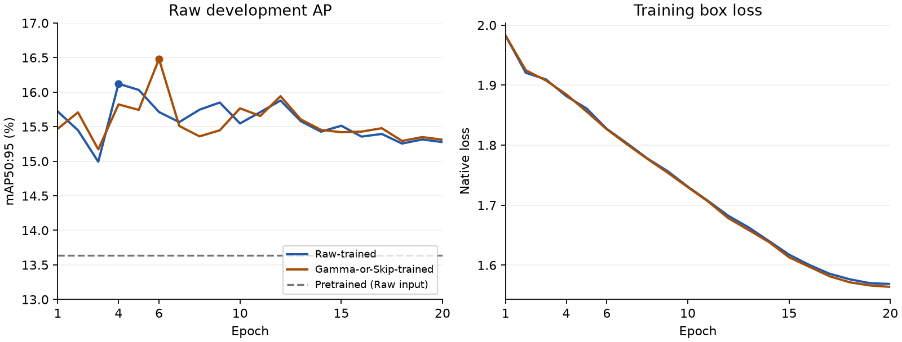

# Issue #7: completed paired S10 training

Both full YOLO26n S10 branches completed on **2026-11-03**, independently from
the same pinned pretrained checkpoint, on the same RTX 5060 Ti. Raw and frozen
**Gamma-or-Skip** training used the same **4,890 image IDs and labels**, seed 2026,
20 epochs, batch 16, imgsz 640, FP32, AdamW and disabled image augmentation.
Both consumed **1,746 optimizer steps** and used the same **13,975-image Raw
development set** for checkpoint selection. Neither run resumed or stopped early.

This completes the paired S10 training milestone, not all of
[issue #7](https://github.com/truong51972/vehicle-detection/issues/7).
The full model/input matrix, uncertainty analysis and scale/model selection
remain pending. Final-test pixels remain untouched.

## Development results

All values below use **Raw development inputs**, with the fixed native
NMS-free validation protocol described in the
[implementation record](ISSUE7_IMPLEMENTATION.md). These are saved epoch metrics,
not a new validation execution. Exact points, histories, settings, completion
receipts and checkpoint hashes are in [s10_results.json](issue7/s10_results.json).

- **Pretrained baseline:** mAP50:95 **13.6362%**, mAP50 **22.3311%**;
  precision **37.9020%**, recall **24.3885%**. The saved issue #5 baseline checksum,
  checkpoint identity, protocol and development-file identity were verified.
- **Raw-trained best, epoch 4:** mAP50:95 **16.122%**, mAP50 **27.519%**;
  precision **60.184%**, recall **25.210%**.
- **Gamma-or-Skip-trained best, epoch 6:** mAP50:95 **16.479%**, mAP50 **27.873%**;
  precision **54.207%**, recall **27.246%**.
- **Raw-trained epoch 20:** mAP50:95 **15.277%**, mAP50 **26.555%**.
- **Gamma-or-Skip-trained epoch 20:** mAP50:95 **15.312%**, mAP50 **26.607%**.

Best-epoch mAP50:95 exceeds pretrained by **2.486 / 2.843 percentage points** for
Raw / Gamma-or-Skip. The observed best-epoch Adaptive lead is **0.357 points**;
at the matched final epoch it is **0.035 points**. The best checkpoints were
selected independently using the same metric and equal full training budgets.
These single-seed point estimates do not establish a reliable Adaptive advantage.
Native precision/recall use best-F1 curve selection, not a fixed operating threshold.

The launcher also ran native final validation of each saved `best.pt`; logs round
mAP50:95 to **0.161 / 0.165**. Checkpoints contain the saved epoch metrics above;
do not treat their displayed decimals as an exact revalidation of stripped weights.

## Convergence and measured costs

Both branches peak early, at epochs 4 and 6, while training box/class losses keep
falling. From best to epoch 20, development mAP50:95 drops **0.845 / 1.167 points**.
This suggests overfitting or a generalization plateau; simply extending this
training schedule has little support from these curves. No early-stop budget
advantage was used in the comparison.

- **Raw:** native training plus per-epoch validation **27.91 min**; training-only
  time **618.14 s**; aggregate training pipeline **158.22 images/s**; peak CUDA
  allocation **2.348 GiB**.
- **Gamma-or-Skip:** native training plus per-epoch validation **26.04 min**;
  training-only time **585.47 s**; aggregate training pipeline **167.05 images/s**;
  peak CUDA allocation **2.348 GiB**.
- **Sequential launcher:** **58.0 min**, including input checks and final native
  best-checkpoint validation; 14:57:24–15:55:24 UTC.

Aggregate throughput is 97,800 training image presentations divided by summed
training seconds. It includes training GPU work and reads pre-exported images;
offline enhancement cost and isolated loader throughput are excluded. Native
epoch timing excludes setup and final best-checkpoint validation. Peak allocation
is not reserved or total device memory. Sequential wall-time differences alone
do not establish a preprocessing performance advantage.

## Integrity and provenance

Experiment ID:
`236a2aa99ec38c1ad6a3b1ebfc74ae355305d5496a50ade5b98489c37a0726aa`.
Training implementation commit: `a853add1743f158381270266a375402eca690743`.
Full local artifacts remain under gitignored `runs/issue7-s10-v2/`.

- Both completion checksums, run identities and **all 50 recorded artifact
  hashes** passed verification, including best/last weights and all 40 epoch
  records. Both histories contain 20 complete finite rows and matched budgets.
- Both six-class initial state hashes match. The architecture freezes **11
  backbone modules**, with **1,365,472 frozen / 1,170,844 trainable parameters**.
  Runtime audits verify nonzero neck/head gradients and actual weight updates;
  epoch checks enforce unchanged backbone parameters and buffers.
- For each branch's best and last checkpoint, all **240 backbone state tensors**
  match pretrained values at the checkpoint's stored dtype. This supplements
  runtime checks; native completed checkpoints store quantized weights.
- Pre-training deep verification established exact paired IDs, labels, source
  hashes, geometry and shared development membership. No dataset pixels or model
  inference were revisited for this reporting update.

Best checkpoint SHA256:

- Raw: `c0364e37b0cac7fa5093fc10f06d6c259253fe8135cd427ded53d03c6b493b73`.
- Gamma-or-Skip: `669cfbbb06f5f0606f564bc65607dee5219f5a8a9bbb2a9c0200e2ad757cacb1`.

The saved notebook's baseline cells/outputs remain intact. Full training used
the existing runner through an external sequential launcher; notebook training
cells remain unexecuted, rather than containing reconstructed execution outputs.

## Remaining decisions and limits

The next evidence needed is pretrained / Raw-trained / Gamma-or-Skip-trained ×
Raw-input / Adaptive-input development validation, with supported per-class AP,
weather/time/scene slices and paired group uncertainty. The train class has only
21 development objects in 17 images, so overall AP cannot replace support-aware
review. One training seed does not quantify seed variability.

Expansion/model-selection rules were **not declared before full S10 outcomes
became visible**. These outcomes must be treated as exploratory for scale
selection; a rule chosen now cannot be called predeclared for S10. Declare rules
before further confirming experiments, then justify symmetric S20 expansion or
stopping and freeze checkpoint(s), data scale and policy for #8.
No S20 run, final model freeze or final-test release is claimed here.
