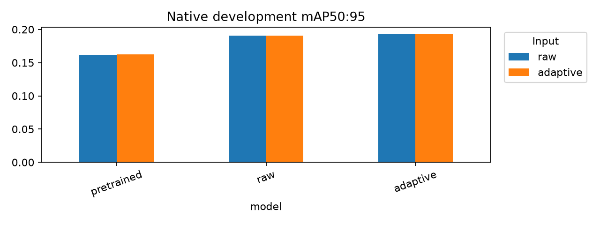
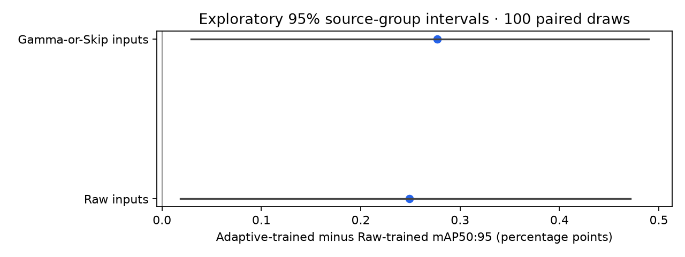
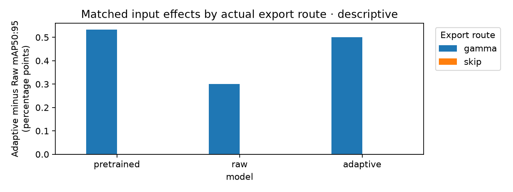
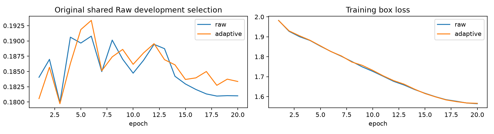

> Historical workflow record. Current entrypoints and replay paths: [issue 41 migration](../HISTORICAL_REPLAY.md).

# Five-class S10 development evaluation — issue #22

All six development cells evaluated the same **13,975 images, 8,258 source groups
and 152,774 five-class GT objects**, including all **121 negative frames**. Native
Ultralytics matching/AP uses the frozen JPEG95 exports, Gamma-or-Skip v2 and
identical FP32 inference settings. No new real training or final-test inference ran.
The [plan](PLAN.md) was recorded before these evaluations, after the S10 training
curves and epoch-6 checkpoint selections were already known.

## Development evidence

mAP50:95 with **Raw / Gamma-or-Skip inputs**, respectively:

- Pretrained COCO→five: **0.16182946 / 0.16216251**.
- Raw-trained S10: **0.19075607 / 0.19085975**.
- Gamma-or-Skip-trained S10: **0.19324790 / 0.19363086**.

Both trained models improve on the new five-class pretrained baseline. The
Adaptive-trained minus Raw-trained point difference is **+0.2492 percentage
points on Raw inputs** and **+0.2771 points on Adaptive inputs**. Changing the
input treatment within a fixed model changes macro AP by only **+0.0104 to
+0.0383 points** here. These are descriptive single-seed development results.
Exact AP50, precision/recall, per-class metrics, stage timings and cache/artifact
hashes are in [matrix.json](matrix.json), [per_class.csv](per_class.csv) and
[all seven paired differences](paired_differences.csv).

[Paired uncertainty](paired_uncertainty.json) records 100 seeded paired
source-group draws for each trained-model contrast, fixed eligible class targets,
valid/invalid draws and per-class intervals. All five classes were eligible and
all 100 draws were valid for each contrast. Macro delta intervals, in percentage
points, are **[+0.0183, +0.4714] on Raw** and **[+0.0295, +0.4898] on Adaptive**
inputs. Both are positive; most individual-class intervals still cross zero.
Nominal 95% percentile intervals
describe development-group variability, conditional on class presence, with no
multiplicity correction. They do not measure training-seed uncertainty or establish
a confirmed Adaptive advantage.

On Raw inputs, Adaptive training raises bus and motorcycle AP while slightly
lowering car and bicycle AP. Do not turn the macro point difference into a claim
that every class benefits. Do not compare these five-class macro scores with the
[historical six-class study](../DEVELOPMENT_RESULTS.md) as proof of improvement:
the class denominator and model heads differ. No common-five historical model
comparison was run.

## Actual Gamma/Skip routes: matched inference-input effects

The review follow-up reads **actual frozen Adaptive export `decisions`**, not a
new router or a night proxy. All route IDs belong to the frozen development
population and pair with the Raw export, with equal source hashes, labels,
geometry and JPEG95 controls. [Full-population route counts](route_populations.csv):

- **Gamma applied: 3,307 images (23.6637%), 2,286 source groups.**
- **Skip: 10,668 images (76.3363%), 6,720 source groups.**

Images partition exactly; 748 groups contain images from both routes, so route
group counts are not additive. The earlier CPU sample's 30/128 Gamma count is
not the population prevalence estimate.

[Time-of-day cross-tab](route_timeofday.csv), Gamma / Skip image counts:

- Night: **3,280 / 2,355**.
- Daytime: **20 / 7,276**.
- Dawn/dusk: **6 / 1,019**.
- Undefined: **1 / 18**.

Thus 99.18% of Gamma-applied images are night images, but 2,355 night images were
assigned Skip. **Night is context, not the actual brightness<0.12 Gamma route.**

On the **same 3,307 Gamma IDs** for each fixed model, all five GT classes are
present. Native Raw → Adaptive **mAP50:95 / mAP50**:

- Pretrained: **0.09704660 → 0.10238297 / 0.17623210 → 0.18355817**;
  mAP50:95 delta **+0.5336 percentage points**.
- Raw-trained: **0.14741678 → 0.15042493 / 0.26584644 → 0.26998578**;
  mAP50:95 delta **+0.3008 points**.
- Adaptive-trained: **0.14745082 → 0.15246382 / 0.26261287 → 0.26939947**;
  mAP50:95 delta **+0.5013 points**.

The **Skip control is exact for all three models**: all 10,668 paired recorded
JPEG hashes agree, every saved native TP/confidence/predicted-class/GT-class
array agrees, and both AP deltas are exactly zero. See
[Skip checks](route_skip_control.csv). This isolates the observed input changes
to Gamma-applied images rather than a Skip encoding or pairing difference.

[Matched route/time-of-day results](route_comparisons.csv) also show positive
Gamma∩night mAP50:95 deltas of **+0.6732 / +0.3711 / +0.5032 points** for the
three models, respectively; Skip∩night deltas remain zero. The descriptive gain
concentrates on the actual Gamma population, which is predominantly night.
Only 27 Gamma images are outside night, split into tiny strata; no robust
daytime/night contrast or general Gamma benefit is established.

All comparisons keep the same source IDs and GT-supported class target on both
input sides. [Per-class AP and support](route_classes.csv) retain absent AP as
undefined and label fewer than five source groups insufficient. Full Gamma
support includes only 63 motorcycle objects in 54 groups and 98 bicycle objects
in 67 groups. Tiny contextual slices can have different represented-class
denominators; do not compare their macro AP levels to infer a condition effect.
Precision/recall use native subset max-F1 operating points above confidence
0.001; failure examples below use confidence 0.25 / IoU0.50.

**Route deltas are descriptive, with no route-specific uncertainty or robust
causal claim.** These compare inference inputs with weights held fixed. The
earlier **+0.2492–0.2771-point training-branch difference** compares different
checkpoints on the overall population and must not be attributed to inference
Gamma. AP is nonlinear: prevalence-weighting the route AP deltas does not
reconstruct the overall AP delta.

Notebook 04 reproduces the route tables/plot from metadata and cached matches,
then reuses `routes-v1/summary.json`. [Route provenance](route_provenance.json)
and [validation](route_validation.json) record the inputs and guarded replay.
No new inference, training, pixel reads, routing or final-test access was needed;
101 protected overall/historical/checkpoint/lock files retained hashes and
timestamps. The original six-cell evidence and candidate lock are unchanged.

## Support, sizes and failures

Overall instances / image presence / source groups:

- Car: **142,541 / 13,820 / 8,198**.
- Truck: **5,965 / 3,773 / 3,043**.
- Bus: **2,276 / 1,759 / 1,549**.
- Motorcycle: **562 / 435 / 408**.
- Bicycle: **1,430 / 872 / 794**.

All five classes pass the overall five-group engineering gate. Natural
weather/timeofday/scene slices retain their original prevalence. Class support
below five groups is marked insufficient; absent AP stays undefined. Slice macro
AP uses represented GT classes, so tiny slices with differing denominators are
descriptive. See [conditions](conditions.csv) and
[class-level slice support](slice_class_support.csv).

[Object-size support](object_size_support.csv) counts actual boxes using
original-pixel areas **<32² / 32²–96² / ≥96²**. Size AP slices select images
containing each size, overlap, and retain all GT/predictions. **They are not
object-area-restricted AP**, and have no size-specific intervals. No custom
matching/IoU engine was introduced.

[Failure rankings](failures.json) give missed-object and false-positive counts
at display confidence 0.25 and IoU0.50; native metrics retain confidence 0.001.
Crowded frames dominate count rankings, which are not an unbiased failure-rate
sample. Inspect the saved native GT/prediction batches and confusion matrices in
the executed notebook for visual context; images remain local and gitignored.
[Three plotted examples](representative_failures.json) identify the exact native
batch/tile: `00f42f6b-b1ca1f6c` retains 23 missed objects under both trained models,
while `00f89335-2ef7949d` retains 20. The crowded/distant vehicles remain a failure
mode despite fine-tuning; these selected examples do not establish prevalence.

## Costs and learning curves

Both branches used 4,890 S10 images, native freeze=11, the same original pinned
pretrained initialization and 20 epochs. Both selected epoch 6 on shared Raw
development validation. Native training-plus-validation elapsed segments sum to
**1,477.653 s Raw / 1,439.300 s Adaptive**. Raw resumed with a time-column reset;
the report sums segments rather than treating its final time value as total cost.
These times exclude offline export and time spent between runs.

On the RTX 5060 Ti, native model inference means were approximately
**1.13–1.22 ms/image** at batch32/imgsz640. Native stage means exclude offline
enhancement, disk preparation and application I/O. The six full evaluator calls
also include deep export verification, plots and result/statistic serialization;
their wall times must not be labeled pure inference speed.

A separate [CPU cost sample](preprocessing_cost.json) used 128 seeded development
source images × three repeats, eight warmup images, one OpenCV thread and
alternating branch order. Raw / Adaptive decode+recipe+in-memory JPEG95:
**p50 6.561 / 7.036 ms**, **p95 7.772 / 10.231 ms**. Recipe-only p50 was
**3.225 / 3.441 ms**, p95 **3.912 / 7.078 ms**. The sample routed 30 images to
Gamma and skipped 98. Raw recipe timing includes the existing quality extraction;
it is not an optimized pass-through deployment baseline. Decode was shared per
paired source. Warm-cache sample timings exclude disk writes, hashes, labels,
model/GPU work and online application I/O. They are not full-export throughput,
deployment p50/p95 or peak-VRAM measurements. Instrumented/resumed #20 export
timings were not reused as performance evidence.

Hardware/software are recorded in [environment.json](environment.json).

## Reproduction and subsequent holdout scope

Notebook [04](https://github.com/truong51972/vehicle-detection/blob/51687b273e7e87b5315d84f5b67202d4cc746992/notebooks/04_eval_and_report.ipynb) defaults to these five-class
paths, saved-result reuse and zero bootstrap draws. Setting
`BOOTSTRAP_RESAMPLES=100` reuses the saved uncertainty analysis. New inference
still requires `ALLOW_INFERENCE=True`; no training/upstream phase is invoked.
The full saved evaluations, matches, 100-draw analysis and executed notebook live
under ignored `runs/development-five-v1/`. Compact files here
preserve numeric evidence and provenance; they do not replace the local match and
checkpoint artifacts needed for replay.

All six aggregate AP metrics were reproduced from saved native matches. The
fresh-kernel cache-only Run All blocks model construction/inference, training,
upstream phases and analysis recomputation, and checks unchanged saved evaluation
and checkpoint files. [Validation receipts](validation.json) record those checks.
The original full suite passed **107 tests**; the route follow-up passes
**110 tests**, including partition/pairing, subset AP, cache-only reuse and an
unexpected Skip-match regression. Ruff lint/format and package build pass.

The [development candidate lock](candidate_lock.json) retains pinned pretrained
plus **both** S10 best checkpoints and frozen v2; no winner, S20 expansion or
retuning is selected. This follows the single-seed evidence and early shared-Raw
peaks. [Proposed issue #8 scope](ISSUE8_SCOPE.md) changes the subsequent target to
five classes and identifies the remaining final protocol/deployment/synthetic
robustness decisions. **All 9,730 reserved final-test IDs remain sealed.** The
development lock is not a final-test release, and no remote issue was closed.
