# Đọc nhanh: nghiên cứu đang đi đến đâu? {#sec-summary}

**Mục tiêu:** kiểm tra liệu xử lý ảnh trước khi đưa vào YOLO26n có giúp phát
hiện phương tiện tốt hơn không, đặc biệt trong ảnh tối, suy giảm chất lượng
và cảnh có xe máy/xe đạp nhỏ. Hướng tăng độ phân giải được đo riêng để phân
biệt lợi ích từ chi tiết đầu vào với lợi ích từ bộ lọc.

Báo cáo này tổng hợp evidence đã lưu tại revision **`7527187`**, bao gồm cả
thí nghiệm Adaptive S20/960 post-hoc sau pilot âm. Nội dung là một tài liệu
tự chứa: định nghĩa, công thức xử lý, quần thể, thiết lập và kết quả cần thiết
đều được giải thích ở đây, không yêu cầu đọc mã nguồn.

::: {.callout-important}
## Kết luận chính

1. **Chưa có chính sách preprocessing nào chứng minh đủ điều kiện thay Raw.**
   Gamma-or-Skip gần như ngang Raw trên S20; local-shadow kém hơn ở chỉ tiêu
   chính và tốn CPU hơn. Hai pilot adaptive mới đều không qua các gate đã đặt.
2. **Tăng resolution có tín hiệu lớn hơn các bộ lọc đã thử.** Trên full S20,
   train/infer 960/960 đạt **24.5684% mAP50:95**, so với **20.6124%** ở
   640/640. Nhưng thay đổi đường chéo này gồm cả training lẫn inference.
3. **Đã train một mô hình Adaptive S20/960 riêng**, khởi tạo độc lập từ COCO.
   Pipeline này đạt **24.5255%**, chưa cho thấy lợi ích tổng thể so với Raw960
   **24.5684%**, và giảm AP của motorcycle/bicycle.
4. Tất cả kết quả trained hiện tại là **một seed, trên development đã dùng
   chọn checkpoint**. Không có kết quả final-test; không có policy được
   xác nhận độc lập hay công bố thay thế.
:::

Quy ước: dấu `.` là dấu thập phân; số lượng lớn phân cách bằng khoảng trắng.
AP trong bảng là **phần trăm**. Chênh lệch AP dùng **điểm phần trăm**, viết
tắt **pp**: từ 20% lên 21% là +1 pp, không phải +1% tương đối.

| Nhánh nghiên cứu | Quần thể đánh giá | Kết quả nổi bật | Cách diễn giải |
|---|---|---|---|
| Raw / Gamma-or-Skip / local-shadow S20/640 | 13 975 development | 20.6124 / 20.6879 / 20.4930% mAP50:95 | Gamma gần ngang Raw; không promote local-shadow |
| Raw train 640 vs 960, cùng infer 960 | Cùng 13 975 development | 22.3980 → 24.5684%; +2.1705 pp | Tín hiệu tốt có điều kiện; dark-bus còn bất định |
| Gamma/Sharpen adaptive pilot | 1 027 calibration-exploration | +0.0063 pp so với Skip | Dừng: gain, uncertainty, regression và support không đạt |
| Local-contrast adaptive pilot trên Raw960 | 1 479 calibration-exploration | +0.1475 pp; CI cắt 0 | Dừng trước confirmation; không đạt bốn gate |
| Adaptive-trained S20/960 post-hoc | 13 975 development | D−B −0.0123 pp; D−A −0.0429 pp | Chưa có lợi ích tổng thể; xe hai bánh giảm AP |

: Bản đồ kết quả. Không xếp hạng AP tuyệt đối giữa calibration và development. {#tbl-overview}

Các tên v0/v1/v2 là **ID thí nghiệm**, không phải thứ hạng chất lượng.
Đặc biệt, tên lịch sử **“Adaptive v2” là Gamma-or-Skip, tương ứng v1 hiện tại**;
nó không phải local-shadow v2. “Round 3” của tìm kiếm lịch sử cũng không đồng
nghĩa với policy v3 hiện tại.

# Dữ liệu và ranh giới đánh giá {#sec-data}

## Nguồn, ảnh và nhãn

Dữ liệu là BDD100K, từ bộ ảnh/annotation BDD2018 hiện có tại máy thực nghiệm:
**69 863 ảnh official train** và **10 000 record official validation**.
Không thay số quan sát này bằng con số danh nghĩa 70 000.

Các ảnh train/development của nghiên cứu hiện tại có kích thước gốc
**1280 × 720**, ba kênh màu 8-bit. Dữ liệu bao gồm ngày, đêm, bình minh/hoàng
hôn; nhiều thời tiết và loại đường. Nghiên cứu giữ phân bố tự nhiên, không
ép cân bằng lớp hay oversample lớp hiếm theo kết quả mô hình.

Taxonomy hiện tại gồm đúng năm lớp:

| ID dùng trong mô hình | Nhãn | Ý nghĩa |
|---|---|---|
| 0 | car | Ô tô |
| 1 | truck | Xe tải |
| 2 | bus | Xe buýt |
| 3 | motorcycle | Xe máy |
| 4 | bicycle | Xe đạp |

Nghiên cứu lịch sử từng có thêm **railway train**. Khi chuyển sang năm lớp,
chỉ box railway bị loại; box còn lại giữ nguyên tọa độ và ảnh vẫn giữ nguyên
role/ID. Ảnh không còn box nào vẫn là **negative image**, không bị bỏ.
Không được diễn giải việc bỏ một lớp khỏi mẫu số macro AP là mô hình tốt lên.

Annotation gốc được chuyển qua định dạng BDD/Scalabel, COCO rồi YOLO native.
Kiểm tra round-trip box có sai số cho phép **0.01 pixel**. Có một box phương
tiện trùng được loại nhất quán theo bộ chuyển đổi native. Nhãn YOLO biểu diễn
tâm và kích thước box chuẩn hóa theo chiều rộng/cao ảnh; các nhánh xử lý dùng
cùng byte nhãn, không crop, dịch chuyển hay resize annotation ngoại tuyến.

## Bốn role được đóng băng

| Role | Số ảnh | Số nhóm leakage canonical | Mục đích |
|---|---:|---:|---|
| Training pool | 48 903 | 29 615 | Nguồn chọn các subset train |
| Calibration | 6 985 | 4 236 | Khảo sát, xây giả thuyết, exploration/confirmation |
| Development validation | 13 975 | 8 258 | Chọn checkpoint và đánh giá development có điều kiện |
| Final test reserved | 9 730 | 5 836 | Chưa mở để đánh giá hiệu năng cuối |

: Các role hiện tại; tổng cộng 79 593 ID được giữ trong bảng split. {#tbl-roles}

Official train được chia xấp xỉ **70/10/20** cho training pool/calibration/
development, seed **2026**. Thuật toán thử 64 hoán vị nhóm và chọn phân bổ có
drift biên thấp dựa trên dữ liệu train: sự hiện diện/số box mỗi lớp, kích
thước đối tượng, ảnh âm, thời tiết, thời điểm, cảnh và một số giao điều kiện.
Nhóm không bị cắt chỉ để đạt đúng tỷ lệ.

Final reservation bắt đầu từ 10 000 official-val records, loại **96 ảnh đã
expose**, **169 ảnh cùng nhóm với exposure** và **5 ảnh cùng nhóm với official
train**, còn 9 730. Annotation của final có thể được dùng như metadata để
kiểm tra role/support; **pixel, header, source-image hash, preview, export và
prediction final-test chưa được thu thập**.

Không có video ID đáng tin cậy trong nguồn. Nhóm được suy từ tiền tố tên
BDD; exact byte duplicates và các ứng viên dHash bằng nhau được union bắc
cầu với nhóm nguồn trong official train. Đây là chống leakage theo dữ liệu
hiện có, **không chứng minh đã tách mọi video hay mọi near-duplicate**.
So trùng nội dung qua official-train/final chưa được hoàn tất vì final bị niêm
phong.

“Nhóm leakage canonical” có thể union nhiều “source group” gốc. Vì vậy số nhóm
trong bootstrap/class support không nhất thiết bằng số nhóm ở @tbl-roles.
Một source group cũng có thể xuất hiện ở cả hai cohort ảnh Apply/Skip.

## Subset S10 và S20

| Subset | Ảnh | Nhóm leakage | Negative images | Trạng thái |
|---|---:|---:|---:|---|
| S10 | 4 890 | 2 974 | 34 | Lịch sử, đã train 20 epoch |
| S20 | 9 781 | 5 915 | 73 | Subset chính cho các thí nghiệm hiện tại |

S10 nằm hoàn toàn trong S20. Tên “20” nghĩa là khoảng 20% của **training pool
48 903 ảnh**, không phải 20% toàn BDD100K. Chọn subset dùng 128 thứ tự nhóm
seeded, tối thiểu hóa drift của cả hai subset theo các đặc trưng train nêu
trên, không dùng AP/development để chọn ảnh. Sai lệch biên lớn nhất được báo
cáo ở bước chọn lịch sử là khoảng 1.870 pp cho S10 và 0.699 pp cho S20.
Membership vẫn giữ nguyên sau khi chuyển taxonomy.

| Lớp | Box train S20 | Box development | Ảnh development có lớp | Source groups development |
|---|---:|---:|---:|---:|
| car | 100 236 | 142 541 | 13 820 | 8 199 |
| truck | 4 106 | 5 965 | 3 773 | 3 043 |
| bus | 1 572 | 2 276 | 1 759 | 1 549 |
| motorcycle | 432 | 562 | 435 | 408 |
| bicycle | 1 080 | 1 430 | 872 | 794 |
| **Tổng box** | **107 426** | **152 774** | Không cộng vì một ảnh có nhiều lớp | Không cộng |

: Support năm lớp của full-S20 và development hiện tại. {#tbl-class-support}

Development có **121 negative images**. Car chiếm khoảng 93.3% box development;
motorcycle và bicycle có ít support hơn nhiều. Macro AP cho mỗi lớp trọng số
bằng nhau, còn tổng TP/FP/FN bị car chi phối.

## Calibration đã dùng đến đâu?

Các vòng calibration không phải các “test set” có thể tái dùng vô hạn. Việc
chọn phương pháp dựa trên một quần thể làm quần thể đó trở thành **consumed
exploration**, kể cả khi không đưa ảnh vào gradient training.

- Có các exposure Gamma calibration, synthetic screening, tìm kiếm routing,
  local-shadow và Gamma/Sharpen trong lịch sử.
- Pilot Gamma/Sharpen dùng 1 027 ảnh mới so với các vòng gần đó, nhưng không
  được gọi là holdout chưa từng expose trong toàn lịch sử.
- Pilot local-contrast mới rà lại exposure ledger rộng hơn, lấy toàn bộ
  **1 479 ảnh / 926 source groups exploration còn hợp lệ** sau loại trừ
  theo ID, leakage/source/content group. Pool exploration còn lại này nay
  đã được sử dụng hết.
- Một confirmation Denoise lịch sử đã chạy và thất bại. Những reservation
  confirmation chưa dùng của các giai đoạn sau vẫn không được mở bởi các
  pilot mới hay post-hoc training.

Không được tái gắn nhãn những ảnh exploration đã xem là “independent
confirmation”, hoặc tiếp tục chỉnh threshold rồi báo lại trên cùng chúng.

# Quy trình ảnh và các phương pháp xử lý {#sec-methods}

## Hợp đồng chung: original → transform → JPEG95

Mỗi nhánh bắt đầu từ **ảnh gốc đã decode**, tính feature/routing từ pixel,
áp đúng transform, rồi encode **JPEG quality 95 một lần** cho đầu vào mô hình.
Raw cũng encode JPEG95 để kiểm soát tác động codec. Adaptive không được chạy
trên một bản Raw đã tái encode rồi encode thêm lần nữa.

Ảnh Skip phải có byte JPEG giống Raw khi dùng cùng nguồn/encoder. Các nhánh
giữ nguyên ID, width/height, box, negative images và thứ tự lớp. Transform
không thay ảnh nguồn. Dữ liệu export và cache native thuộc thư mục mới,
không ghi đè export/checkpoint lịch sử.

Đây là **preprocessing offline** trước dataloader, không phải filter động
trong vòng train. Khi suy luận trên ứng dụng thực tế, chi phí transform sẽ
phải cộng lại; native detector timing đọc ảnh đã export không chứa khoản đó.

## Feature chất lượng dùng để quyết định route

Trước khi đo feature, ảnh được giảm kích thước giữ tỷ lệ sao cho cạnh dài
nhất không quá **512 pixel**, nội suy area, rồi đổi sang grayscale:

| Feature | Định nghĩa | Giới hạn cần nhớ |
|---|---|---|
| Brightness | Mean grayscale / 255 | “Tối” theo pixel không đồng nhất với metadata “night” |
| Contrast | Độ lệch chuẩn grayscale / 255 | Contrast toàn ảnh không cho biết contrast trên chiếc xe |
| Sharpness | Phương sai Laplacian grayscale | Texture cũng làm tăng chỉ số; không phải chuẩn đo blur vật lý |
| Noise median-residual | Median của trị tuyệt đối phần dư so với median filter 3×3, chia 0.6745×255 | Có thể bằng 0 trên ảnh có noise; không phải noise sensor đã hiệu chuẩn |
| Black fraction | Tỷ lệ grayscale ≤3 | Cảnh tối có thể chứa vùng mất thông tin không thể cứu |
| White fraction | Tỷ lệ grayscale ≥252 | Tín hiệu clipping toàn ảnh, không phát hiện mọi kênh màu bão hòa |

Một số tìm kiếm lịch sử còn dùng high-pass noise toàn độ phân giải trên
grayscale chuẩn hóa về [0,1]: trung bình trị tuyệt đối đáp ứng kernel
`[[1,-2,1],[-2,4,-2],[1,-2,1]]`, chuẩn hóa
theo hệ số 6 và căn bậc hai của pi/2. Đơn vị này **khác** noise median-residual;
không dùng threshold của estimator này cho estimator kia.

Router của mọi phương pháp chỉ dùng **pixel**, không nhận GT, weather/time,
ID ảnh, scenario corruption hay prediction của detector. GT/metadata chỉ được
join sau đó để phân tích. Một feature phân biệt được corruption chưa có nghĩa
là nó dự đoán đúng **filter có giúp detection hay không**.

## v0 — Raw

Không tăng sáng, khử nhiễu hay sharpen. Chỉ giữ hợp đồng decode/encode JPEG95.
Đây là đối chứng chính: một phương pháp phức tạp phải cải thiện detection đủ
để bù chi phí và không làm hỏng lớp/cohort ưu tiên.

## v1 — Gamma-or-Skip

Nếu **brightness <0.12**, áp Gamma **0.85**; còn lại Skip. Với giá trị kênh
8-bit `x`, bảng tra là `floor(255 × (x/255)^0.85)`, cắt về [0,255].
Gamma nhỏ hơn 1 nâng các mức tối, giữ nguyên hình học.

Policy lịch sử ban đầu từng cho phép CLAHE trên số ảnh ít; bản được dùng
trong trained comparison đã disable CLAHE/Denoise/Sharpen vì thiếu support.
Trên mẫu calibration 256 ảnh, Gamma có 65 ảnh eligible và 12 candidate để
chọn mức; CLAHE chỉ có 5, Denoise/Sharpen không có candidate eligible.
Ngưỡng minimum 12 là gate kỹ thuật, không phải đảm bảo thống kê.

Vì vậy **không mô tả v1 như một adaptive router bốn bộ lọc**. Đó là Gamma
hoặc Skip. Việc mọi ảnh đã xử lý cải thiện proxy loss chất lượng không tự
chứng minh tăng AP.

## v2 — Local-shadow gain

Ý tưởng là tăng sáng theo vị trí thay vì một Gamma toàn ảnh:

1. Giảm ảnh về cạnh dài tối đa 512, chuyển grayscale.
2. Gaussian blur với sigma **16** tạo trường illumination mượt.
3. Chuẩn hóa illumination về [0,1] và tính gain:
   `clip(sqrt(0.25 / max(illumination, 0.0625)), 1, 2)`.
4. Resize trường gain về kích thước gốc bằng bilinear.
5. Nhân từng kênh ảnh gốc với gain, cắt [0,255], chuyển uint8.

Gain chỉ nâng sáng trong khoảng **1×–2×**; giữ detail gốc nhưng có thể
khuếch đại noise, đổi saturation và không khôi phục chi tiết đã mất.
Đây là một operator cố định, không phải mạng enhancement được học.
Pilot và thí nghiệm S20 về sau là hai câu hỏi riêng, không dùng S20 để
viết lại một pilot thất bại thành đạt.

## v3 lịch sử — Route exposure/detail Gamma → Sharpen

Hai tín hiệu trên **ảnh gốc**:

- **E (exposure):** brightness <0.18, contrast <0.20, black fraction <0.10,
  noise ≤0.01.
- **D (detail):** 50 ≤ sharpness <150, noise ≤0.01.

E-only áp Gamma 0.85; D-only áp unsharp amount **0.15**, Gaussian sigma **1**;
cả hai áp **Gamma rồi Sharpen**; không tín hiệu nào thì Skip.
Unsharp kết hợp ảnh và bản Gaussian theo `1.15×ảnh − 0.15×ảnh_mượt`, có cắt
giá trị 8-bit. Severe low-sharpness được Skip thay vì giả định sharpen khôi
phục thông tin đã mất.

Bốn arm Skip/exposure/detail/full-route dùng cùng original routes để kiểm
tra thành phần và thứ tự đã định, không tìm reverse-order sau khi xem AP.
Pilot này được giữ riêng với local-contrast ở phần tiếp theo.

## v3 hiện tại — Adaptive local contrast có giới hạn

Router Apply chỉ khi **đồng thời** thỏa:

- contrast **<0.20**;
- **0.04 < brightness <0.80**;
- noise **≤0.01**;
- black fraction **<0.30**;
- white fraction **<0.10**.

Không thỏa thì Skip. Operator trên ảnh full-resolution:

1. Lấy grayscale `Y`, áp CLAHE clip limit **1.5**, grid **8×8**, được `E`.
2. Tính protection `clip(min(Y−8, 247−Y)/32, 0, 1)`.
3. Offset là `round(clip(0.5×(E−Y), −12, 12) × protection)`.
4. Cộng cùng offset vào B, G, R và cắt từng kênh về [0,255].

Transform có thể **nâng hoặc hạ** cường độ; mỗi kênh đổi tối đa 12 mức.
Grayscale ≤8 hoặc ≥247 được bảo vệ hoàn toàn. Always-on control dùng đúng
operator nhưng bỏ router; Raw không đổi pixel.

**Giới hạn màu:** cộng cùng offset chỉ giữ chênh lệch kênh khi không xảy ra
gamut clipping. Ví dụ BGR (0,160,255) có thể thành (2,162,255): kênh đỏ đã
bão hòa nên không tăng cùng hai kênh còn lại. Không gọi đây là transform
“chroma-preserving tuyệt đối”, và protection grayscale không bảo vệ mọi
highlight có một kênh màu bão hòa.

## Những họ bộ lọc khác đã khảo sát

| Họ | Cơ chế và các mức chính đã thử | Rủi ro/giới hạn |
|---|---|---|
| Gamma | 0.70, 0.775, 0.85 để nâng sáng; 1.3 để hạ sáng trong screening lịch sử | Khuếch đại vùng tối/noise, không cứu clipping |
| CLAHE | Cân bằng histogram cục bộ trên luminance; clip 1.2/1.5/2.0, grid 8 | Texture/noise tăng; gain trên veil tổng hợp không chứng minh gain trên sương thật |
| Colored NLM | Non-local means, strength 2 hoặc 5, template 7, search 21 | Mất detail nhỏ và chi phí CPU cao |
| Bilateral | Lọc giữ biên, d=5, sigmaColor=25, sigmaSpace=3 | Noise proxy cũng phản ứng texture; hiệu quả không transfer ổn định |
| Unsharp | Sigma 1, amount 0.075/0.15/0.4 | Halos, khuếch đại texture; không đảo được motion blur |
| Percentile stretch | Stretch luminance LAB từ percentile 1 đến 99 | Clipping/biến đổi contrast có thể hại cảnh clean |
| Ordered pairs | Gamma↔CLAHE, Gamma↔Denoise, Sharpen↔Bilateral | Thứ tự quan trọng; hai filter không mặc nhiên tốt hơn một |
| Quality routing | Rule brightness/contrast/noise/sharpness, first-match, fallback Skip | Tối ưu trên exploration có thể overfit; không phải detector-benefit oracle |

# Thiết lập training và evaluation {#sec-protocol}

## Mô hình và training recipe

Mô hình chính là **YOLO26n**, khởi tạo từ cùng checkpoint COCO-80 đã pin.
Mapping COCO→năm lớp dùng native validator; các model trained có head năm
lớp. Mỗi arm bắt đầu **độc lập từ checkpoint COCO**, không tiếp tục từ
checkpoint trained của arm đối chứng.

| Thiết lập | Giá trị |
|---|---|
| Seed | 2026; deterministic=True |
| Epoch budget full | 20; không early-stop để rút budget |
| Batch | 16; nominal batch size nbs=64 |
| Precision | FP32; AMP=False |
| Optimizer | AdamW; lr0=0.001, lrf=0.01, cosine schedule |
| Warmup | 3 epoch; warmup bias LR=0 |
| Weight decay | 0.0005 |
| Freeze | 11 module đầu theo boundary kiến trúc native |
| Train geometry | Square 640 hoặc 960; rect=False |
| Train fraction/cache | Toàn subset đã chọn; không image cache |
| Augmentation detection | Tắt HSV, geometry, flips, mosaic, mixup, cutmix, copy-paste, multi-scale và augmentation bổ sung |
| Workers | S20/640 lịch sử: 8; resolution/post-hoc: 0 |
| Initialization | Cùng YOLO26n COCO; không tiếp tục từ Raw-trained |

Native optimizer/scheduler/EMA sở hữu vòng tối ưu. Tỷ lệ nbs/batch là 4,
nhưng accumulation trong warmup do native trainer điều khiển, không khẳng
định mỗi bước optimizer luôn đúng bốn minibatch từ đầu.

Budget 20 epoch là thiết lập so sánh đã đóng băng, **không phải bằng chứng
mọi mô hình đã hội tụ tối ưu**. Không tự tăng epoch, đổi batch/AMP, tìm seed
hay đổi optimizer sau khi thấy kết quả.

## Checkpoint được chọn như thế nào?

Các arm S20/640 lịch sử chọn checkpoint trên cùng **Raw development**, không
chọn mỗi mô hình trên input domain riêng. Sau đó đánh giá model trên policy
phù hợp. Vì thế “selection AP” và “policy-matched evaluation AP” là hai số khác.

Trong full-resolution và post-hoc study, cả hai arm đều được chọn bằng
Raw development **actual cạnh dài 640**, rectangular **pad=0**, batch32,
native fitness/best checkpoint. Epoch được chọn là Raw640 **9**, Raw960
**10**, Adaptive960 **12**. Model này giữ cố định qua các ô evaluation.

| Vai trò | Nominal size | Pad | Tensor đã quan sát |
|---|---:|---:|---|
| Selector mới, cả hai training sizes | 640 | 0 | 384×640 |
| Matrix inference 640 | 640 | 0.5 | 384×672 |
| Matrix inference 960 | 960 | 0.5 | 576×992 |
| Training 640 / 960 | 640 / 960 | Square train | 640×640 / 960×960 |

Pad=0 của selector mới khác padding lịch sử. Vì vậy selector mới không phải
bản sao hoàn toàn của selector S20/640 cũ, dù nguyên tắc dùng Raw được giữ.
**Epoch tốt nhất theo Raw640 không mặc nhiên tốt nhất theo Adaptive960.**

## Metrics: AP khác operating-point counts

- **IoU:** diện tích giao chia diện tích hợp giữa prediction box và GT.
- **AP50:** diện tích dưới đường precision–recall tại matching IoU 0.50.
- **AP50:95:** trung bình AP ở mười matching IoU 0.50, 0.55, …, 0.95.
- **mAP:** trung bình đều theo năm lớp, không theo số box của lớp.
- **TP/FP/FN minh họa:** confidence ≥0.25, matching IoU 0.50, native one-to-one
  matching. Recall=TP/(TP+FN); precision=TP/(TP+FP).

Evaluation giữ FP32, batch32, workers0, confidence thấp **0.001**, max_det300,
rectangular loading, seed2026 và NMS-free. Tham số native `iou=0.7` của cấu
hình validator **không thay thế** dải matching IoU dùng tính AP.

Precision/recall native được chọn theo F1 không nhất thiết ở confidence
0.25. Không so chúng với bảng counts như thể cùng operating point. AP tăng
và TP tại 0.25 giảm có thể cùng đúng: ranking, calibration confidence và
localization thay đổi. Không cộng AP hay tính AP riêng cho từng ảnh.

## Cohort và uncertainty

- **Dark:** brightness <0.12; bright là phần bù, không phải metadata night.
- **Low sharpness:** Laplacian variance <50; đây là pixel-defined cohort,
  không phải ground truth của blur vật lý.
- **Small-two-wheeler image cohort:** ảnh chứa ít nhất một box motorcycle/
  bicycle có diện tích gốc <32² pixel; giữ **mọi GT** trong ảnh.
- **Apply/Skip:** route thật đã đóng băng trên original pixels, không gán
  theo day/night hoặc theo prediction.

Các cohort có thể overlap. Image-cohort AP **không phải COCO AP-small**.
S20/640 cũ đo brightness trên original pixels có 3 307 ảnh dark; các nghiên
cứu full-resolution/post-hoc dùng cùng Raw-JPEG feature cache có 3 308.
Đó là hai định nghĩa đo đã lưu khác nhau ở biên threshold, không tráo cohort
khi so sánh trong một study.

Paired bootstrap lấy nguyên **source group có hoàn lại**, dùng cùng draw
cho hai arm, rồi tính lại dataset AP. Class target được cố định theo
support trước phân tích; draw thiếu lớp bắt buộc bị đánh dấu invalid,
không điền AP=0 và không bốc lại để làm CI đẹp hơn.

Mức tối thiểu năm source groups chỉ là engineering floor, không phải bảo
đảm precision thống kê. Các CI 95% là percentile interval **có điều kiện
trên model/quần thể/lớp hiện diện**; không bao phủ training-seed uncertainty,
quy trình chọn model hay multiplicity của nhiều phép thử.

# Bằng chứng lịch sử: điều gì đã được thử và vì sao dừng? {#sec-history}

Phần này tránh lặp lại các hướng đã thất bại, nhưng không gộp các objective,
taxonomy và quần thể khác nhau thành một bảng xếp hạng AP chung.

## Giai đoạn YOLO11 và chuyển sang năm lớp

Snapshot YOLO11n trước protocol hiện tại có 55 890 train / 13 973 tune,
mAP50:95 epoch đầu **15.715%**. Đó chỉ là một epoch của budget tối đa 100,
taxonomy/split/model khác; **không phải completed baseline** để so với
YOLO26n hiện tại.

Thí nghiệm YOLO26n sáu lớp S10 từng có matrix pretrained, Raw-trained,
Gamma-trained với Raw/Gamma input. Nó được thay bằng nghiên cứu năm lớp
do railway quá ít support; không suy ra hiệu năng tăng chỉ vì macro mẫu số
đã đổi.

## Synthetic screening ban đầu

Mẫu calibration **256 ảnh / 158 nhóm**, taxonomy sáu lớp, 45 datasets. Stress
giữ nguyên GT/hình học, mỗi nhánh original→corruption→restore→JPEG95:

| Corruption | Mild / medium / severe | Điều không được suy diễn |
|---|---|---|
| Shot/read noise | Photons 800/200/50; read sigma 0.003/0.008/0.02 sau inverse gamma 2.2 | Không phải raw sensor/ISP đã hiệu chuẩn |
| Motion blur | Line PSF 5/11/21 pixel; hướng cố định theo ID | Không bao quát mọi chuyển động camera/đối tượng |
| Defocus | Disk radius 1/2/4 pixel | Không phải mô hình optics đầy đủ |
| Underexposure | Exposure factor 0.7/0.45/0.25 trong pseudo-linear space | Không cứu được chi tiết đã clipping |
| Overexposure | 1.3/1.7/2.3, có clipping | Tối lại không khôi phục thông tin đã mất |
| Veil/low contrast | Blend về mức 0.9 với alpha 0.1/0.25/0.4 | Không phải sương depth-aware |

CLAHE trên veil medium là shortlist duy nhất theo phân tích đã sửa:
**supported-five-class AP 17.7199 → 19.1555%**, tăng **1.4356 pp**, CI
**[+0.3985, +2.9012] pp**, restore p95 **8.898 ms**. Đây là screen trên ảnh
đã dùng chọn operator, không phải xác nhận lợi ích trên natural fog hay router.

Railway chỉ có một source group; bootstrap v1 thiếu lớp này ở 43/100 draw,
làm macro target thay đổi giữa năm/sáu lớp. Bản corrected giữ năm lớp có
support cố định và dùng lại prediction cũ; **CI v1 không còn là bằng chứng
hiện hành**. Không có inference mới để “sửa” điểm số.

Một final stress matrix 42 evaluation từng được đề xuất; đó chỉ là
specification chưa chạy, không phải kết quả final-test.

## Round 2: filter grid và ordered pairs

Hai mươi treatment trên mười scenario: clean và ba mức mỗi họ underexposure,
noise, motion. Primary objective cân đều **bốn family**, rồi cân đều severity
trong mỗi họ synthetic; không đại diện prevalence triển khai.

Grid gồm hai đối chứng Skip/Gamma-or-Skip; Gamma0.70/0.85; CLAHE1.2/2.0;
NLM2/5; Sharpen0.15/0.4; Bilateral; Percentile; hai thứ tự Gamma↔CLAHE1.2,
Gamma↔NLM2, Sharpen0.15↔Bilateral; và hai brightness/noise routing hypotheses.

| Giai đoạn | Quần thể | Skip | Gamma-or-Skip | NLM strength 5 |
|---|---|---:|---:|---:|
| Exploration | 256 ảnh / 155 nhóm | 18.2089% | 18.2237% | **18.8825%** |
| Confirmation | 260 ảnh / 156 nhóm | 16.7337% | 16.8230% | **16.2714%** |
| Development transfer cố định | 256 ảnh / 146 nhóm | 12.3886% | 12.3942% | 12.3742% |

: Family-balanced mAP50:95; chỉ so treatment trong cùng một hàng. {#tbl-denoise}

Exploration leader NLM5 tăng **+0.6588 pp so với Gamma-or-Skip**, nhưng
confirmation giảm **−0.5516 pp**, CI **[−1.4674, +0.0919] pp**. Các tolerance
clean/noise/class cũng thất bại. CPU confirmation NLM5 khoảng **165.7 ms/ảnh**,
so với Gamma-or-Skip 3.2 ms và Skip0.21 ms trong cùng phép đo.
Tổng 260 native evaluations / 66 680 image passes được giữ; không thay
runner-up sau confirmation để tìm một “winner”.

Ordered pairs cũng không mặc nhiên giúp: Sharpen0.15→Bilateral đạt
18.2984%, đảo thứ tự đạt 18.1687%; Gamma0.70→CLAHE1.2 đạt 17.4456%,
đảo thứ tự 17.0762%, đều dưới Skip trong exploration objective này.

## Quality search rồi kiểm tra transfer sang nhóm mới

Search dùng threshold quantile của feature, first-match rules, fallback Skip,
ghép prediction đã đo theo từng ảnh rồi tính AP **trên toàn dataset**.
Không gán AP cho từng ảnh. Bản mở rộng có 19 measured actions; thêm
Gamma0.775, Sharpen0.075 và Sharpen0.075→Bilateral không tạo winner mới.

Exploration route đứng đầu: contrast >0.2335527894 → Sharpen0.15→Bilateral;
nếu không thì high-pass noise <0.0016339057 → Gamma0.70; còn lại Skip.
Family-balanced AP **18.5643%**; direct CPU mean bình quân scenario
**4.38 ms**, worst-scenario p95 **7.73 ms**, đạt cost gate.
Tuy vậy trên clean, route có **923 TP/216 FP**, so với Skip **929/212**:
AP gain nhỏ không đồng nghĩa không hại cảnh clean.

Sentinel round tiếp theo cố định năm scenario, dùng **256 ảnh cũ +256 ảnh
mới**, báo riêng cohort mới. Trên ảnh mới:

| Arm | Sentinel family-balanced mAP50:95 |
|---|---:|
| Raw/Skip | 13.54089% |
| Gamma-or-Skip | 13.60626% |
| Route exploration nói trên | 13.59006% |
| Static bilateral | 13.41345% |
| Noise-range bilateral | 13.54876% |

Route hơn Gamma-or-Skip **+0.59575 pp trên cohort cũ**, nhưng **−0.01621 pp
trên cohort mới**, CI mới **[−0.24858, +0.32628] pp**. Pool hai cohort sẽ che
failure-to-transfer này. Không treatment đạt useful-improvement gate nên
dừng sau **25 evaluations /12 800 image passes**, không chạy phần mở rộng.
Noise-range nhận ra noise regime nhưng không dự đoán được benefit detector.

## Five-class S10: kết quả trained lịch sử

Hai arm train 4 890 ảnh, 20 epoch, cùng best epoch6:

| Detector | Raw development input | Gamma-or-Skip development input |
|---|---:|---:|
| COCO pretrained → năm lớp | 16.1829% | 16.2163% |
| Raw-trained S10 | 19.0756% | 19.0860% |
| Gamma-trained S10 | 19.3248% | 19.3631% |

: mAP50:95 trên cùng 13 975 development. {#tbl-s10}

Giữ input cố định, khác training arm tăng khoảng +0.2492/+0.2771 pp;
100-draw CI có điều kiện lần lượt **[+0.0183,+0.4714]** /
**[+0.0295,+0.4898] pp**. Không có training-seed uncertainty.

Trên 3 307 ảnh Gamma-applied, input Gamma tăng AP cho cả ba model, nhưng
Skip giữ AP/counts chính xác. Trong số đó 3 280 ảnh là night, trong khi có
2 355 ảnh night vẫn Skip. Không coi mọi ảnh night là route Gamma.

Raw S10 có native resume sau epoch12; checkpoint best được chọn trước
interruption. Native train/val seconds **1 477.653 Raw /1 439.300 Gamma**
không bao gồm downtime/partial work. Việc xác minh reuse về sau **không
phải một training replicate mới**.

# S20/640: Raw, Gamma-or-Skip và local-shadow {#sec-s20}

## Kết quả toàn development

Cùng 9 781 training IDs, 13 975 development IDs, năm lớp/GT/negatives,
20 epoch, batch16, seed2026, input640. Checkpoint chọn trên chung Raw
development, rồi đánh giá mỗi detector trên policy tương ứng.

| Nhánh | Selected epoch | mAP50 | mAP50:95 | Δ AP50:95 so với Raw |
|---|---:|---:|---:|---:|
| v0 Raw | 9 | 35.1576% | 20.6124% | 0 |
| v1 Gamma-or-Skip | 10 | 35.2484% | 20.6879% | +0.0755 pp |
| v2 local-shadow | 9 | 35.3136% | 20.4930% | −0.1194 pp |

| Lớp | Raw AP50:95 | Gamma AP50:95 | Local-shadow AP50:95 |
|---|---:|---:|---:|
| car | 35.5443% | 35.4385% | 35.6586% |
| truck | 25.0262% | 24.8216% | 24.5748% |
| bus | 24.8998% | 24.8195% | 24.6158% |
| motorcycle | 7.7450% | 8.1438% | 7.4628% |
| bicycle | 9.8465% | 10.2159% | 10.1531% |

Gamma hơn Raw rất ít ở macro, chưa có bằng chứng đủ để khẳng định ưu thế đáng
tin cậy. Local-shadow có mAP50 nhỉnh hơn nhưng **primary mAP50:95 thấp hơn
cả Raw lẫn Gamma**. Không chọn một metric thuận lợi sau khi primary thất bại.

## Cohort và chi phí

| Cohort theo original-pixel features | Số ảnh | Raw | Gamma | Local-shadow |
|---|---:|---:|---:|---:|
| Dark | 3 307 | 16.3610% | 16.6475% | 16.7199% |
| Bright | 10 668 | 21.2454% | 21.3616% | 21.1073% |
| Small-two-wheeler image cohort | 412 | 18.5495% | 18.3581% | 17.9643% |
| Low sharpness | 122 | 13.1655% | 12.0708% | 11.8310% |

Các ô là cohort AP50:95. Low-sharpness macro chỉ có **bốn lớp quan sát**;
không có bicycle GT, bus/motorcycle chỉ một source group mỗi lớp.
Dark motorcycle AP giảm **4.8689 →2.8760 →2.5007%** dù dark macro tăng nhẹ.

| Nhánh | CPU preprocessing mean /p95 | Native train-history time | Notebook train wall |
|---|---|---:|---:|
| Raw | 2.428 /2.940 ms | 2 051.38 s | 2 141.959 s |
| Gamma | 2.794 /4.605 ms | 2 102.97 s | 2 177.362 s |
| Local-shadow | 13.627 /16.382 ms | 2 046.66 s | 2 115.316 s |

CPU đo cùng 256 ảnh exploration đã dùng, tám OpenCV threads, ba repeat,
rotated order; gồm quality diagnostics, không gồm read/JPEG/detector.
Local-shadow khoảng **5.6× Raw** ở mean trong phép đo này. Không suy diễn
thời gian training gần nhau là preprocessing miễn phí: filter đã chạy offline.

Pilot local-shadow trước training dùng 256 ảnh/136 nhóm, frozen pretrained:
Raw 15.7103%, Gamma 15.7223%, local 15.8248%. Gain local **+0.1145 pp so với
Raw** thấp hơn gate +0.2; CI **[−0.5926,+0.6592] pp**; mean CPU 11.117 ms
vượt gate 10 ms và dark-car regression vượt tolerance. Declaration đã hash-bind
trước đo nhưng chưa commit riêng trước acquisition; hạn chế provenance này
không được xóa bằng thí nghiệm S20 đã commit prospectively về sau.

::: {layout-ncol=3}
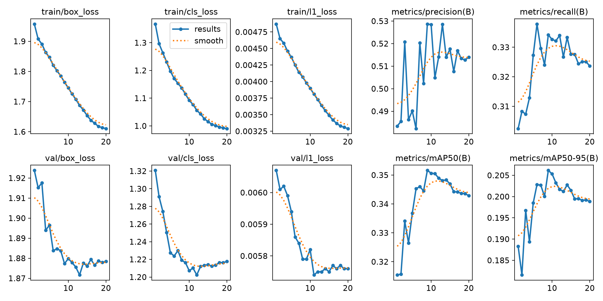{#fig-s20-raw}

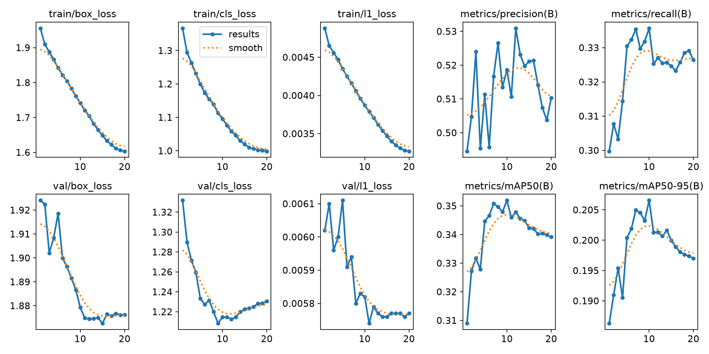{#fig-s20-gamma}

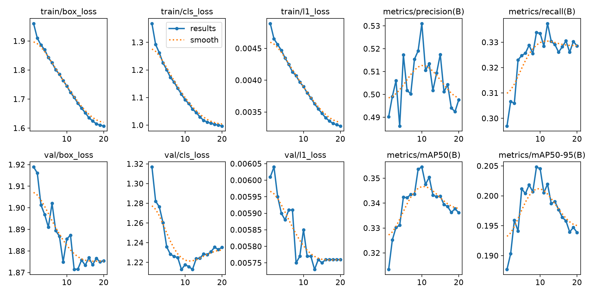{#fig-s20-shadow}
:::

Các chart là selection history trên Raw development, không thay thế các
policy-matched evaluation trong bảng. Trục AP gốc của chart dùng fraction 0–1.

# Gamma/Sharpen pilot và chẩn đoán resolution {#sec-resolution}

## Pilot exposure/detail: hiệu quả gần bằng không

Trên **1 027 ảnh /649 source groups** calibration-exploration, frozen
pretrained detector, nominal 640:

| Arm | mAP50:95 | mAP50 |
|---|---:|---:|
| Skip | 16.904200% | 28.076839% |
| Exposure component | 16.909368% | 28.135048% |
| Detail component | 16.906175% | 28.084783% |
| Full route Gamma→Sharpen | 16.910513% | 28.137235% |

Gain full-route **+0.006313 pp**, CI100-draw **[−0.095116,+0.115024] pp**,
thấp hơn +0.2 gate. Route chia E-only 164 ảnh, D-only 63, both 19, Skip 781.
Ba nhánh xử lý đều thiếu support năm lớp theo yêu cầu; truck regression
ở E-only vượt tolerance. Cost full-route 2.266/3.083 ms mean/p95 đạt gate,
nhưng không thể cứu accuracy/support gates.

Chẩn đoán saved GT/matches cho thấy phần lớn motorcycle/bicycle nằm ở ảnh
bright và bị route Skip; global darkness không bao phủ phần lớn failure.
Cache không lưu matched GT index hay box geometry prediction, nên không thể
gán kích thước/độ tối cho từng **box thực sự bị miss**.

## Tăng inference size trên cùng frozen model

Giữ nguyên 1 027 ảnh đã consumed, Skip JPEG95 bytes, GT và pretrained model:

| Inference size | mAP50:95 | mAP50 |
|---|---:|---:|
| 640 | 16.904200% | 28.076839% |
| 960 | 19.276913% | 31.366105% |

Gain **+2.372712 pp**, CI100-draw **[+1.360202,+3.961617] pp**.
Đây là tín hiệu exploratory trên dữ liệu đã dùng, không independent confirmation.
Motorcycle/bicycle TP tại confidence 0.25 vẫn **1/14** dù AP tăng; resolution
chưa chứng minh đã giải quyết missed-object coverage của hai lớp này.

## Short training diagnostic: 2 048 ảnh, năm epoch

Hai model độc lập, cùng 2 048 S20-prefix training images/1 244 groups, năm
epoch, cố định **last checkpoint**, đánh giá trên 1 027 ảnh exploration:

| Train /infer | mAP50:95 | mAP50 |
|---|---:|---:|
| 640 /640 | 20.219447% | 33.981616% |
| 640 /960 | 22.842672% | 39.693852% |
| 960 /640 | 19.252958% | 31.965879% |
| 960 /960 | 23.756023% | 39.668199% |

Giữ inference 960, thêm training 960 được **+0.913351 pp**, nhưng CI 100-draw
**[−0.081883,+1.778887] pp** cắt 0. Dark-bus giảm **7.766145 pp** trên 16 GT/
16 source groups, vượt tolerance. Không promote từ diagnostic này.

Attempt đầu hoàn thành hai train run nhưng lỗi API trong evaluation/reporting;
attempt repeat được yêu cầu và khai báo riêng trước chạy. Kết quả trên là
repeat, không chọn attempt thuận lợi và không gọi cùng seed/population là
replicate độc lập. Năm epoch có ba warmup epoch, không phải full convergence.

## Full-S20, 20 epoch: matrix training/inference resolution

Thí nghiệm mới dùng toàn S20, cùng Raw JPEG95, fixed-640/pad0 selector.
Đánh giá trên toàn development; không so trực tiếp hiệu ứng của nó với short
diagnostic để gán gain cho riêng số ảnh hay số epoch.

| Ô | Train | Infer nominal | mAP50:95 | mAP50 |
|---|---:|---:|---:|---:|
| A | 640 | 640 | 20.612379% | 35.157592% |
| B | 640 | 960 | 22.397992% | 38.957322% |
| C | 960 | 640 | 20.311641% | 34.379856% |
| D | 960 | 960 | 24.568446% | 41.600479% |

: Full-S20 resolution matrix, một checkpoint cố định mỗi training arm. {#tbl-resolution}

- **B−A +1.7856 pp:** chỉ tăng inference size trên Raw640-trained.
- **D−B +2.1705 pp:** training960 bổ sung, giữ inference960.
- **C−A −0.3007 pp:** training960 khi inference640 không tốt hơn.
- **D−A +3.9561 pp:** thay cả hai yếu tố; không gán toàn gain cho training.
- **Interaction +2.4712 pp:** training effect phụ thuộc inference size trong
  thiết lập đã đo; không suy ra cơ chế nhân quả cho từng box.

Primary D−B CI 1 000-draw **[+1.7727,+2.6196] pp**. All/dark/bright đều
1 000 valid/0 missing-class draw. Đây là CI có điều kiện, không training-seed CI.

| Lớp | B: AP50:95 | D: AP50:95 | D−B | CI95% D−B, pp |
|---|---:|---:|---:|---|
| car | 39.247% | 41.038% | +1.791 | [+1.698,+1.889] |
| truck | 26.344% | 28.804% | +2.460 | [+1.829,+3.105] |
| bus | 25.809% | 27.735% | +1.926 | [+0.868,+3.058] |
| motorcycle | 7.780% | 11.090% | +3.311 | [+2.050,+4.725] |
| bicycle | 12.810% | 14.175% | +1.366 | [+0.497,+2.343] |

Ở confidence 0.25, TP/FP/FN **85 335/28 800/67 439 →83 620/20 743/69 154**.
FP giảm 27.98%, nhưng TP cũng giảm 2.01%.

**Dark-bus vẫn inconclusive:** 163 GT/129 source groups; AP tăng 0.170 pp,
CI **[−2.952,+3.415] pp**, nhưng TP 40→31, FN 123→132. Positive primary CI
không xóa được mâu thuẫn coverage này. Frozen assessment giữ `inconclusive`.

## Convergence và chi phí resolution

| Arm | Selected epoch | Selector peak /last AP50:95 | Training wall | Peak allocated /reserved VRAM |
|---|---:|---|---:|---|
| Raw640 | 9 | 20.864 /20.042% | 65.679 min | 2.347 /2.775 GiB |
| Raw960 | 10 | 20.824 /20.135% | 91.176 min | 5.239 /5.545 GiB |

Training wall 960/640 **1.388×**; allocated VRAM khoảng 2.23×. Train loss tiếp
tục giảm sau epoch 9/10 nhưng selector AP giảm: tăng epoch không tự đảm bảo
generalization tốt hơn. Các run hoàn thành 20 epoch, không recovery/resume hay
batch reduction.

::: {layout-ncol=2}
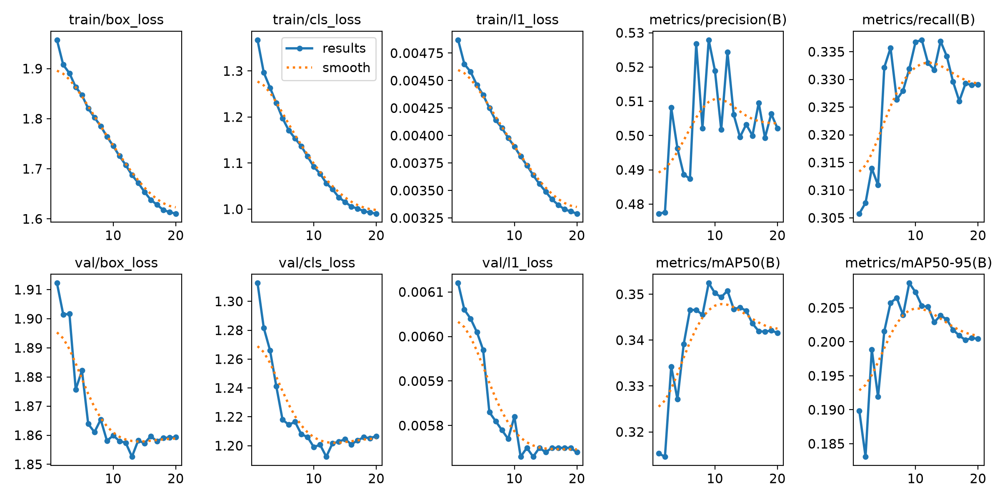{#fig-resolution-640}

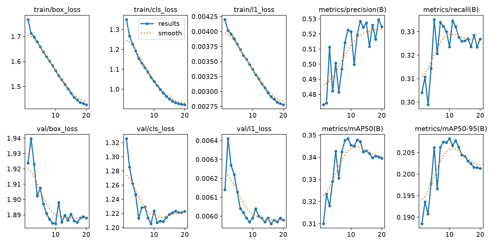{#fig-resolution-960}
:::

| Train/infer | Native inference ms/ảnh | Validation-call wall | Throughput trong call | Batch mean /p95 |
|---|---:|---:|---:|---|
| 640/640 | 1.0314 | 83.660 s | 167.046 ảnh/s | 98.054 /121.588 ms |
| 640/960 | 2.4761 | 120.638 s | 115.843 ảnh/s | 152.948 /170.861 ms |
| 960/640 | 1.0306 | 82.484 s | 169.427 ảnh/s | 96.277 /121.099 ms |
| 960/960 | 2.4820 | 121.706 s | 114.826 ảnh/s | 155.187 /176.701 ms |

Mỗi call có 437 batches. Inference-only ở 960 khoảng 2.4×640; validation throughput
không phải nghịch đảo của inference-only vì có setup/I/O/metrics. Batch p95
không phải per-image p95 và không phải deployment SLA.

Hai train arm và matrix đo tổng wall **163.663 min**, không phải GPU busy
time hay end-to-end notebook wall. CPU bootstrap từng bị ngắt rồi tiếp tục
chỉ từ matches đã lưu; continuation mất **65.065 min** trên ba worker.
Preparation 137.7 s và attempt CPU ngắt trước đó ít nhất 40.880 min wall là
khoản riêng. Không có train/inference bổ sung trong continuation.

# Local-contrast pilot trên trained Raw960 {#sec-local-pilot}

## Thiết kế và kết quả

Đây là pilot mới, dùng checkpoint Raw960 **đã train S20**, không phải
pretrained COCO của pilot Gamma/Sharpen. Có **1 479 ảnh/926 source groups**,
12 negative images, 16 181 GT; ba arm Raw/always-on/adaptive, infer 960.
Plan/operator/membership đã commit trước acquisition.

| Arm | mAP50:95 | mAP50 |
|---|---:|---:|
| Raw | 26.011103% | 43.738080% |
| Always-on local contrast | 26.034995% | 43.778730% |
| Adaptive local contrast | 26.158582% | 43.942740% |

Calibration Raw 26.0111% và development Raw 24.5684% là **hai quần thể khác**,
không có nghĩa model được cải thiện giữa hai lần đo.

| Lớp | GT /source groups | Adaptive−Raw AP50:95 | CI95%, pp |
|---|---|---:|---|
| car | 15 088 /918 | −0.043305 pp | [−0.103815,+0.021350] |
| truck | 626 /307 | +0.080937 pp | [−0.136180,+0.318671] |
| bus | 259 /178 | +0.147976 pp | [−0.160207,+0.512532] |
| motorcycle | 52 /42 | +0.484384 pp | [−0.365908,+1.752600] |
| bicycle | 156 /91 | +0.067401 pp | [−0.245173,+0.352285] |

Primary gain **+0.147479 pp**, CI **[−0.050963,+0.415904] pp**. Hai lớp xe
hai bánh mean gain **+0.275893 pp**, dưới yêu cầu+0.5.

Native fixed-threshold totals **8 975 TP/2 197 FP/7 206 FN →9 013/2 263/7 168**.
Motorcycle 9 TP→10, bicycle 46→47: mỗi lớp thêm một TP, không phải xác nhận
đã giải quyết missed two-wheelers.

## Router có làm đúng việc không?

Apply **584 ảnh (39.49%)**, Skip 895. Apply chỉ chứa 17/52 motorcycle GT và
26/156 bicycle GT. Audit feature cũ chỉ ra toàn bộ 35 motorcycle GT bị Skip
và 130 bicycle GT bị Skip đều ở ảnh **không đạt contrast<0.20**; gần như tất cả
chỉ fail gate đó. Đây là giải thích quyết định route, không phải nguyên
nhân box bị miss và không phải lý do để retune threshold trên cùng dữ liệu.

Always-on−Raw gain ở Apply **+0.766622 pp**, ở Skip **−0.177045 pp**;
separation **+0.943667 pp**, qua route-control gate. Có tín hiệu router tránh
một phần blanket-filter damage, nhưng chưa đủ accuracy tổng thể.

Dark-bus 20 GT/16 source groups giảm **1.616524 pp**, vượt tolerance 1 pp,
CI **[−7.552324,+1.118486] pp**; TP/FP/FN vẫn3/2/17. Đây là thất bại theo
point-tolerance, **không phải statistically established harm**.

## Gate và quyết định

Các gate được đóng băng trước đo, chỉ adaptive arm có quyền advance:

| Gate | Yêu cầu | Quan sát | Kết quả |
|---|---|---|---|
| Primary gain | ≥+0.2 pp | +0.147479 pp | Không đạt |
| Primary uncertainty | CI lower>0; ≥950 valid draw; năm lớp đủ support | Lower −0.050963 pp; 1 000 valid | Không đạt do CI |
| Two-wheeler mean | ≥+0.5 pp; individual protection | +0.275893 pp | Không đạt mean |
| Regression | Supported cohort/class không mất >1 pp; overall class không mất >2 pp | Dark-bus −1.616524 pp | Không đạt |
| Route predictor/control | Gain Apply đủ lớn và vượt Skip theo ngưỡng đã đặt | Separation +0.943667 pp | Đạt |
| CPU preprocessing | Mean ≤10 ms, p95 ≤25 ms | 5.811 /11.913 ms | Đạt |

Gate uncertainty còn yêu cầu mỗi primary class có ít nhất 20 source groups.
mAP50 không được giảm quá 0.1 pp. Với từng lớp xe hai bánh, point gain phải
không âm và CI lower không dưới −1 pp. Cohort class có support từ năm nhóm
nếu tăng FN hơn 5% và ít nhất hai FN phải có class-CI lower dương, nếu không
dừng inconclusive.

Route-control dùng ít nhất ba lớp có support chung ở cả Apply/Skip:
always-on−Raw gain ở Apply phải ≥+0.2 pp và cao hơn gain ở Skip ít nhất
0.2 pp; full adaptive AP không được thấp hơn always-on quá 0.1 pp.
Đây là kiểm tra trên population AP, không phải per-image benefit label.

All/bright có 1 000 valid bootstrap draws; dark 995 valid/5 missing-class draws.
Không redraw hay zero-impute để đổi kết quả. Cost dùng 4 437 calls/arm,
tám threads, rotated order, ba repeat; Raw 2.515/3.281 ms,
always 10.401/12.510 ms, adaptive 5.811/11.913 ms.

**Quyết định prospective: dừng, không confirmation/policy freeze/training
chính thức.** Cost hoặc route association đạt không bù được bốn gate fail.
Local contrast là một operator bị giới hạn đã đo, không đại diện cho mọi
learned enhancement/adaptive mechanism.

# Post-hoc: đã train Adaptive S20/960 thì sao? {#sec-posthoc}

## Câu hỏi và ranh giới

Sau pilot âm, một yêu cầu riêng cho phép **một thí nghiệm post-hoc**: train
trên policy local-contrast unchanged để xem transformed-domain adaptation
có đổi phản ứng detector không. Đây không phải override biến failed pilot
thành passed, không độc lập confirmation và không có released policy.

9 781 S20 train images được route **3 916 Apply /5 865 Skip**; development
13 975 ảnh **5 653 Apply /8 322 Skip**. Training khởi tạo COCO độc lập,
20 epoch ở 960, batch 16, cùng recipe Raw960. Raw development actual 640/pad 0
chọn **epoch 12**, Raw chọn epoch 10. Đã quan sát đủ 21 selection/terminal passes.

Đánh giá bốn ô cùng infer nominal 960/pad 0.5, 437 batches mỗi ô, actual 576×992:

| Ô | Model training input | Evaluation input | mAP50:95 | mAP50 |
|---|---|---|---:|---:|
| A | Raw | Raw | 24.568446% | 41.600479% |
| B | Raw | Adaptive | 24.537852% | 41.522696% |
| C | Adaptive | Raw | 24.491937% | 41.387553% |
| D | Adaptive | Adaptive | 24.525520% | 41.430396% |

: Post-hoc input-domain matrix. A tái lập Raw960 trước đó, không có Raw retraining mới. {#tbl-posthoc}

| Contrast | Câu hỏi | ΔmAP50:95 |
|---|---|---:|
| D−B | Đổi training arm, giữ Adaptive evaluation input | −0.012332 pp |
| C−A | Đổi training arm, giữ Raw evaluation input | −0.076509 pp |
| B−A | Preprocessing trên Raw-trained model | −0.030593 pp |
| D−C | Preprocessing trên Adaptive-trained model | +0.033584 pp |
| D−A | Thay toàn pipeline | −0.042925 pp |
| (D−B)−(C−A) | Interaction | +0.064177 pp |

Positive interaction không phải accuracy gain: ở đây nó là chênh lệch giữa
hai training effect âm. Các difference macro rất nhỏ, không có CI mới hay
seed repeat; **chưa có lợi ích tổng thể dưới recipe/selector này**, không
chứng minh adaptive fine-tuning luôn tệ.

## Từng lớp: bus tăng đang che regression xe hai bánh

| Lớp | A AP50:95 | B | C | D | D−B, pp | D−A, pp |
|---|---:|---:|---:|---:|---:|---:|
| car | 41.037974% | 41.024447% | 41.011143% | 41.080488% | +0.056042 | +0.042514 |
| truck | 28.803535% | 28.718528% | 28.588975% | 28.550538% | −0.167991 | −0.252997 |
| bus | 27.735028% | 27.762289% | 29.925944% | 30.038436% | +2.276148 | +2.303409 |
| motorcycle | 11.090448% | 11.077007% | 9.632939% | 9.650877% | −1.426130 | −1.439571 |
| bicycle | 14.175244% | 14.106991% | 13.300681% | 13.307262% | −0.799729 | −0.867981 |

| Lớp | A AP50 | B | C | D |
|---|---:|---:|---:|---:|
| car | 69.830974% | 69.860238% | 70.090200% | 70.198084% |
| truck | 43.268986% | 43.119842% | 42.621654% | 42.578921% |
| bus | 38.379809% | 38.396732% | 41.039183% | 41.123265% |
| motorcycle | 23.429944% | 23.208225% | 21.160355% | 21.181432% |
| bicycle | 33.092680% | 33.028441% | 32.026371% | 32.070279% |

Giữ Adaptive input, mean AP50:95 của motorcycle/bicycle giảm **1.112929 pp**.
Bus tăng 2.276 pp làm macro gần ngang, nên chỉ nhìn mean sẽ bỏ qua tradeoff
trên những lớp mục tiêu của nghiên cứu.

::: {layout-ncol=2}
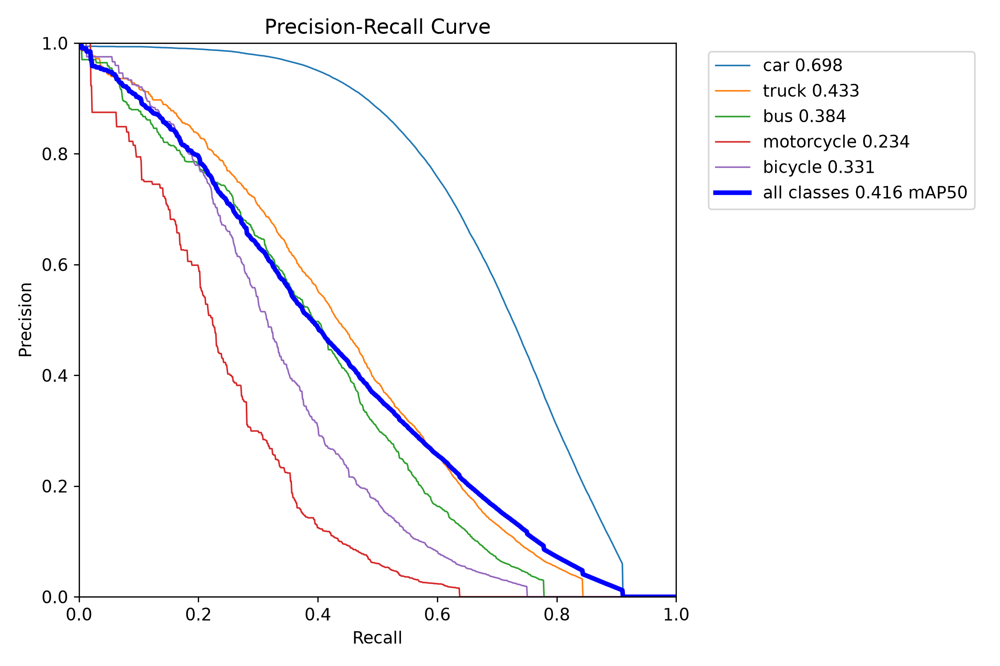{#fig-raw-pr}

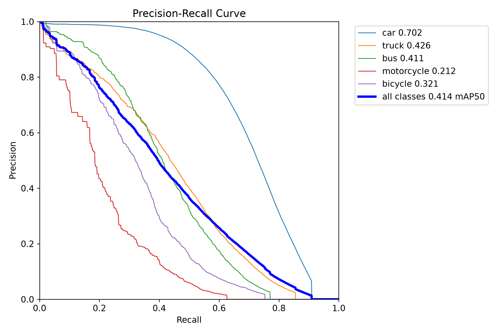{#fig-adaptive-pr}
:::

## Coverage tại confidence 0.25

Entries dưới đây là **TP /FP /FN**, IoU 0.50; support theo @tbl-class-support.

| Lớp | A: Raw/Raw | B: Raw/Adaptive | C: Adaptive/Raw | D: Adaptive/Adaptive |
|---|---|---|---|---|
| car | 80 224 /18 546 /62 317 | 80 640 /19 187 /61 901 | 84 304 /23 384 /58 237 | 84 782 /23 883 /57 759 |
| truck | 2 215 /1 509 /3 750 | 2 244 /1 574 /3 721 | 2 539 /2 332 /3 426 | 2 571 /2 422 /3 394 |
| bus | 737 /467 /1 539 | 736 /462 /1 540 | 830 /535 /1 446 | 824 /529 /1 452 |
| motorcycle | 112 /76 /450 | 109 /84 /453 | 101 /87 /461 | 101 /89 /461 |
| bicycle | 332 /145 /1 098 | 325 /145 /1 105 | 371 /233 /1 059 | 371 /235 /1 059 |
| **Tổng** | **83 620 /20 743 /69 154** | **84 054 /21 452 /68 720** | **88 145 /26 571 /64 629** | **88 649 /27 158 /64 125** |

| Ô | Precision từ tổng counts | Recall từ tổng counts |
|---|---:|---:|
| A | 80.124% | 54.734% |
| B | 79.668% | 55.019% |
| C | 76.838% | 57.696% |
| D | 76.549% | 58.026% |

Pipeline Adaptive tăng recall tổng nhưng tăng nhiều FP và giảm precision;
car chi phối tổng. Motorcycle lại mất 11 TP so với Raw/Raw. Bicycle có thêm
39 TP nhưng FP 145→235, trong khi AP vẫn giảm. Đây là tradeoff threshold/
ranking/localization, không phải mọi lớp có coverage tốt hơn.

::: {layout-ncol=2}
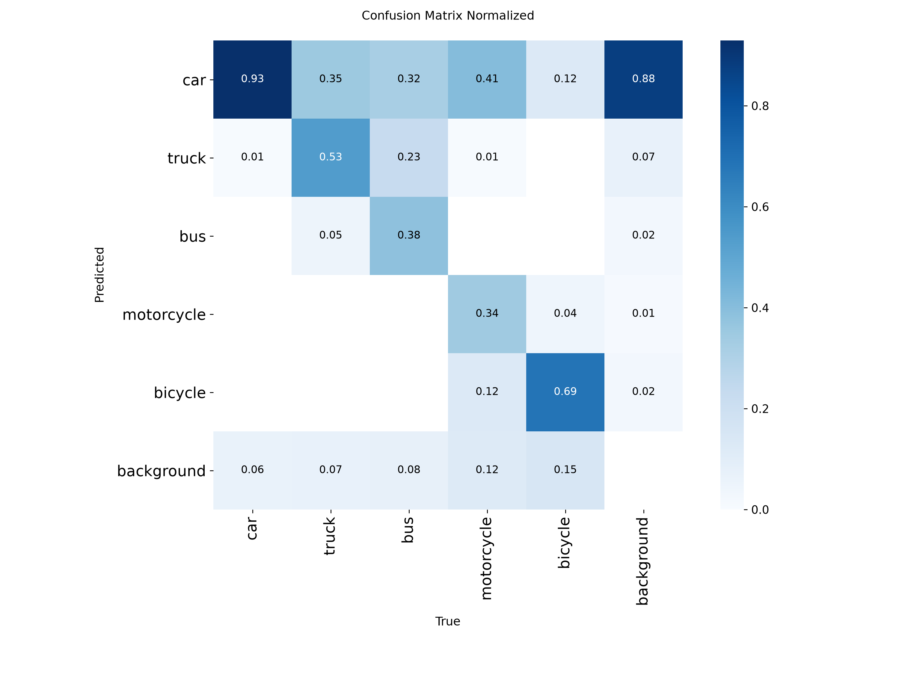{#fig-raw-confusion}

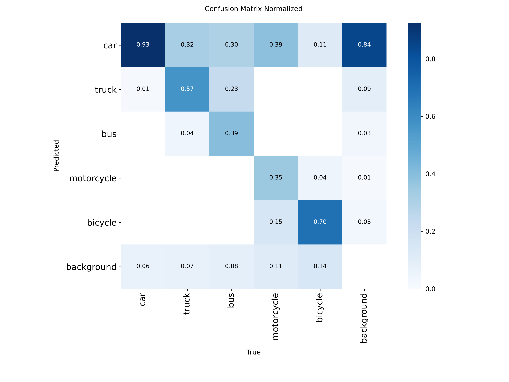{#fig-adaptive-confusion}
:::

Các confusion matrix là chart chẩn đoán native với cấu hình matching riêng;
không dùng số đọc trên hình thay cho bảng TP/FP/FN định nghĩa IoU0.50 ở trên.

## Dark, bright và small-two-wheeler images

| Cohort | Ảnh | A | B | C | D |
|---|---:|---:|---:|---:|---:|
| Dark | 3 308 | 18.236810% | 18.018087% | 17.205083% | 17.553391% |
| Bright | 10 667 | 25.447283% | 25.431571% | 25.476058% | 25.480032% |
| Small-two-wheeler image cohort | 412 | 22.626081% | 22.665806% | 22.884890% | 23.021572% |

Dark D−A **−0.683420 pp**, D−B **−0.464697 pp**. Dark motorcycle AP
**4.997001→2.783383%**, TP 6→3, FP 7→12; dark bicycle AP
**10.516474→8.923354%**. Dark-bus TP31→37 tăng trong post-hoc, nhưng không
xóa regression xe hai bánh hay biến study này thành confirmation cho
resolution experiment trước.

Small-two-wheeler cohort mean tăng, song motorcycle AP trong cohort
**6.644077→5.649851%**, còn bicycle **6.085219→6.109967%** gần ngang.
Cohort chứa mọi GT của 412 ảnh, không suy ra “small-target AP đã tốt lên”.

## Apply/Skip: filter input hay model training?

Saved-only analysis giữ nguyên router, checkpoint, prediction và từng GT.
Không đọc thêm pixel hay inference. Mỗi cohort tính lại dataset AP từ
matches native; không lấy trung bình AP từng ảnh.

| Route | Ảnh | Source groups | Motorcycle GT /groups | Bicycle GT /groups |
|---|---:|---:|---|---|
| Apply | 5 653 | 3 629 | 137 /113 | 377 /226 |
| Skip | 8 322 | 5 473 | 425 /296 | 1 053 /582 |

| Route | A AP50:95 | B | C | D | D−B |
|---|---:|---:|---:|---:|---:|
| Apply | 19.779407% | 19.709724% | 19.656529% | 19.846649% | +0.136925 pp |
| Skip | 26.416611% | 26.416611% | 26.384174% | 26.384174% | −0.032437 pp |

| Route | D−B motorcycle AP50:95 | D−B bicycle AP50:95 |
|---|---:|---:|
| Apply | −1.122604 pp | −0.924724 pp |
| Skip | −1.352313 pp | −0.723812 pp |

Hai lớp giảm trong **cả hai route**. Điều này không phù hợp với giải thích
đơn giản “chỉ những ảnh Apply mới bị ảnh hưởng”: model trained mới được
dùng cho mọi ảnh, kể cả Skip.

Với một checkpoint cố định, A=B và C=D chính xác trong Skip vì input bytes
giống nhau. Đây là consistency check hữu ích, không phải confirmation
khoa học. AP phi tuyến nên **không cộng AP cohort theo tỷ lệ ảnh để khôi
phục AP toàn development**. Group có thể span cả hai route; hai cohort
không phải hai mẫu group độc lập.

## Convergence, budget và cost

Adaptive best ở epoch 12, selector peak **20.849%**, epoch 20 **20.175%**;
đây là Raw640 selector, không phải Adaptive960 matrix AP 24.5255%.

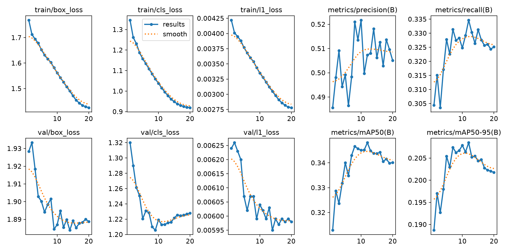{#fig-adaptive-history}

| Arm train960 | Training wall | Peak allocated /reserved | Selected epoch |
|---|---:|---|---:|
| Raw | 91.176 min | 5.239 /5.545 GiB | 10 |
| Adaptive | 86.766 min | 5.239 /5.598 GiB | 12 |

Adaptive train wall thấp hơn 4.836% trên cùng host, nhưng thứ tự/cache/nhiệt/
tải hệ thống không được randomize. Không coi đây là speedup triển khai.
Preparation/export 179.493 s là khoản khác, không phải per-image online cost.

| Ô | Validation-call wall | Native inference | Batch mean /p95 |
|---|---:|---:|---|
| A | 115.850s | 2.381177ms/ảnh | 147.371 /165.107ms |
| B | 125.379s | 2.376386ms/ảnh | 147.988 /167.405ms |
| C | 115.885s | 2.372818ms/ảnh | 147.566 /164.883ms |
| D | 115.738s | 2.379162ms/ảnh | 146.113 /161.854ms |

Native inference đọc ảnh đã export, **không chứa** CPU preprocessing
adaptive 5.811 ms mean của pilot trên quần thể khác. Không cộng các mean
khác cohort/benchmark rồi gọi là latency end-to-end đã đo.

Một run Adaptive mới có 195 620 training exposures, 293 475 selection/terminal
image passes và 55 900 explicit matrix passes. Không có retry/resume,
shortened budget, batch reduction, thêm seed hay policy retuning. Bốn ô
evaluation giữ nguyên checkpoint. Không truy cập confirmation/final.

# Hình ảnh thực tế và cách đọc {#sec-images}

Các hình dưới là **batch0 native đã lưu**, không phải ví dụ được chọn để
tối đa hóa lợi ích của Adaptive. Cùng vị trí tile là cùng source ID.
Hình minh họa bối cảnh nhiều xe nhỏ/xa, cảnh đêm và occlusion; không đủ để
quy nguyên nhân lỗi cho một feature hay một filter.

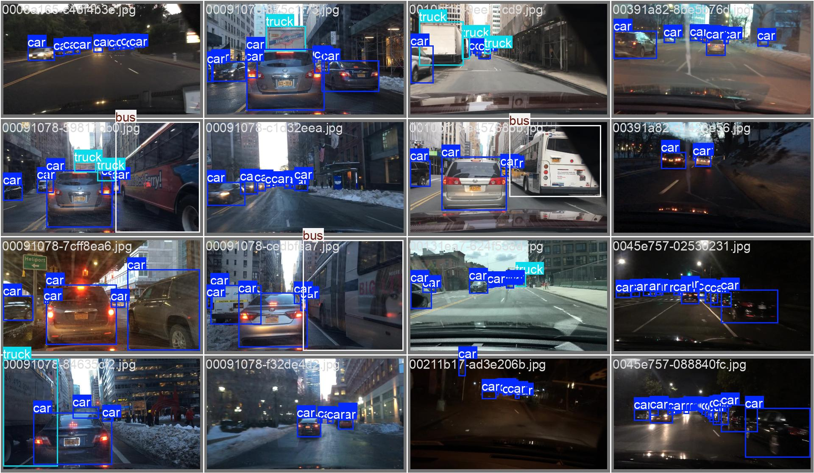{#fig-development-gt}

::: {layout-ncol=2}
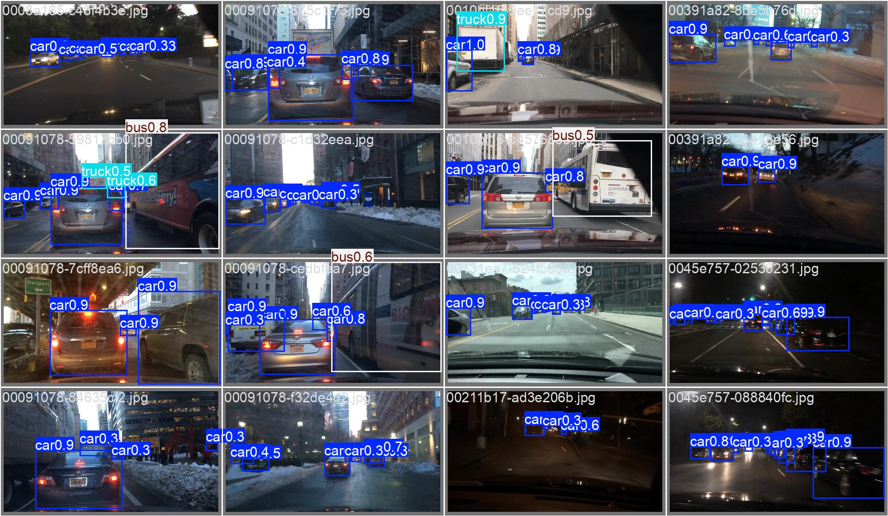{#fig-development-raw}

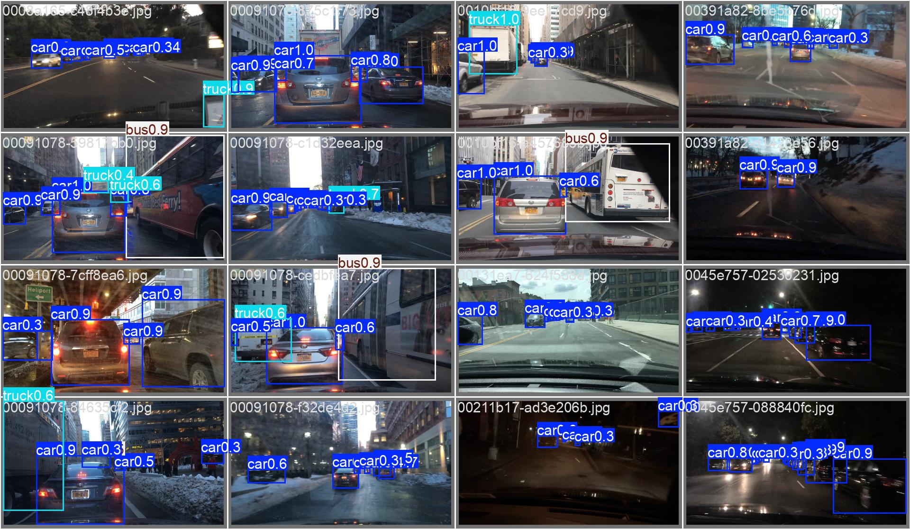{#fig-development-adaptive}
:::

Nhãn confidence trên mosaic là output hiển thị native; không suy ra AP từ
một ảnh, không coi mọi GT khó nhìn là annotation sai, và không suy ra TP
chỉ bằng màu/độ tự tin của box. Counts và AP ở các bảng dùng matching native.

Tất cả 13 hình của báo cáo được **copy nguyên byte từ artifact trong runs**
sang `docs/images/`. Đọc hoặc render báo cáo không cần thư mục runs,
weights, dataset, GPU, kernel notebook hay thực thi Python.
Ảnh BDD100K vẫn chịu điều kiện sử dụng của nguồn dữ liệu gốc.

# Kết luận, giới hạn và quyết định sử dụng {#sec-conclusions}

## Những gì evidence hiện tại hỗ trợ

1. **Raw là đối chứng thực dụng để giữ lại.** Gamma-or-Skip có chi phí thấp
   và vài gain nhỏ, nhưng S20 hiện tại không cho thấy gain đủ rõ để gọi là
   cải thiện đáng tin cậy.
2. **Không promote local-shadow hoặc adaptive local-contrast đã thử.**
   Các failure gate được ghi trước đo; một subset hay metric thuận lợi
   không đủ đảo quyết định.
3. **Resolution là hướng có signal lớn nhất trong các đo lường này**, nhưng
   cần cân latency/VRAM và coverage lớp hiếm; Raw960 hiện là reference
   phát triển hữu ích, không phải mô hình đã được final-test chứng nhận.
4. **Transformed-domain training đã được đo**, không còn là việc “chưa thử”.
   Dưới đúng operator/recipe/selector đã đóng băng, không thấy overall
   benefit; motorcycle/bicycle regressions đáng chú ý hơn macro gần hòa.
5. **Negative result là kết quả hợp lệ.** Không cần train/release một policy
   chỉ để đủ lifecycle. Các notebook lifecycle chính thức vẫn ghi skipped;
   post-hoc training được ghi riêng, không sửa lại quyết định prospective.

## Những gì chưa được chứng minh

- Khả năng tổng quát hóa qua seed, camera, detector hay dataset khác.
- Lợi ích statistically established của các chênh lệch AP rất nhỏ.
- Hiệu quả riêng trên box nhỏ theo COCO AP-small hoặc từng missed GT.
- Robustness thực với fog/noise/motion chỉ từ corruption tổng hợp.
- Adaptive960 tối ưu theo selector Adaptive960: selector thực là Raw640.
- Latency ứng dụng batch1, GPU busy time, CPU/GPU overlap, export/INT8/
  TensorRT hoặc SLA; các con số hiện tại là benchmark native tuần tự.
- Hiệu năng final-test: **chưa có đo lường nào**.

Nếu cần một quyết định triển khai tiếp theo, trước hết phải xác định chi phí
bỏ sót/báo nhầm theo lớp và operating point, rồi phê duyệt một protocol xác
nhận độc lập hợp lệ. Không tự mở final, không tự retune trên development
đã xem và không tái dùng exploration đã consumed như dữ liệu mới.

# Provenance, ảnh và cách tái xem {#sec-provenance}

## Định danh để phân biệt đúng artifact

| Thành phần | Định danh |
|---|---|
| Revision được tổng hợp | `7527187`, gồm kết quả merge #53 |
| Split-table SHA256 | `b7a6aba1d1f72e1b1e3eceda8e8427d41f44408067fad63ee68479137714cb96` |
| S20 sorted-ID digest | `ca35e8665e4b7961379b75bf96c697210f29f0fd17c6a3a172c9de6903bea1bc` |
| Development sorted-ID digest | `bf2957e6f237c3c2373f9913117933e6de0ae3c7d3bcf5aa700362efa0e71ff3` |
| COCO initialization SHA256 | `9b09cc8bf347f0fc8a5f7657480587f25db09b34bf33b0652110fb03a8ad4fef` |
| Raw960 best SHA256 | `b13ec9339f7a58d55dd53c46f7e0e24330a889a761f3ee8cc4a3e9764573b2cb` |
| Adaptive960 best SHA256 | `a1bfb001ebc70189ff01ed6d415a1b4683c8439edc7f4779fa9a07f0a4858266` |

Môi trường acquisition chính: Python3.11, NumPy2.4.6, OpenCV4.14.0.94,
Torch2.15.0/CUDA13.2, Ultralytics8.4.198, RTX5060Ti16GiB, host WSL/Linux.
Seed cố định không hứa hẹn bitwise equality giữa các shape/phần cứng.
Các timing chỉ áp dụng host/settings đã đo.

## Evidence đọc máy vẫn được giữ

Báo cáo là điểm đọc chính, nhưng không thay các plan/JSON/CSV/NPZ/receipt
bằng một bản tóm tắt có thể sửa tùy ý. Các study giữ root riêng:

| Nhóm evidence | Nội dung dùng tổng hợp |
|---|---|
| `issue5`, `issue6`, `issue6-v2` | Protocol, membership, subset/policy và calibration lịch sử |
| `issue11-v1`, `issue11-v2` | Synthetic screen và fixed-estimand correction |
| `development-v1`, `development-five-v1`, `issue21`, `round2-training-v1` | Sáu/năm lớp S10; trained metrics và verified reuse |
| `round2-preprocessing-v2`, `round2-quality-v1/v2`, `round2-research-v3` | Grid, ordered pairs, routing search và transfer âm |
| `issue43`, `issue45`, `issue45-s20` | S20/640 Raw/Gamma, local-shadow pilot và extension |
| `issue47`, `issue47-discovery` | Gamma/Sharpen âm, diagnosis và inference-size test |
| `issue47-resolution-training`, `issue47-resolution-training-repeat` | Attempt lỗi và short-training repeat được khai báo riêng |
| `issue47-s20-resolution-20e`, `issue51` | Full-S20 resolution, continuation và packaged evidence |
| `issue47-v3-960`, `issue47-v3-960-acceptance` | Fresh-calibration local-contrast và saved-only audit |
| `issue47-posthoc-adaptive-960`, `issue47-posthoc-routes` | Adaptive training, bốn ô và Apply/Skip saved analysis |

Các filename có “v2/v3” trong evidence lịch sử giữ nguyên nghĩa tại thời
điểm đo, không phải tự động mapping sang version notebook hiện tại.
Một số receipt chứa hash đường dẫn lịch sử tại revision cũ; đó là định danh
provenance, không có nghĩa source/notebook cũ vẫn là entrypoint active.

Plan và báo cáo đã hash-bind, cùng các đích liên kết mà notebook/evidence
cần, được giữ nguyên byte. Đợt dọn docs chỉ loại 11 tài liệu hướng dẫn/snapshot
lịch sử không có dependency hay liên kết từ tập tài liệu được giữ;
không xóa measured JSON/CSV/plots, sửa model, resplit dữ liệu hay đổi gate.
Các tài liệu đã bỏ vẫn có trong lịch sử Git trước đợt dọn.

## Nguồn ảnh trong báo cáo

Tên bên trái là bản copy Git-eligible dưới `docs/images/`; bên phải là
artifact gốc. Không tái chạy detector để tạo các hình này.

| Tên ảnh | Artifact gốc tương đối từ repository root |
|---|---|
| `s20-raw640-training.png` | `runs/v0/train/results.png` |
| `s20-gamma640-training.png` | `runs/v1/train/results.png` |
| `s20-shadow640-training.png` | `runs/v2/train/results.png` |
| `resolution-raw640-training.png` | `runs/issue47-s20-resolution-20e/train640/results.png` |
| `resolution-raw960-training.png` | `runs/issue47-s20-resolution-20e/train960/results.png` |
| `adaptive960-training.png` | `runs/issue47-posthoc-adaptive-960/train/results.png` |
| `raw960-pr.png` | `runs/issue47-posthoc-adaptive-960/eval_raw_raw/BoxPR_curve.png` |
| `adaptive960-pr.png` | `runs/issue47-posthoc-adaptive-960/eval_adaptive_adaptive/BoxPR_curve.png` |
| `raw960-confusion.png` | `runs/issue47-posthoc-adaptive-960/eval_raw_raw/confusion_matrix_normalized.png` |
| `adaptive960-confusion.png` | `runs/issue47-posthoc-adaptive-960/eval_adaptive_adaptive/confusion_matrix_normalized.png` |
| `development-raw-gt.jpg` | `runs/issue47-posthoc-adaptive-960/eval_raw_raw/val_batch0_labels.jpg` |
| `development-raw-pred.jpg` | `runs/issue47-posthoc-adaptive-960/eval_raw_raw/val_batch0_pred.jpg` |
| `development-adaptive-pred.jpg` | `runs/issue47-posthoc-adaptive-960/eval_adaptive_adaptive/val_batch0_pred.jpg` |

## Đọc và render mà không chạy nghiên cứu

Mở file Quarto này như Markdown để xem source, hoặc dùng lệnh dưới đây từ
repository root để tạo HTML tự chứa. Quarto execution đã tắt; render không
chạy notebook, training, inference hay bootstrap:

```bash
quarto render docs/report.qmd --to html
```

HTML nhúng ảnh/resources để chia sẻ độc lập. Source Quarto, ảnh và bản
`docs/report.html` được lưu trong Git; cần render lại HTML sau khi cập nhật
source. File HTML là sản phẩm xuất bản, không phải evidence acquisition.
Khi cập nhật kết quả, giữ nguyên artifact khoa học cũ và ghi
rõ study mới, quần thể, checkpoint, selector, metric và giới hạn tương ứng.
