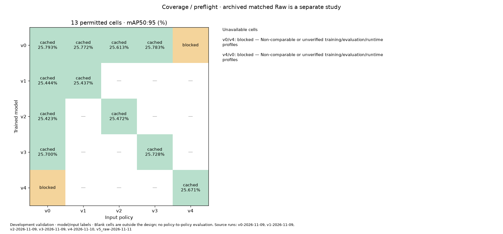
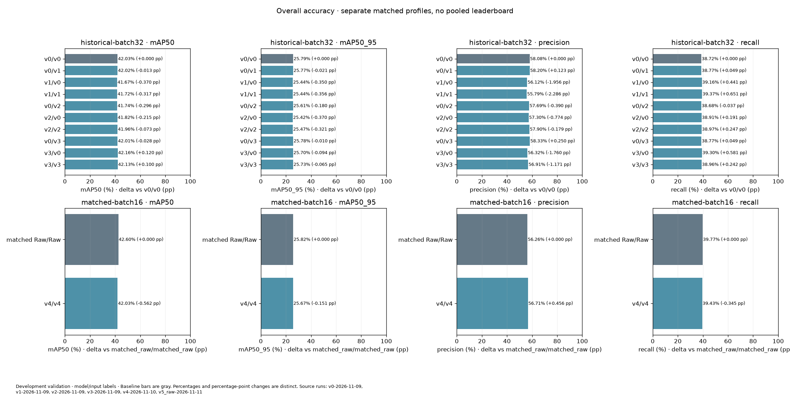
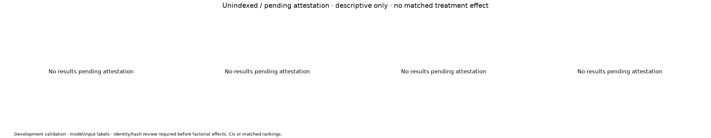
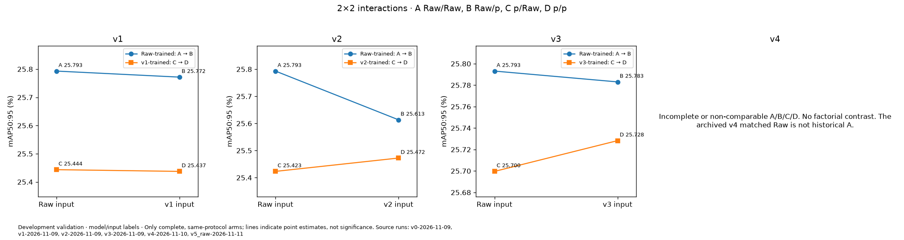
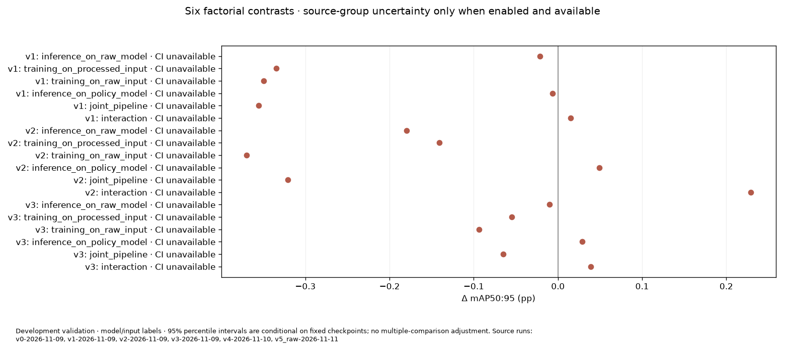
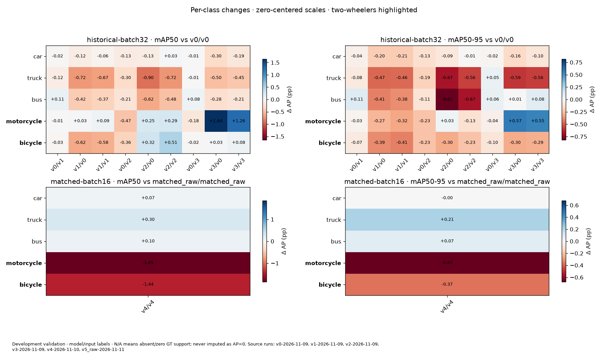
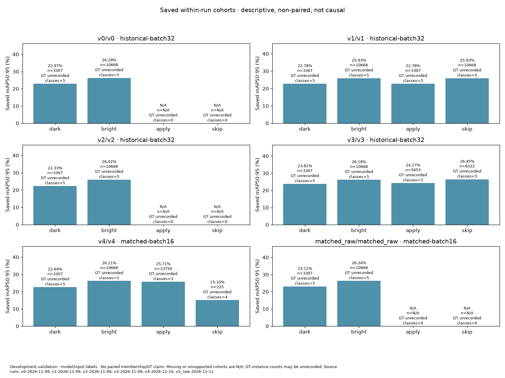
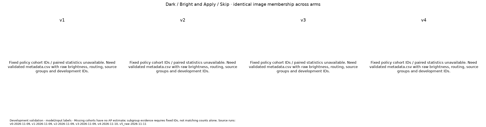
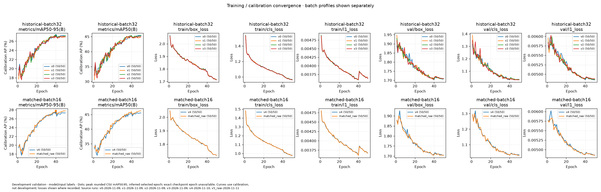
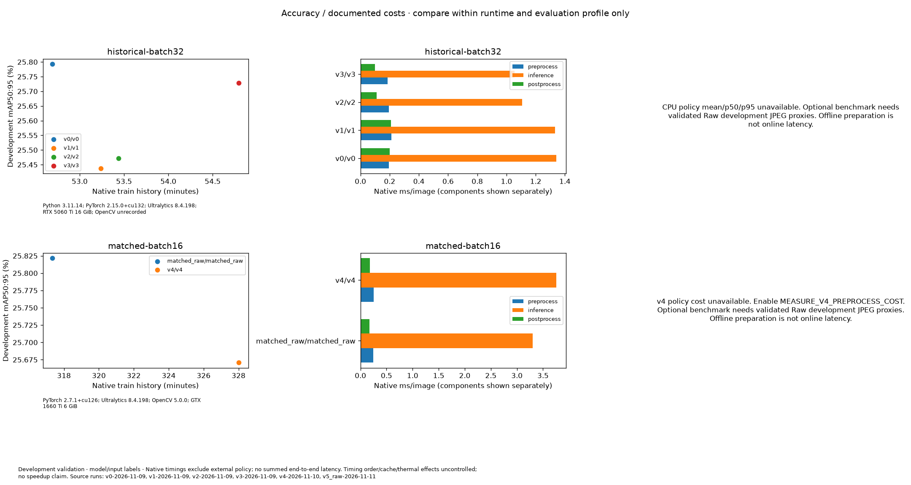

# Generated development comparison

See manifest.json for run IDs, profiles, checkpoint/source hashes, status and settings. Saved cohorts and pending evidence are descriptive, non-paired and not causal. External CPU timings are separate from native GPU timings. Final holdout sealed.

## coverage

## overall

## pending attestation

## factorial

## effects

## classes

## saved cohorts

## paired cohorts

## convergence

## cost

[coverage](coverage.csv)

[effects](effects.csv)

[saved_cohorts](saved_cohorts.csv)

[provenance](provenance.csv)
