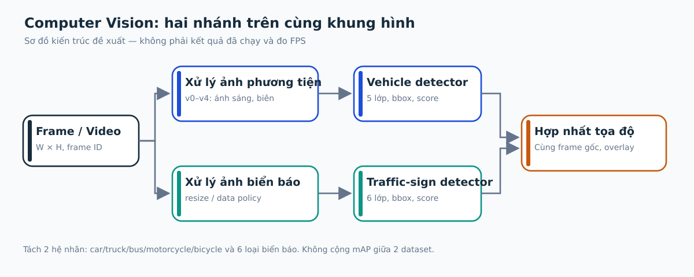
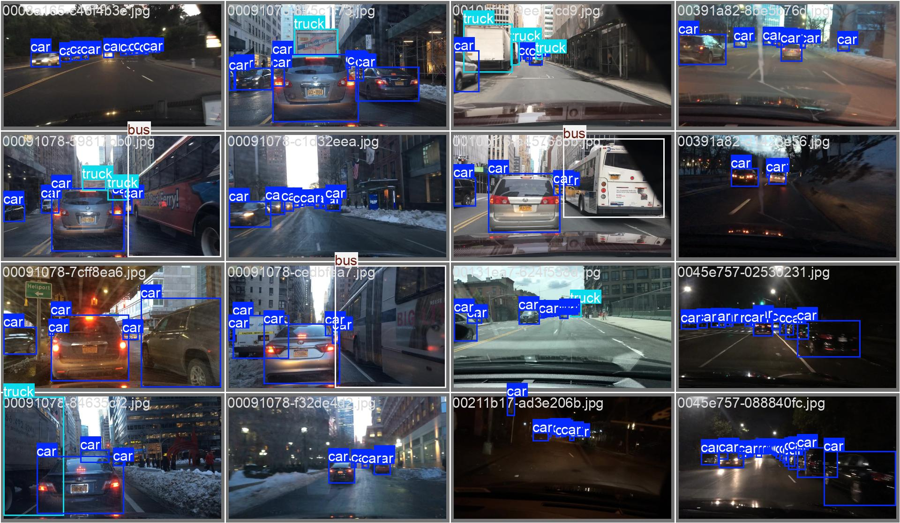
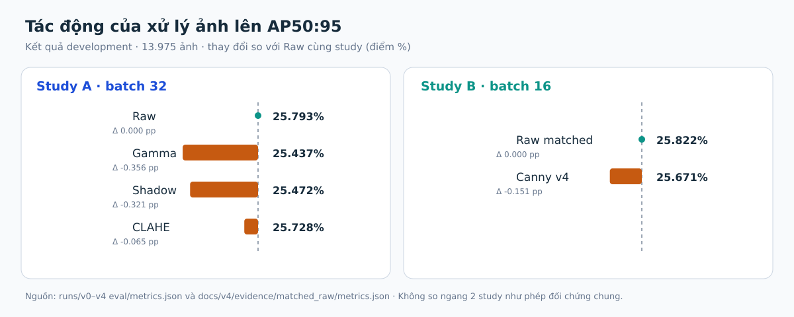
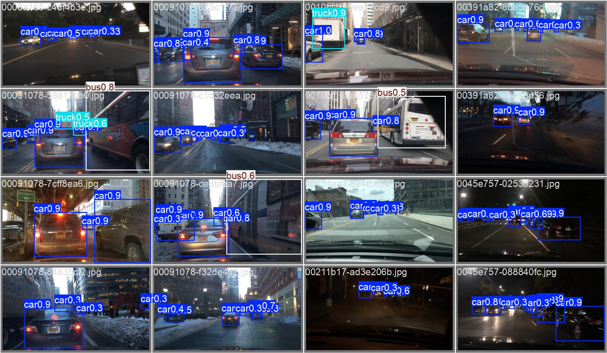
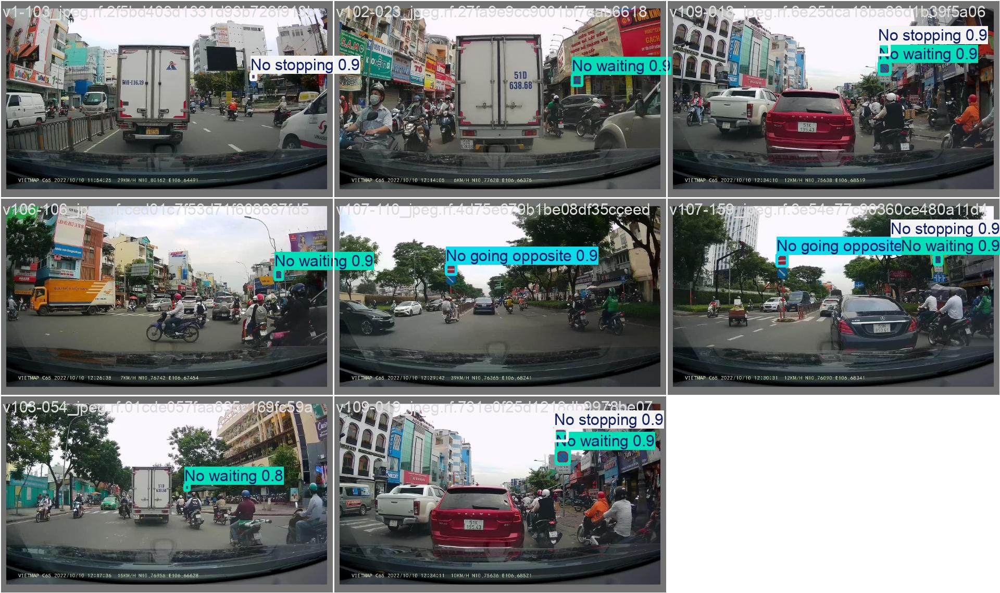
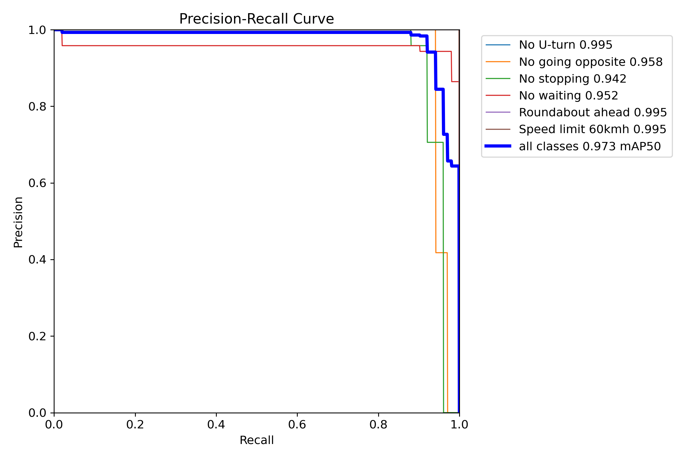

<!--
SINGLE FILE REPORT SCAFFOLD; NOT A FINISHED OR RENDERED PDF.
Keep all five chapters, abstract, references, appendices in this one file.
Template-specific two title pages, abstract/title spacing, exact chapter heading
positioning remain TODO for a later PDF validation task.
Course "Computer Vision" given by user; sample template "Image and Video Processing".
Lecturer identity/course wording must be confirmed.
-->

# Tóm tắt {.unnumbered}

Nhận thức cảnh giao thông chịu ảnh hưởng của chiếu sáng, tương phản và kích thước đối tượng. Báo cáo khảo sát năm chính sách xử lý ảnh đối với phát hiện năm lớp phương tiện trên BDD100K, đồng thời phân tích hai phương án phát hiện sáu loại biển báo giao thông Việt Nam. Các phép biến đổi Gamma, hiệu chỉnh vùng tối, CLAHE và tăng cường chi tiết có tham chiếu Canny được xem xét cùng kết quả phát hiện, độ ổn định theo lớp và giới hạn đánh giá. Trên nhóm thực nghiệm đối chứng phù hợp, v4 chưa vượt ảnh gốc. Hai nhánh biển báo có dữ liệu và giao thức khác nhau nên cần đối chiếu thận trọng. Việc tích hợp hai nhánh trên cùng video vẫn là hướng triển khai, chưa phải kết quả đã đo.

**Từ khóa:** thị giác máy tính; xử lý ảnh; phát hiện phương tiện; phát hiện biển báo; Gamma; CLAHE; Canny; YOLO26n.

# Giới thiệu (Introduction)

## Bối cảnh và động lực

Một khung hình giao thông đồng thời chứa phương tiện, biển báo, vạch đường, vùng nền và các nguồn nhiễu thị giác. Với các hệ thống camera, cùng một đối tượng có thể xuất hiện rất khác nhau giữa ban ngày và ban đêm, trên vùng bị bóng đổ hoặc ánh sáng ngược, khi di chuyển gây nhòe, hay khi kích thước đối tượng chỉ chiếm vài chục pixel. Những biến thiên này tác động trước hết lên **tín hiệu ảnh**: phân bố mức xám, độ tương phản cục bộ, độ sắc nét, mức nhiễu và cấu trúc biên.

Nghiên cứu BDD100K cho thấy nhu cầu đánh giá nhận thức giao thông trên nhiều điều kiện cảnh quan, thời tiết và ánh sáng thay vì một tập cảnh đồng nhất [@yu2020bdd100k]. Trong đồ án này, mô hình phát hiện YOLO26n được dùng như **thiết bị đo chức năng**: sau khi thay đổi đầu vào bằng thuật toán Computer Vision, ta kiểm tra xem chất lượng phát hiện bounding box và loại đối tượng có thay đổi hay không. Việc một ảnh trông sáng hoặc sắc nét hơn **không tự động chứng minh** độ chính xác phát hiện cao hơn.

Hai hướng công việc của nhóm được giữ tách biệt về dữ liệu và bằng chứng: phát hiện phương tiện trên BDD100K và phát hiện biển báo giao thông Việt Nam. Trong giai đoạn hiện tại, nhóm có các kết quả đánh giá riêng và một thiết kế giao diện tích hợp chung; chưa có bằng chứng từ việc chạy hai detector trên cùng một video.

## Phát biểu bài toán

Với khung ảnh màu \(I\in\mathbb{R}^{H\times W\times 3}\), một chính sách xử lý ảnh \(T_k\) tạo ảnh \(I_k=T_k(I)\). Detector \(D\) trả về tập dự đoán \(\mathcal{B}=\{(x_1,y_1,x_2,y_2,c,s)\}\), với vị trí hộp, lớp \(c\) và điểm tin cậy \(s\). Câu hỏi không chỉ là chất lượng cảm nhận của \(I_k\), mà là **mối liên hệ giữa biến đổi ảnh và kết quả định vị/phân loại** trên cùng ground truth.

Nhánh phương tiện khảo sát năm lớp **car, truck, bus, motorcycle, bicycle**, tương ứng với bộ nhãn được giữ lại trong dự án vehicle [@vehicleRepo2026]. Nhánh biển báo dùng sáu lớp riêng trên dữ liệu Vietnamese Traffic Signs Detection v7; cách xây dựng hai hướng biển báo của Đỗ Hữu Phát và Trần Trung Hiếu khác nhau, vì thế cần phân tích cả định nghĩa dữ liệu, phương pháp chuẩn bị ảnh và giao thức kiểm tra [@phatRepo2026; @hieuRepo2026].

**Phạm vi đo lường:** detection từ ảnh tĩnh; kiểm tra độ nhạy với độ sáng, cấu trúc biên và kích thước ảnh; phân tích chỉ số hộp phát hiện. Báo cáo **không** tuyên bố đã ước lượng khoảng cách theo mét, tracking ổn định, điều khiển phương tiện hay chứng minh tính sẵn sàng triển khai an toàn.

## Mục tiêu và câu hỏi nghiên cứu

1. Tìm hiểu đặc trưng ảnh giao thông và cơ chế của Gamma, hiệu chỉnh chiếu sáng cục bộ, CLAHE, Canny; mô tả khi nào phép biến đổi được áp dụng hoặc bị bỏ qua.
2. Đánh giá ảnh gốc và ảnh xử lý bằng các **đối chứng có cùng giao thức**, nêu rõ tác động lên AP, recall, từng lớp và nhóm ánh sáng.
3. Đối chiếu hai quy trình biển báo dựa trên đúng artifact của từng repository, tránh đánh đồng kích thước ảnh lúc đánh giá với kích thước lúc huấn luyện.
4. Đề xuất hợp đồng đầu ra để ghép hai detector vào cùng khung hình, có quy tắc quy đổi tọa độ và kế hoạch đo chi phí xử lý video.

Các câu hỏi nghiên cứu tương ứng là: (RQ1) Xử lý ảnh có cải thiện phát hiện phương tiện trên đối chứng phù hợp không? (RQ2) Dữ liệu/chuẩn bị ảnh và kích thước ảnh có thể giải thích sự khác nhau của hai nhánh biển báo đến mức nào? (RQ3) Điều kiện nào cần thỏa trước khi có thể kết luận về một hệ thống phát hiện tích hợp từ video?

## Đóng góp và giới hạn của đồ án

Đóng góp thực chứng hiện có gồm các chính sách v0–v4, log đánh giá vehicle có lưu định danh model/split, và hai bộ hiện vật phát hiện biển báo do thành viên nhóm cung cấp. Đóng góp phân tích nằm ở việc gắn thay đổi tín hiệu ảnh với **đối chứng định lượng** thay vì chỉ so sánh hình ảnh trước–sau. Đóng góp kiến trúc về tích hợp hai nhánh hiện là **thiết kế**, không phải một hệ thống đã được đánh giá đầu cuối.

Báo cáo tổ chức theo mẫu FPT MSE: Chương 2 khảo sát các công trình liên quan; Chương 3 mô tả dữ liệu, thuật toán CV, quy trình đánh giá; Chương 4 trình bày kết quả theo từng nhóm bằng chứng; Chương 5 kết luận và chỉ ra giới hạn.

# Tổng quan nghiên cứu (Literature Review)

## Thị giác máy tính trong cảnh giao thông và dữ liệu đa điều kiện

Bài toán phát hiện đối tượng giao thông chịu ảnh hưởng đồng thời của biến thiên ngoại cảnh (thời tiết, thời điểm, góc nhìn) và biến thiên nội tại của đối tượng (kích thước, màu, che khuất, chuyển động). BDD100K được thiết kế nhằm mở rộng độ đa dạng cảnh lái xe và hỗ trợ nhiều tác vụ CV, trong đó có object detection [@yu2020bdd100k]. Vì vậy, việc khảo sát độ nhạy theo nhóm ảnh tối hoặc theo lớp hiếm có ý nghĩa hơn một chỉ số tổng hợp duy nhất.

Đối với biển báo, đặc điểm thị giác khác phương tiện: biển báo thường nhỏ, có hình dạng, màu sắc và ký hiệu mang tính quy ước; khác biệt giữa các lớp có thể nằm ở vài chi tiết gần nhau. Việc tăng độ phân giải suy luận có thể giúp giữ chi tiết, nhưng đồng thời làm tăng chi phí xử lý và không thể khôi phục các thành phần ảnh đã mất do nhòe hoặc nén. Hai dự án biển báo đang dùng cùng tên họ mô hình nhưng không có một giao thức tiền xử lý/huấn luyện hoàn toàn đồng nhất; các chỉ số cần được quy về cùng nguồn và điều kiện khi so sánh [@phatRepo2026; @hieuRepo2026].

## Hiệu chỉnh mức xám và Gamma

Biến đổi Gamma là một ánh xạ điểm phi tuyến, thường được mô tả trên pixel chuẩn hóa bằng \(y=x^\gamma\), với \(x,y\in[0,1]\). Nếu \(\gamma<1\), các mức xám thấp được nâng lên mạnh hơn so với mức cao; nhưng vùng tối không chứa thông tin tín hiệu hữu ích sẽ vẫn không có thêm chi tiết thực. Tác động của Gamma phụ thuộc vào encoding, thứ tự kênh màu và bước lượng tử hóa; mô hình hóa toán học phải đối chiếu implementation thật.

Trong cảnh giao thông, nâng sáng có thể làm lộ ranh giới thân xe trên nền tối, đồng thời làm nhiễu vùng thiếu sáng và các nguồn phát quang dễ bị bão hòa. Vì vậy, nên đánh giá riêng ảnh *được xử lý* và ảnh *được bỏ qua*, đối chiếu cùng định nghĩa độ sáng, thay vì suy luận từ ảnh minh họa đơn lẻ.

## Tương phản cục bộ: AHE và CLAHE

Cân bằng histogram toàn ảnh dùng phân phối mức xám chung để phân bổ lại dải cường độ, nhưng có thể bỏ qua thay đổi cục bộ. Adaptive Histogram Equalization (AHE) mở rộng phép biến đổi đến các ô không gian; nghiên cứu của Pizer và cộng sự chỉ ra hạn chế khuếch đại nhiễu trong các vùng tương đối đồng nhất và đề xuất các biến thể khắc phục [@pizer1987adaptive]. CLAHE áp giới hạn phân phối histogram ở từng ô để tránh khuếch đại tương phản quá mức và nội suy giữa các ô [@zuiderveld1994clahe].

Với ảnh xe chạy qua bóng râm, CLAHE có thể hỗ trợ tăng độ tương phản vùng cần quan sát. Tuy nhiên, vùng nền nhiều hoa văn có thể được tăng cường cùng đối tượng. Do đó, đồ án chỉ xem CLAHE là một **giả thuyết xử lý tín hiệu cần đo bằng detector**, không mặc nhiên coi đó là nâng cấp có ích.

## Canny, thông tin biên và sai lệch giữa thị giác người và detector

Canny đưa ra một cách phát hiện biên dựa trên các tiêu chí phát hiện và định vị; xấp xỉ thực hành gồm lọc Gaussian, ước lượng gradient, loại cực đại không mong muốn và kết nối biên bằng hai ngưỡng [@canny1986edge]. Trong giao thông, biên xe có thể hữu ích cho định vị; tuy nhiên, ranh giới biển quảng cáo, vỉa hè, kết cấu mặt đường và nhiễu nén cũng tạo biên.

Cần phân biệt **Canny edge map** (đầu ra có tính cấu trúc) với **ảnh RGB sau tăng cường dựa trên biên Canny** (đầu vào của detector). Tăng mật độ biên không đồng nghĩa tăng tín hiệu ngữ nghĩa. Đồ án kiểm tra chính giả thuyết này trong phiên bản v4 và phân tích hậu quả đối với các lớp xe hai bánh.

## Kích thước vật thể, hình học bounding box và phép đo

Sau resize hoặc letterbox, hộp dự đoán được biểu diễn trong một hệ tọa độ trung gian. Muốn ghép kết quả của hai detector trên cùng frame phải đảo phép biến đổi tỉ lệ/padding một cách nhất quán. Không thể lấy tọa độ sau resize để trực tiếp vẽ lên ảnh gốc nếu chưa quy đổi.

Về đánh giá, Intersection over Union (IoU) lượng hóa phần chồng khít giữa hộp dự đoán và ground truth. AP@0.50 đánh giá với ngưỡng IoU 0,50, còn AP@0.50:0.95 tổng hợp nhiều ngưỡng khắt khe hơn. Ở lớp có rất ít ví dụ, biến động vài dự đoán có thể gây thay đổi đáng kể về kết quả; nên công bố **support, AP theo lớp và điều kiện dữ liệu** bên cạnh mAP.

## Những công trình hiện có và khoảng trống nghiên cứu

| Nguồn | Đóng góp liên quan | Giới hạn khi áp dụng vào đồ án |
|:--|:--|:--|
| @yu2020bdd100k | Dữ liệu giao thông đa dạng với nhiều tác vụ thị giác máy tính | Không tự trả lời hiệu quả của từng preprocessing policy |
| @pizer1987adaptive | Cân bằng histogram thích nghi và hệ quả khuếch đại nhiễu | Không đo trực tiếp AP phương tiện trên BDD100K |
| @zuiderveld1994clahe | Giới hạn histogram nhằm kiểm soát tăng tương phản cục bộ | Chất lượng hiển thị chưa phải bằng chứng tăng detector AP |
| @canny1986edge | Nguyên lý biên có mục tiêu phát hiện/định vị | Edge map không đồng nghĩa cải thiện detection |
| @phatRepo2026; @hieuRepo2026 | Hai thực nghiệm phát hiện biển báo giao thông Việt Nam | Chưa có phép đánh giá chung hoàn toàn được tái lập trên cùng môi trường |

Từ đối chiếu này, khoảng trống **trong phạm vi đồ án** là thiếu một bảng đo có đối chứng cho các xử lý ảnh cụ thể, phân rã theo độ sáng/lớp/kích thước và không làm lẫn kết quả các nhóm chạy khác cấu hình. Phần phát hiện biển báo bổ sung một đối tượng có đặc tính thị giác khác xe; tuy nhiên, phép so sánh hai phương án biển báo và phép ghép video phải được giới hạn theo mức bằng chứng thực tế, không được tuyên bố thành đóng góp thống kê vượt dữ liệu.

# Phương pháp (Methodology — Dataset + Algorithms)

## Thiết kế nghiên cứu: xử lý ảnh trước, phát hiện sau

Đề tài được tổ chức theo hai nhánh độc lập. Nhánh phương tiện thực hiện so sánh các ảnh được biến đổi bởi các chính sách CV trên cùng hệ nhãn và cùng quy trình tạo bộ dữ liệu. Nhánh biển báo xem xét cách lựa chọn, lọc và biến đổi ảnh đầu vào trước khi sử dụng detector. Cả hai đều dùng YOLO26n để tạo hộp dự đoán; **đối tượng nghiên cứu chính là ảnh, dữ liệu và quy trình xử lý**, không phải thiết kế kiến trúc mạng mới.

{#fig-cv-pipeline width=95%}

Quy trình phương tiện được chuẩn hóa như sau:

1. Đọc cùng tập ảnh gốc và nhãn bounding box.
2. Đo đặc trưng ảnh, quyết định có áp dụng chính sách hay không.
3. Áp dụng một trong năm chính sách v0–v4 **độc lập**, không xếp chồng các phiên bản.
4. Xuất ảnh bằng JPEG quality 95 theo pipeline thực nghiệm, giữ kích thước và tọa độ gốc.
5. Nạp checkpoint tương ứng, đánh giá trên tập development có cùng ID ảnh và nhãn.
6. Tổng hợp AP/recall theo lớp, theo độ sáng và theo **nhóm thực nghiệm có cùng điều kiện đối chứng**.

Trong demo/video tương lai, chi phí xử lý ảnh phải đo trên luồng trực tiếp; chi phí chuẩn bị dữ liệu offline **không phải** độ trễ vận hành của video.

## Biểu diễn ảnh, vùng sáng và thống kê thị giác

Ảnh đầu vào có ba kênh màu; bước xử lý nội bộ tùy thuật toán có thể chuyển BGR sang grayscale trước khi ước lượng chất lượng ảnh hoặc tìm cạnh. Gọi \(Y(u,v)\) là độ sáng tại pixel \((u,v)\) với giá trị 8-bit, một chỉ số độ sáng toàn cục có thể tính bằng \(\mu_Y = \frac{1}{255HW}\sum_{u,v}Y(u,v)\). Độ tương phản toàn ảnh có thể mô tả bằng độ lệch chuẩn chuẩn hóa \(\sigma_Y/255\); nhưng chỉ số này không phản ánh hết sự chênh sáng trong một vùng nhỏ.

Repo vehicle đo đặc trưng chất lượng sau khi giảm ảnh grayscale về cạnh dài tối đa 512 pixel, dùng trung bình cho brightness, độ lệch chuẩn cho contrast, độ biến thiên Laplacian cho sharpness và ước lượng noise theo sai khác với median filter; chính sách v4 còn dựa vào tỷ lệ pixel biên. Những biến này phục vụ *routing*, không phải kết quả nhận dạng ngữ nghĩa. Điều kiện Apply/Skip cần được cố định trước khi xem kết quả detector để tránh đánh giá thiên lệch.

**Lưu ý thị giác:** tăng brightness của ảnh có vùng bị cháy sáng không thể khôi phục chi tiết trắng đã bị clipping; tương tự, tăng contrast hoặc sharpen có thể làm rõ cả noise và texture nền.

## Nhánh phương tiện: dữ liệu BDD100K và hình học nhãn

Bộ BDD100K cung cấp dữ liệu cảnh đường phố đa điều kiện [@yu2020bdd100k]. Dự án vehicle giữ năm lớp **car, truck, bus, motorcycle, bicycle**; lớp tên **train** trong dữ liệu nguồn không nằm trong taxonomy đầu ra. Việc chuẩn bị ảnh và nhãn sử dụng các định nghĩa phân chia đã cố định trong cấu hình source; S20 là một tập con của training pool, không được cộng lại như một split mới [@vehicleRepo2026].

| Vai trò | Số ảnh | Sử dụng và giới hạn |
|:--|--:|:--|
| Training pool | 48.903 | Nguồn tạo bộ train |
| S20 | 9.781 | **Subset** của training pool dùng fine-tune; không cộng vào tổng pool |
| Calibration | 6.985 | Hiệu chỉnh/chọn mô hình theo giao thức dự án |
| Development evaluation | 13.975 | Báo cáo kết quả của các phiên bản |
| Sealed final holdout | 9.730 | **Chưa dùng để chốt kết quả ở giai đoạn này** |

: Phân vai tập dữ liệu trong nghiên cứu phương tiện; số liệu từ bộ cấu hình/evidence hiện có, không phải toàn bộ tập BDD100K. {#tbl-vehicle-splits}

Ảnh và bbox được xử lý trên hệ tọa độ gốc. Nếu một ảnh kích thước \(W\times H\) chuyển thành kích thước \(W'\times H'\) bằng resize thuần, cần dùng \(x=x'W/W'\) và \(y=y'H/H'\) để trở về gốc. Với letterbox, phải trừ padding trước khi chia theo tỉ lệ scale. Trong nghiên cứu không đổi hình học, box GT vẫn giữ nguyên khi áp dụng Gamma/CLAHE/Canny; trong video cần kiểm tra lại tọa độ sau suy luận.

{#fig-vehicle-ground-truth width=92%}

### Mất cân bằng lớp và kích thước đối tượng

Trong tập development, các đối tượng **car** chiếm phần lớn số bounding box; xe máy và xe đạp có số mẫu ít hơn nhiều. Do đó, một thay đổi có AP trung bình biến động nhỏ vẫn có thể che dấu hồi quy lớn của lớp ít gặp. Khi đánh giá một chính sách xử lý ảnh, báo cáo cả số GT, per-class AP/recall, các ảnh bị bỏ sót và kích thước hộp được quan sát là yêu cầu quan trọng về Computer Vision.

## Các chính sách biến đổi ảnh v0–v4

| Phiên bản | Tín hiệu ảnh / thao tác CV | Chính sách | Rủi ro cần kiểm tra |
|:--|:--|:--|:--|
| **v0 Raw** | Ảnh gốc làm đối chứng, vẫn theo cùng đường xuất JPEG | Always keep | Nhiễu và điều kiện ánh sáng gốc |
| **v1 Gamma-or-Skip** | Gamma 0,85 | Apply khi brightness dưới 0,12 | Nâng noise ở vùng rất tối; lệch phân bố ảnh |
| **v2 Local-shadow** | Trường chiếu sáng làm mượt, gain 1×–2× | Điều chỉnh vùng tối trong ảnh | Khuếch đại nền/nhiễu, saturation |
| **v3 Adaptive local contrast** | CLAHE clip 1,5, lưới 8×8, offset có biên | Apply khi tương phản thấp và các gate phù hợp | Tăng texture nền, biến màu khi kênh clipping |
| **v4 Canny-guided detail** | Phát hiện biên Canny và tăng chi tiết cục bộ quanh biên | Gate dựa brightness/noise/edge density | Tăng biên nền và artifact nén |

: Các phép xử lý ảnh chính trong repository vehicle, theo YAML v1–v4 hiện hành. {#tbl-vehicle-policies}

### v0 — Ảnh gốc làm đối chứng

Raw giữ pixel sau bước giải mã và xuất dữ liệu theo cùng thiết lập mã hóa JPEG quality 95. Đối chứng này giúp tách lợi ích của thuật toán xử lý ảnh khỏi khác biệt do định dạng đầu vào. Nếu bypass một bước trong lúc inference nhưng không bypass lúc train, cần ghi rõ vì đó là **domain shift** trong quan sát của detector.

### v1 — Gamma-or-Skip

Với \(x\in[0,1]\), chính sách v1 áp dụng \(f(x)=x^{0.85}\) khi độ sáng toàn ảnh nhỏ hơn 0,12. Vùng còn lại Skip. Đây là phép biến đổi phi tuyến theo cường độ pixel; không thay đổi hình học bbox và không thêm thông tin vật thể đã mất. Phần v1 từng được gọi là “Adaptive v2” trong các thí nghiệm cũ, nhưng trong taxonomy hiện hành phải giữ nhãn **v1 Gamma**, không nhầm với v2 Local-shadow.

### v2 — Hiệu chỉnh bóng cục bộ

v2 ước lượng trường illumination từ grayscale bằng Gaussian smoothing (sigma 16), tính hệ số nâng sáng biến đổi theo vùng và giới hạn gain trong khoảng **1× đến 2×**. Điều này khác Gamma áp một ánh xạ lên toàn ảnh: một xe nằm trong bóng râm có thể nhận điều chỉnh khác vùng trời sáng. Tuy nhiên, vùng tối thường đi cùng thiếu tín hiệu/nhiễu nhiều; mức gain lớn không đảm bảo cải thiện khả năng định vị bbox.

### v3 — CLAHE có giới hạn và routing

v3 xây dựng phép CLAHE trên grayscale với clip limit **1,5** và grid **8×8**, sau đó lấy một phần độ chênh mức sáng để hiệu chỉnh ảnh gốc. Biên thay đổi tối đa **12 mức 8-bit** trên mỗi kênh nhằm tránh thay đổi cực đoan. Gate yêu cầu tương phản nhỏ hơn **0,20**, brightness trong khoảng **0,04–0,80**, noise tối đa **0,01**, cùng ngưỡng tỷ lệ pixel rất tối/rất sáng; ngoài phạm vi này ảnh giữ nguyên [@vehicleRepo2026].

Cách thiết kế này phản ánh hai mối quan tâm CV: nâng tương phản **cục bộ** ở vùng có tín hiệu nhưng tránh tăng mạnh nhiễu hoặc clipping. Việc giữ cùng hệ tọa độ giúp so sánh GT với prediction không bị ảnh hưởng bởi phép biến đổi không gian.

### v4 — Tăng chi tiết có tham chiếu Canny

v4 sử dụng Gaussian blur (sigma 1), các ngưỡng Canny **50/150**, mặt nạ vùng gần biên và tăng chi tiết với hệ số **0,5**, giới hạn offset **12**. Gate xét brightness 0,04–0,90, noise không quá 0,02 và edge density trong khoảng 0,001–0,20. Các phép tăng chi tiết diễn ra ở độ phân giải ảnh ban đầu, trong khi phép kiểm tra quality sử dụng ảnh giảm kích thước. Đây là **ảnh RGB được tăng cường quanh biên**, không phải đưa trực tiếp một edge map nhị phân vào detector.

Cần đo không chỉ AP mà cả tỷ lệ Apply. Nếu gần như mọi ảnh đều Apply, chính sách có tên *adaptive* nhưng thực tế vận hành gần như **always-on**; chi phí và nguy cơ tăng biên nền cần được phân tích như một lựa chọn xử lý ảnh.

## Hai nhóm thực nghiệm có đối chứng riêng

Để tránh đánh giá một hiệu ứng xử lý ảnh dựa trên khác biệt không liên quan, các model được báo cáo theo hai nhóm có cấu hình nhất quán hơn:

| Nhóm | Phiên bản | Resolution | Batch train/eval | Cách so sánh |
|:--|:--|:--|:--|:--|
| Study A | v0, v1, v2, v3 | 640 | 32 | So từng phiên bản với Raw cùng Study A |
| Study B | Raw control, v1, v4 | 640 | 16 | Ưu tiên đối chứng Raw batch 16 đã lưu trong evidence v4 |

: Tách nhóm nghiên cứu để giảm nguy cơ so sánh sai điều kiện. {#tbl-vehicle-studies}

Việc dùng cùng checkpoint khởi tạo, seed, 50 epoch, split và giao thức đánh giá giúp giảm nhiễu thiết kế, nhưng **không loại trừ hoàn toàn tác động của stochastic training hoặc khác biệt hệ thống**. Số liệu hiện có là một seed cho mỗi nhánh; không dùng từ “cải thiện chắc chắn” nếu chưa có phép lặp/ước lượng bất định. Các thử nghiệm độc lập về độ phân giải 960 hoặc 20 epoch ở các nhánh nghiên cứu khác không được ghép vào bảng này.

## Nhánh biển báo: sáu lớp và hai quy trình CV

Cả hai repository dẫn tới bộ **Vietnamese Traffic Signs Detection v7** theo chuẩn YOLO, có phân chia được báo cáo là **2.118 train / 196 validation / 103 test**, sáu lớp: No U-turn, No going opposite, No stopping, No waiting, Roundabout ahead và Speed limit 60kmh. Repo Phát lưu cấu hình data với nguồn Roboflow v7; repo Hiếu trình bày quy trình xử lý dataset cùng nguồn trong README [@phatRepo2026; @hieuRepo2026].

### Phương án Phát: giữ pipeline cơ sở và đánh giá ảnh đa kích thước

Repo **dhphat/traffic-sign-detection** lưu script huấn luyện, đánh giá, xử lý video, checkpoint và biểu đồ. File cấu hình run cho thấy YOLO26n, ảnh **640**, **50 epoch**, batch **32**, SGD và seed **42** trên thiết bị **MPS**. Script **eval.py** nạp một checkpoint rồi đánh giá tập test ở **640** và **960**; đây là hai **kích thước suy luận**, không chứng minh hai mô hình đã được huấn luyện riêng ở hai kích thước.

Một chú ý về dữ liệu: README Roboflow trong repository mô tả auto-contrast, exposure, blur và salt-and-pepper augmentation ở dữ liệu phát hành. Vì vậy, “ảnh gốc” ở nhánh biển báo có thể đã qua một preprocessing pipeline của bộ nguồn; không nên gọi đó là ảnh camera raw chưa chỉnh [@phatRepo2026].

### Phương án Hiếu: pHash và augmentation theo lớp hiếm

Repo **ec2003/VN-traffic-sign-detection** lưu notebook từ chuẩn bị dữ liệu tới suy luận, cấu hình run, hai checkpoint, đồ thị train/val và một số ảnh test. Phần xử lý dữ liệu do repo mô tả tập trung vào **cân bằng lớp và kiểm soát trùng gần**:

- Phân bố trước lọc: **2.730** instance train, gồm lớp No waiting **939**, Speed limit 60kmh **189**.
- Lọc bằng **perceptual hash (pHash)** với Hamming threshold **5** trên nhóm ảnh thuộc lớp dày; README cho biết loại **902** ảnh gần trùng, để lại **1.216** ảnh trước augmentation, số instance giảm từ **2.730** xuống **1.507**.
- Tăng cường nhẹ trên ảnh giữ lại; thêm các phép xoay (tới 12°), biến đổi brightness/contrast, blur, shift/scale cho ảnh chứa lớp speed limit hiếm. Bounding box phải được biến đổi theo ảnh và loại trường hợp không còn đủ vùng hiển thị.
- Không chỉnh sửa trực tiếp các tập validation/test theo mô tả repo; cấu hình huấn luyện sau chuẩn bị dữ liệu là **imgsz 832**, **70 epoch**, batch **12**, AdamW và seed **0** [@hieuRepo2026].

pHash là kỹ thuật Computer Vision đo độ giống nhau từ biểu diễn ảnh đã giảm tần số không gian; nó có ích để giảm trùng trong một phân vùng, nhưng **lọc trong tập train không chứng minh độc lập train/valid/test**. Các phép lật ngang cũng cần đánh giá theo ngữ nghĩa của ký hiệu biển báo, tránh tạo mẫu ảnh có hình dạng không hợp lệ theo thực tế giao thông.

### Tại sao chưa được kết luận model nào vượt trội?

Hai nhánh khác cách chuẩn bị train, lượng ảnh sau lọc, kích thước lúc train, augmentation, batch, optimizer, seed và môi trường. Vì thế, chênh lệch AP tổng hợp giữa Phát và Hiếu chỉ là **so sánh kết quả hệ thống theo từng giao thức**, không phải causal ablation của riêng pHash, CLAHE hoặc YOLO26n. Để kiểm định một xử lý CV cụ thể, cần cùng data IDs, giữ nguyên checkpoint/evaluation pipeline, chỉ thay **một** thành phần xử lý hoặc dùng thiết kế có đối chứng được định nghĩa trước.

## Thước đo và phép kiểm tra hình học

Với hai hộp \(A,B\), IoU được xác định bởi \( |A\cap B|/|A\cup B| \). Các mức AP50 và AP50:95 chấm độ khớp hộp dưới ngưỡng IoU khác nhau. Precision/Recall ở một ngưỡng confidence cụ thể không được suy ra trực tiếp từ mAP; cần giữ quy định confidence và NMS khi đọc bảng hoặc so sánh confusion matrix.

Trong bối cảnh CV, mỗi bảng số liệu phải có **tập ảnh, số GT, phiên bản transform, kích thước ảnh, cấu hình suy luận và nguồn artifact**. Khi chuyển ảnh qua resize/letterbox, chỉ số bbox dự đoán phải được quy về ảnh gốc trước khi vẽ chung hai nhánh. Đây là điều kiện cần để nhận xét một detection là bị lệch vị trí hay thiếu đối tượng.

## Thiết kế tích hợp trên cùng video — chưa xác nhận thực nghiệm

Kiến trúc đề xuất sử dụng một decoder video duy nhất, gắn frame ID và timestamp trước khi tách hai nhánh. Nhánh phương tiện áp chính sách v0–v4 đã chọn; nhánh biển báo đi theo chuẩn ảnh phù hợp checkpoint. Mỗi nhánh trả về class namespace riêng, tọa độ được quy về **ảnh gốc**, confidence và thời gian xử lý. Bộ hợp nhất không đổi ý nghĩa lớp, chỉ kết hợp hai tập bounding box trên cùng frame.

Để biến thiết kế thành kết quả, cần chạy video thực, lưu ảnh/clip đầu ra, checkpoint SHA, log chọn preprocess, số khung hình, lỗi decode, thời gian decode → xử lý → suy luận hai nhánh → dựng overlay → encode; báo cáo FPS theo toàn pipeline thay vì lấy nghịch đảo một bộ đếm inference của Ultralytics. Việc dự án vehicle đã có Gradio demo không tự chứng minh đã tích hợp detector biển báo.

# Kết quả thực nghiệm (Simulation Results)

## Kiểm kê nguồn và nguyên tắc đọc bảng

Các số liệu trong chương được chia theo nguồn: **(V)** file evaluation đã có trong repository vehicle; **(P)** README/CSV/args của Phát; **(H)** README/CSV/args của Hiếu; **(N)** bảng được cung cấp trong dự thảo nhóm nhưng chưa có JSON test độc lập tại cấu hình đó. Kết quả giữa các nguồn không được trộn thành một leaderboard nếu split hoặc cách chuẩn bị ảnh khác nhau.

| Mã | Nguồn | Bằng chứng kiểm tra được | Giới hạn |
|:--|:--|:--|:--|
| V-A | Vehicle study A | runs/v0–v3-2026-11-09/eval/metrics.json; cấu hình batch 32 | Một seed, development evaluation |
| V-B | Vehicle study B | docs/v4/evidence/matched_raw/metrics.json và runs/v4-2026-11-10/eval/metrics.json; batch 16 | Một seed, chưa mở final holdout |
| P | Phát | args.yaml, results.csv, best.pt, ảnh validation; eval.py | File metrics.json test 640/960 mô tả trong README **không có trong tree** tại commit đã kiểm tra |
| H | Hiếu | args.yaml, results.csv, best.pt, README test @832, PR/confusion/prediction assets | Thiếu machine-readable test summary 832 và raw dataset trong Git; chưa tự chạy lại |
| N | Dự thảo nhóm | Bảng 640/960 cho Phát và Hiếu, support test 103 ảnh | Chưa đối chiếu JSON test theo cùng giao thức/cùng test IDs |

: Phân loại mức chứng cứ; “có checkpoint” khác với “đã tái lập bài test”. {#tbl-evidence-status}

## Phương tiện: độ chính xác tổng thể dưới các thuật toán xử lý ảnh

### Study A — v0 đến v3, batch 32

Các model v0–v3 được so sánh trên cùng 13.975 ảnh development, eval imgsz 640 và batch 32. File JSON lưu AP theo lớp và theo nhóm độ sáng. Bảng trình bày giá trị phần trăm, **không** phải phân số 0–1.

| Chính sách | AP50 (%) | AP50:95 (%) | ΔAP50:95 so Raw (điểm %) |
|:--|--:|--:|--:|
| v0 Raw | 42,035 | 25,793 | 0,000 |
| v1 Gamma | 41,718 | 25,437 | −0,356 |
| v2 Local-shadow | 41,962 | 25,472 | −0,321 |
| v3 CLAHE có gate | 42,135 | 25,728 | −0,065 |

: Study A — kết quả đo trên development, dựa vào runs/v0–v3-2026-11-09/eval/metrics.json. {#tbl-study-a}

Theo AP50, v3 nhỉnh hơn v0 khoảng **0,100 điểm phần trăm**. Nhưng theo AP50:95, v3 **thấp hơn v0 khoảng 0,065 điểm**. Điều này cho thấy cách phát biểu “v3 cải thiện detection” phụ thuộc chỉ số được chọn. Vì AP50:95 đòi hỏi hộp chính xác hơn ở nhiều mức IoU, không nên diễn giải một gia tăng nhỏ ở AP50 như bằng chứng cải thiện định vị đồng đều.

{#fig-vehicle-study-groups width=95%}

### Vùng ảnh tối: tín hiệu có điều kiện, không phải thành công toàn cục

Với nhóm **3.307** ảnh tối theo định nghĩa brightness trong repo, AP50:95 của v0 là **22,968%**, v3 là **23,809%** (chênh khoảng **+0,841 điểm phần trăm**). Dấu hiệu này cho thấy transform có thể hữu ích với một nhóm chiếu sáng cụ thể, mặc dù kết quả tổng thể v3 không vượt đối chứng theo AP50:95.

Cần ghi rõ nhóm ảnh tối đã là một phân tầng được xác định bởi thuật toán quality; các giá trị phân tầng không chứng minh tính khái quát sang mọi cảnh ban đêm hoặc những loại camera khác. Không suy ra statistical significance khi chỉ có một lần chạy và chưa có bootstrap theo ảnh/nhóm video.

### Study B — Canny v4 so với Raw batch 16

Study B có đối chứng Raw được lưu riêng tại docs/v4/evidence/matched_raw, cùng cấu hình batch 16 với v4. Đây là cặp được phép dùng để thảo luận tác động của v4; **không** dùng v0 batch 32 ở Study A để so trực tiếp với v4.

| Chính sách | AP50 (%) | AP50:95 (%) | Chênh AP50:95 so Raw (điểm %) |
|:--|--:|--:|--:|
| Raw đối chứng batch 16 | 42,596 | 25,822 | 0,000 |
| v4 Canny-guided | 42,035 | 25,671 | −0,151 |

: Study B — phép đối chứng Raw–v4 batch 16, file metrics.json từ evidence v4. {#tbl-study-b}

Kết quả cho thấy v4 giảm **0,562 điểm AP50** và **0,151 điểm AP50:95** so với Raw cùng batch. Trong nhóm v4, bước xử lý được kích hoạt ở **13.750/13.975 ảnh ≈ 98,39%**. Do tỷ lệ Skip rất nhỏ, lợi ích của cơ chế gate cần xem xét lại về mặt chi phí và nhiễu biên. Đặc biệt, kết quả không ủng hộ khẳng định rằng “bổ sung Canny chắc chắn giúp phát hiện vật thể nhỏ tốt hơn”.

## Phân tích sai số theo lớp phương tiện

Số hộp GT trên development rất lệch: **car 142.541**, **truck 5.965**, **bus 2.276**, **motorcycle 562**, **bicycle 1.430**. Tổng là **152.774**; car chiếm khoảng **93,3%**. Về nguyên tắc mAP lấy trung bình AP theo lớp, nhưng **độ tin cậy của ước lượng AP theo từng lớp** còn phụ thuộc số đối tượng, độ khó, và tính phụ thuộc của ảnh cùng video.

| Lớp | GT boxes | AP50 Raw B (%) | AP50 v4 (%) | Δ AP50 (điểm %) |
|:--|--:|--:|--:|--:|
| car | 142.541 | 72,014 | 72,087 | +0,073 |
| truck | 5.965 | 46,736 | 47,038 | +0,301 |
| bus | 2.276 | 42,955 | 43,058 | +0,103 |
| motorcycle | 562 | 21,751 | 19,902 | **−1,849** |
| bicycle | 1.430 | 29,524 | 28,088 | **−1,436** |

: Per-class AP50 trong Study B theo các file Raw/v4; chênh làm tròn theo điểm phần trăm. {#tbl-vehicle-class-deltas}

Đây là góc nhìn quan trọng cho môn Computer Vision. Một phép tăng cường biên có thể làm rõ những ranh giới đối tượng lớn, nhưng cũng tăng biên nền hoặc artifact quanh xe hai bánh nhỏ. Bảng số liệu **cho thấy tương quan về kết quả**, chưa đủ để kết luận cơ chế gây lỗi. Để chứng minh nguyên nhân, cần ví dụ định vị vùng ảnh, edge map và cặp prediction được lưu trên cùng frame.

{#fig-vehicle-raw-pred width=92%}

## Phát hiện biển báo: dữ liệu, tác động của xử lý ảnh và độ phân giải

### Hai phương án đang khác nhau những gì?

| Khía cạnh | Nhánh Phát | Nhánh Hiếu |
|:--|:--|:--|
| Source | dhphat/traffic-sign-detection | ec2003/VN-traffic-sign-detection |
| Dataset gốc báo cáo | Vietnamese Traffic Signs Detection v7 | Cùng dataset version v7 |
| Xử lý dữ liệu | Theo tập Roboflow xuất sẵn | pHash dedup train + augmentation chọn lọc lớp hiếm |
| Kích thước lúc train | 640 | 832 |
| Epoch / batch | 50 / 32 | 70 / 12 |
| Optimizer / seed | SGD / 42 | AdamW / 0 |
| Hiện vật có trong repo | best.pt, args.yaml, 50 dòng results.csv, validation plots | best.pt/last.pt, args.yaml, 70 dòng results.csv, validation + test plot |
| Thao tác đánh giá công khai | Script test ở 640 và 960 | README/notebook báo cáo test ở 832 |

: Cấu hình từ các repository thành viên ở commit cố định trong phụ lục; bảng này nêu yếu tố **gây nhiễu phép so sánh**, không nhằm xếp hạng người thực hiện. {#tbl-sign-pipelines}

Hai nhánh cùng dùng sáu lớp nhưng **không phải hai checkpoint được train dưới một phép đối chứng hoàn toàn giống nhau**. Việc Hiếu có bước pHash và augmentation mục tiêu là một khác biệt về Computer Vision đáng mô tả, tuy nhiên không thể quy mọi thay đổi AP cho riêng bước này.

### Bằng chứng từ history và báo cáo test của từng repository

Từ file results.csv của Phát, mAP50:95 **validation tốt nhất** là khoảng **75,416% tại epoch 42**; đây là kết quả theo từng epoch trên validation, không phải test. Repo lưu best.pt nhưng **không có file metrics.json test** tại commit đã kiểm tra, dù script eval.py có thể tạo file này [@phatRepo2026].

Với Hiếu, README báo cáo best validation AP50:95 **76,35% tại epoch 56**. README còn ghi một lần đánh giá **test @832** với AP50 **97,27%**, AP50:95 **78,36%**, precision **96,86%**, recall **96,33%**. Những số này được dẫn **theo README repository**, chưa được chạy tái lập trong lần chỉnh báo cáo này. Test ở imgsz 832 **không** phải test ở imgsz 640 hay 960 [@hieuRepo2026].

{#fig-hieu-test-pred width=94%}

{#fig-hieu-test-pr width=90%}

Repo Phát cũng lưu các ảnh demo suy luận. Ví dụ có thể xem [ảnh demo Phát số 01](https://github.com/dhphat/traffic-sign-detection/blob/f3c30d8be4e31404a73e8621d8fb050a62c90e05/share/demo/demo_01_v109-020.jpg); đây là **hình tham chiếu từ nguồn**, không phải sản phẩm tích hợp hai detector của nhóm.

### Bảng so sánh 640/960 nhóm cung cấp — chưa được tái lập

Bản dự thảo nhóm ghi kết quả test sau, nhưng tại các commit đã kiểm tra, **chưa có đủ file kết quả test machine-readable ở cả hai kích thước cho cả hai checkpoint** để xác minh phép đo dưới cùng môi trường. Vì vậy, bảng chỉ có trạng thái **group-reported**.

| Mô hình | Kích thước đánh giá | AP50 (%) | AP50:95 (%) | Trạng thái |
|:--|--:|--:|--:|:--|
| Phát | 640 | 95,0 | 76,1 | Nhóm báo cáo |
| Phát | 960 | 96,1 | 77,9 | Nhóm báo cáo |
| Hiếu | 640 | 96,9 | 74,6 | Nhóm báo cáo |
| Hiếu | 960 | 97,5 | 78,7 | Nhóm báo cáo |

: Bảng 640/960 từ bản dự thảo DOCX được nhóm cung cấp; **không** coi là tái lập độc lập. {#tbl-sign-group-reported}

Tại 640, nhóm báo cáo Hiếu cao hơn về AP50 nhưng Phát cao hơn về AP50:95; ở 960, Hiếu cao hơn ở cả hai chỉ số. Tuy nhiên, đó là **so sánh mô tả trên số nhóm cung cấp**, không chứng minh ý nghĩa thống kê hay cho biết việc tăng 640→960 tối ưu hơn về chi phí. Bộ ảnh test chỉ có **103 ảnh**, và bản dự thảo ghi **140 GT instances**, trong đó lớp Speed limit 60kmh có **4**, No U-turn có **12**. Số lượng nhỏ khiến một vài detection khác biệt có ảnh hưởng lớn; cần audit danh sách test và trùng ảnh trước khi đưa ra nhận định về tổng quát hóa.

### Insight về pHash, biến đổi hình học và ảnh biển báo nhỏ

Việc giảm gần trùng từ train có thể giúp tránh lặp một số kiểu ảnh mẫu nhưng cũng làm thay đổi phân bố lớp. Vì Hiếu còn augmentation chọn lọc cho lớp hiếm, phép so sánh với Phát **không phải** ablation pHash thuần. Muốn kết luận xử lý CV nào hiệu quả hơn cần tối thiểu các arm **Raw**, **Dedup-only**, **Augmentation-only**, **Dedup+Augmentation** với cùng model/split/seed/eval. Đây là **thiết kế thực nghiệm được đề xuất**, không phải bốn kết quả đã tồn tại.

Trong video thực tế, biển báo thường chiếm vùng ảnh nhỏ, có thể bị che một phần hoặc nhòe chuyển động. Đề xuất phân tích tiếp AP theo diện tích bbox, khía cạnh shape và chất lượng ảnh crop. Đối với những lớp biển báo có hướng hoặc mũi tên, phép lật ngang cần được kiểm tra ngữ nghĩa và tính hợp lệ nhãn, không tự giả định mọi phép augmentation đều an toàn.

## Kết quả tích hợp và phân tích chi phí

**Chưa có bằng chứng chạy chung hai mô hình trên một luồng video** trong các nguồn đã kiểm tra. Đã có code/video demo ở từng nhánh nhưng không đồng nghĩa một sản phẩm tích hợp. Vì chưa có pipeline chung được chạy và log, các chỉ số **joint FPS**, latency end-to-end, tỉ lệ mất frame, mức sử dụng GPU, lỗi đồng bộ và hiệu quả phối hợp hai nhánh phải để **chưa đo**.

Không thể gộp mAP vehicle và mAP sign thành “mAP toàn hệ thống” vì hai bộ dữ liệu, lớp và giao thức khác nhau. Nếu nhóm triển khai sau này, nên báo cáo hai mAP độc lập, ảnh/clip minh họa từ cùng frame, số lượng detection đúng/sai theo từng nhánh và chi phí decode/preprocess/inference/overlay/encode.

## Thảo luận và giới hạn hiệu lực

Thứ nhất, **ảnh nhìn đẹp hơn không nhất thiết phát hiện tốt hơn**: kết quả v4 cho thấy thêm biên có thể làm giảm AP ở motorcycle/bicycle. Thứ hai, hiệu quả có thể **phụ thuộc miền**: v3 cho tín hiệu tăng AP trên phân tầng tối nhưng không tăng AP50:95 tổng. Thứ ba, so sánh biển báo phải **gắn với quy trình dữ liệu và kích thước thực tế**, không đánh đồng hai mô hình hay hai phép đánh giá từ những repo khác nhau. Cuối cùng, mức độ tái lập hiện tại chưa đủ để khẳng định ý nghĩa thống kê, độc lập tuyệt đối các tập ảnh hoặc sẵn sàng vận hành an toàn.

# Kết luận (Conclusions)

## Trả lời các câu hỏi nghiên cứu

**RQ1 — Xử lý ảnh có tăng chất lượng detection phương tiện?** Trong các thí nghiệm đã chốt, chưa có chính sách v1–v4 nào đủ bằng chứng để thay Raw như lựa chọn mặc định. Ở Study A, v3 cao hơn Raw một ít ở AP50 nhưng thấp hơn Raw ở AP50:95; v3 thể hiện tín hiệu tích cực tại nhóm ảnh tối đã xác định. Ở Study B, tăng cường biên tham chiếu Canny (v4) thấp hơn Raw cùng batch và làm giảm AP50 ở xe máy/xe đạp. Đó là các kết luận mô tả trên development với một seed, **không phải** chứng minh hiệu quả tổng quát trên mọi video.

**RQ2 — Hai quy trình biển báo cho thấy điều gì về Computer Vision?** Phát và Hiếu sử dụng cùng tập nguồn và cùng sáu lớp, nhưng khác cách xử lý dữ liệu, ảnh đầu vào khi huấn luyện và cách đánh giá đã lưu. Hiếu có bước pHash/augmentation chọn lọc nên đưa ra một hướng kiểm soát dữ liệu đáng khảo sát; tuy nhiên dữ liệu báo cáo hiện có chưa tạo thành ablation đủ chặt để quy chênh lệch AP cho bước này. Kết quả test @832 của Hiếu trong README là một giao thức riêng, không được hoán đổi với các số 640/960 nhóm cung cấp.

**RQ3 — Hai detector đã trở thành một hệ thống nhận thức cảnh được đo kiểm chưa?** Chưa. Hai nhánh có mô hình và minh họa phát hiện riêng, nhưng chưa có video chạy chung được log thời gian và đánh giá đầu cuối. Hệ thống tích hợp trong báo cáo mới là thiết kế hướng đến thực nghiệm.

## Đóng góp theo trọng tâm Computer Vision

Đồ án tổ chức được một phép so sánh dựa trên pixel/đặc trưng ảnh và kết quả detection, giữ nguyên hình học GT khi biến đổi độ sáng/tương phản/biên. Điểm thực chất là hiểu **điều kiện nào tác động tích cực hoặc tiêu cực** và biết đọc số liệu per-class, per-cohort thay vì dùng nhận xét “ảnh nhìn nét hơn”. Phân tích sign detection bổ sung góc nhìn về nhãn hiếm, trùng gần, augmentation có bảo toàn bbox và độ nhạy của đối tượng nhỏ.

## Giới hạn và hướng phát triển

Nghiên cứu vehicle còn phụ thuộc một seed, chưa có xác suất bất định theo video group và chưa mở tập final holdout. Nhánh biển báo có test nhỏ và chưa có phép benchmark chuẩn hóa cùng dataset ID/thiết bị; cần kiểm tra trùng cross-split và tính hợp lệ của phép flip biển báo. Tốc độ tổng video, độ trễ từng bước và kết quả tích hợp còn thiếu.

Các bước có thể thực hiện tiếp, theo thứ tự: (1) chuẩn hóa provenance và test-prediction data cho hai repo biển báo; (2) vẽ hình before/after/histogram/edge map cùng ROI; (3) bổ sung phân tích false negative của xe nhỏ và biển báo hiếm; (4) chạy hai detector trên cùng video, đo toàn pipeline; (5) kiểm thử độc lập trên nhiều điều kiện ánh sáng/camera trước khi kết luận hiệu quả. Không bổ sung một thí nghiệm chưa chạy vào mục Results như thể đã hoàn tất.


# Tài liệu tham khảo {.unnumbered}

Danh mục được biên dịch từ **references.bib**. Các mã nguồn của thành viên được trích dẫn ở **commit cố định** để người đọc đối chiếu đúng phiên bản, không phải mặc nhiên dùng nội dung mới nhất của nhánh main.

::: {#refs}
:::

```{=latex}
\appendix
```

# Phụ lục A — Chi tiết các toán tử xử lý ảnh

## Trích đặc trưng chất lượng ảnh

Với ảnh grayscale \(Y\) 8-bit, độ sáng chuẩn hóa được ước lượng bằng \(\operatorname{mean}(Y)/255\), tương phản bằng \(\operatorname{std}(Y)/255\). Đặc trưng sắc nét có thể tính từ phương sai Laplacian. Noise trong phiên bản vehicle được xấp xỉ bằng median của sai khác tuyệt đối giữa grayscale và ảnh median-filter 3×3, sau đó chuẩn hóa bởi \(0.6745\times255\). Black fraction và white fraction lần lượt đếm pixel rất tối/rất sáng (theo ngưỡng implementation).

Các giá trị quality được tính trên grayscale đã giảm về cạnh dài tối đa **512**; thuật toán Canny tăng cường chi tiết của v4 thao tác trên ảnh theo độ phân giải nguồn. Do cách lấy mẫu khác nhau, tỷ lệ edge của quality không thay thế cho việc xem edge map thật.

## Bảng tham số được công bố

| Version | Cấu hình chính, từ file YAML | Câu hỏi cần xem bằng ảnh |
|:--|:--|:--|
| v0 | Raw, JPEG quality 95 | Các vùng mất chi tiết ban đầu |
| v1 | brightness nhỏ hơn 0,12; Gamma 0,85 | Noise nền sau nâng sáng |
| v2 | illumination Gaussian sigma 16; gain 1×–2× | Vùng shadow có bị mất cấu trúc/clip? |
| v3 | contrast nhỏ hơn 0,20; brightness 0,04–0,80; noise ≤0,01; black/white ratio <0,30/<0,10; CLAHE clip 1,5, grid 8×8, offset ±12 | Cân bằng chi tiết vật thể và texture nền |
| v4 | brightness 0,04–0,90; noise ≤0,02; edge density 0,001–0,20; Canny 50/150, Gaussian sigma 1, detail amount 0,5, offset ±12 | Biên giả và lớp motorcycle/bicycle |

: Tham số để tái tạo chính sách; cần kiểm tra mã nguồn tại commit của vehicle nếu bản triển khai tiếp tục thay đổi. {#tbl-operator-params}

Trong v3/v4, offset được giới hạn trên tín hiệu ảnh trước khi lưu JPEG. Không thể lấy giới hạn ±12 để suy ra rằng pixel **sau nén JPEG** cũng chỉ khác ảnh gốc tối đa 12 đơn vị. Đó là hai bước biến đổi độc lập và cần đo riêng nếu đánh giá noise/artifact.

## Hình minh họa cần bổ sung sau

Một hình định tính tốt nên cho cùng frame ở các phiên bản Raw, Gamma, Shadow, CLAHE, Canny, kèm: histogram grayscale; crop ROI có cùng tọa độ và tỷ lệ; biên Canny; nhãn GT; sau cùng là bbox dự đoán. Không dùng ảnh không cùng scene để tuyên bố phiên bản này làm rõ đối tượng tốt hơn phiên bản kia. Phần hình đối chiếu hiện tại ưu tiên kết quả thật đã được lưu, không tạo phép inference mới.

# Phụ lục B — Giao thức đánh giá và đối chứng

## Cấu hình vehicle tại thời điểm snapshot

Các file v0/v1/v2/v3 dùng cùng checkpoint khởi tạo YOLO26n COCO, seed **2026**, 50 epoch, ảnh **640**, batch **32**. v4 thuộc lần chạy batch **16**. Các YAML mô tả SGD, lr0 **0,01**, không sử dụng tăng cường photometric HSV trong train để giữ phân phối phép xử lý ảnh có kiểm soát; mục này nhằm chứng minh các arm kiểm tra thuật toán CV dưới những điều kiện gần nhau, không phân tích tối ưu loss.

Bước đánh giá vehicle trên development áp dụng **imgsz 640**, conf **0,001**, IoU **0,7**, max_det **300**, augmentation off, batch theo study; version Ultralytics ghi trong metrics.json là **8.4.198**. Phải tách raw matched batch16 khỏi v0 batch32. Tập final holdout **9.730 ảnh** chưa dùng để chốt số trong báo cáo.

## Hệ thống đo ảnh/video

Một phép benchmark tích hợp phải ghi hardware, môi trường, driver, file video, resolution, frame rate, chế độ decode, số frame sau warmup, phiên bản code và model checkpoint. Tách thời gian **decode / preprocessing phương tiện / preprocessing biển báo / inference từng nhánh / hợp nhất bbox / overlay / encode**. Có thể chạy hai nhánh tuần tự hoặc đồng thời, nhưng phải khai báo rõ và đo trên cùng cơ sở thời gian.

FPS đầy đủ có thể ước tính từ số khung hình thành công chia thời gian thực tế toàn job; không thay thế bằng \(1000/(t_{preprocess}+t_{infer}+t_{postprocess})\) nếu các thành phần thời gian không bao gồm read/write video, dữ liệu di chuyển giữa thiết bị hoặc synchronization. Các con số latency do script Phát suy ra từ Ultralytics speed counters cần gắn đúng phạm vi phép đo.

## Phép kiểm tra biển báo có thể tái lập

Dữ liệu test cần giữ danh sách filename, nhãn/box, class ordering, kiểm tra image hash/pHash giữa cả ba split, định nghĩa resize/letterbox, confidence và NMS, cùng phiên bản Ultralytics. Để so hai model 640/960, phải chạy cùng nguyên tập test, cùng máy và khai báo seed/eval settings; phép đánh giá ở **832** của Hiếu là một phép đo bổ sung, không được chèn vào một hàng 960.

# Phụ lục C — Xuất xứ dữ liệu, hình và mã nguồn

## Nguồn repository đã kiểm tra

| Nhánh | Repository và commit snapshot | Hiện vật đáng chú ý |
|:--|:--|:--|
| Vehicle | [truong51972/vehicle-detection](https://github.com/truong51972/vehicle-detection) | configs/data.yaml; notebook/experiments/v0–v4; runs/v*/eval/metrics.json; docs/v4/evidence/matched_raw |
| Phát | [dhphat/traffic-sign-detection@f3c30d8](https://github.com/dhphat/traffic-sign-detection/tree/f3c30d8be4e31404a73e8621d8fb050a62c90e05) | train.py, eval.py, infer_video.py, data/data.yaml, results.csv, best.pt, các ảnh demo |
| Hiếu | [ec2003/VN-traffic-sign-detection@1bcf75e](https://github.com/ec2003/VN-traffic-sign-detection/tree/1bcf75eebbb3b255f622ade63900cead00abd863) | notebook, README, runs/detect/train/args.yaml, results.csv, best.pt, val plots, test assets |

: Các nguồn công khai đọc tại thời điểm cập nhật; cam kết khoa học yêu cầu dẫn đúng commit và artifact. {#tbl-repo-provenance}

Repo Hiếu **có best.pt và args.yaml**, trái với một nhận định sơ bộ trong bản review DOCX khi chưa có link repository này. Vì vậy, lý do chưa xem một phép so sánh test 640/960 là tái lập độc lập **không phải thiếu checkpoint Hiếu**, mà là **chưa có bộ metrics và bộ ảnh/nhãn test cùng config đã chạy lại** trong phạm vi phiên soạn báo cáo.

## Nguồn metrics và hình minh họa

Vehicle Study A: runs/v0-2026-11-09/eval/metrics.json, tương tự v1/v2/v3. Vehicle Study B: docs/v4/evidence/matched_raw/metrics.json và runs/v4-2026-11-10/eval/metrics.json. Bản đồ source split và hash ở configs/data.yaml; không dùng dataset được tải lại không bảo đảm cùng phân chia.

Ảnh minh họa hình GT/pred vehicle là asset gốc đã có trong docs/images của project. Hình prediction và PR biển báo của Hiếu được **sao chép không chỉnh sửa** từ assets tại commit 1bcf75e; attribution và điều kiện nguồn được ghi trong figures/README.md. Hai SVG pipeline và so sánh Vehicle do nhóm biên soạn lại từ số liệu/kiến trúc được mô tả, **không phải screenshot kết quả thí nghiệm mới**. Ảnh demo của Phát được **dẫn link về repository** thay vì sao chép.

## Những kết luận chưa đủ dữ liệu

- Bảng test Phát/Hiếu tại imgsz 640/960 có xuất xứ từ **dự thảo do nhóm cung cấp**; không có đủ đối chiếu máy đọc ở hai kích thước trong snapshot.
- Repo Phát lưu script eval có thể sinh JSON, nhưng bản snapshot không có file **metrics.json** được README nhắc tới.
- Repo Hiếu có thông tin test 832 và biểu đồ test; cần truy vết file prediction/GT mới định lượng sai sót cụ thể hoặc đo bất định.
- pHash train subset chưa chứng minh **cross-split** độc lập; Roboflow dataset source có mô tả augmentation từ lúc xuất bản.
- Chưa có video đầu ra và log tốc độ **chung** cho hai detector, nên không công bố joint mAP, FPS, khoảng cách vật lý hoặc hiệu quả thời gian thực.

## Nguyên tắc tái lập

Không đưa secret/API key, toàn bộ training dataset hay weights không được phép chia sẻ vào báo cáo. Không suy từ **Git blob SHA-1** của checkpoint ra **SHA-256 của nội dung binary**. Khi tạo phép đánh giá mới, ghi cả hash checkpoint, dataset/split manifest, câu lệnh chạy, thiết bị và JSON kết quả; bảng/hình phải ghi rõ được tạo lại từ dữ liệu nào.

